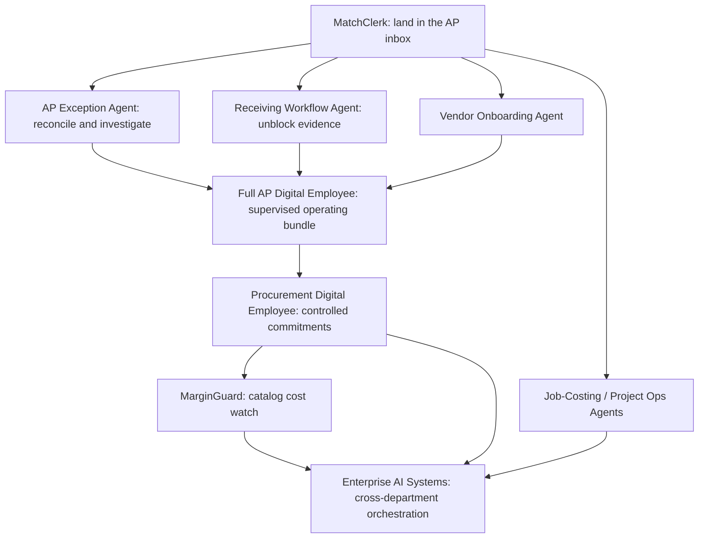

# Manasflow — Product Management & Systems Analysis Portfolio

**Nine source-grounded product/solution tracks · six lifecycle phases each · 54 phase documents.** This portfolio translates the supplied Manasflow implementation pack into a complete proposed PM/BSA/solutions-architecture work sample. MatchClerk is fully specified in the source; eight expansion offerings are developed as explicit design proposals.

**Status:** architecture and delivery documentation, authored 2026-10-17. No application, customer research, test execution, stakeholder approval, revenue or production deployment is claimed. Hypothetical personas, ROI inputs, future dates and operational targets are labeled throughout. The workspace remains a standalone document collection.

## Executive product index

| Product / source coverage | Core objective | Strategy | Scope | PRD / FRD | Delivery | QA / UAT | Launch |
| --- | --- | --- | --- | --- | --- | --- | --- |
| **MatchClerk** — source specification | Extract supplier invoice lines, match invoices to purchase orders and receiving evidence, suggest accounting codes, and create QBO/Xero bills after human approval. | [Phase 1](matchclerk/01-ideation-and-strategy.md) | [Phase 2](matchclerk/02-roadmapping-and-scoping.md) | [Phase 3](matchclerk/03-requirements-prd-frd.md) | [Phase 4](matchclerk/04-sprint-execution-and-triage.md) | [Phase 5](matchclerk/05-testing-qa-and-uat.md) | [Phase 6](matchclerk/06-launch-gtm-and-telemetry.md) |
| **AP Exception Agent** — expansion proposal | Reconcile vendor statements to AP records, investigate duplicate or suspicious invoices, and assemble evidence-backed payment preparation packs for human release. | [Phase 1](ap-exception-agent/01-ideation-and-strategy.md) | [Phase 2](ap-exception-agent/02-roadmapping-and-scoping.md) | [Phase 3](ap-exception-agent/03-requirements-prd-frd.md) | [Phase 4](ap-exception-agent/04-sprint-execution-and-triage.md) | [Phase 5](ap-exception-agent/05-testing-qa-and-uat.md) | [Phase 6](ap-exception-agent/06-launch-gtm-and-telemetry.md) |
| **Receiving Workflow Agent** — expansion proposal | Capture and attest partial goods receipts against PO lines, surface shortages and damage, and unblock invoice matching only when received evidence is valid. | [Phase 1](receiving-workflow-agent/01-ideation-and-strategy.md) | [Phase 2](receiving-workflow-agent/02-roadmapping-and-scoping.md) | [Phase 3](receiving-workflow-agent/03-requirements-prd-frd.md) | [Phase 4](receiving-workflow-agent/04-sprint-execution-and-triage.md) | [Phase 5](receiving-workflow-agent/05-testing-qa-and-uat.md) | [Phase 6](receiving-workflow-agent/06-launch-gtm-and-telemetry.md) |
| **Full AP Digital Employee** — umbrella bundle | Coordinate invoice processing, exception handling, vendor onboarding controls and payment preparation into a supervised AP operating workspace. | [Phase 1](full-ap-digital-employee/01-ideation-and-strategy.md) | [Phase 2](full-ap-digital-employee/02-roadmapping-and-scoping.md) | [Phase 3](full-ap-digital-employee/03-requirements-prd-frd.md) | [Phase 4](full-ap-digital-employee/04-sprint-execution-and-triage.md) | [Phase 5](full-ap-digital-employee/05-testing-qa-and-uat.md) | [Phase 6](full-ap-digital-employee/06-launch-gtm-and-telemetry.md) |
| **Vendor Onboarding Agent** — expansion proposal | Collect supplier identity and contact data, validate required evidence, obtain independent controller approval, and synchronize a verified vendor record without changing bank details. | [Phase 1](vendor-onboarding-agent/01-ideation-and-strategy.md) | [Phase 2](vendor-onboarding-agent/02-roadmapping-and-scoping.md) | [Phase 3](vendor-onboarding-agent/03-requirements-prd-frd.md) | [Phase 4](vendor-onboarding-agent/04-sprint-execution-and-triage.md) | [Phase 5](vendor-onboarding-agent/05-testing-qa-and-uat.md) | [Phase 6](vendor-onboarding-agent/06-launch-gtm-and-telemetry.md) |
| **Procurement Digital Employee** — expansion proposal | Turn approved purchase requests into reviewed purchase orders, track supplier responsiveness and variances, and attach catalog price intelligence. | [Phase 1](procurement-digital-employee/01-ideation-and-strategy.md) | [Phase 2](procurement-digital-employee/02-roadmapping-and-scoping.md) | [Phase 3](procurement-digital-employee/03-requirements-prd-frd.md) | [Phase 4](procurement-digital-employee/04-sprint-execution-and-triage.md) | [Phase 5](procurement-digital-employee/05-testing-qa-and-uat.md) | [Phase 6](procurement-digital-employee/06-launch-gtm-and-telemetry.md) |
| **MarginGuard** — expansion proposal | Watch supplier catalog cost changes, calculate their effect on product gross margin, and route evidence-backed price or supplier review proposals to a human owner. | [Phase 1](marginguard/01-ideation-and-strategy.md) | [Phase 2](marginguard/02-roadmapping-and-scoping.md) | [Phase 3](marginguard/03-requirements-prd-frd.md) | [Phase 4](marginguard/04-sprint-execution-and-triage.md) | [Phase 5](marginguard/05-testing-qa-and-uat.md) | [Phase 6](marginguard/06-launch-gtm-and-telemetry.md) |
| **Job-Costing / Project Ops Agents** — expansion proposal | Map approved AP costs to valid jobs and cost codes, synchronize controlled project-cost entries, and highlight budget variance with source evidence. | [Phase 1](job-costing-project-ops-agents/01-ideation-and-strategy.md) | [Phase 2](job-costing-project-ops-agents/02-roadmapping-and-scoping.md) | [Phase 3](job-costing-project-ops-agents/03-requirements-prd-frd.md) | [Phase 4](job-costing-project-ops-agents/04-sprint-execution-and-triage.md) | [Phase 5](job-costing-project-ops-agents/05-testing-qa-and-uat.md) | [Phase 6](job-costing-project-ops-agents/06-launch-gtm-and-telemetry.md) |
| **Enterprise AI Systems** — service/solution tier | Orchestrate governed cross-department workflows across AP, inventory and project operations with reusable connectors, scoped agents and auditable human approvals. | [Phase 1](enterprise-ai-systems/01-ideation-and-strategy.md) | [Phase 2](enterprise-ai-systems/02-roadmapping-and-scoping.md) | [Phase 3](enterprise-ai-systems/03-requirements-prd-frd.md) | [Phase 4](enterprise-ai-systems/04-sprint-execution-and-triage.md) | [Phase 5](enterprise-ai-systems/05-testing-qa-and-uat.md) | [Phase 6](enterprise-ai-systems/06-launch-gtm-and-telemetry.md) |

Vendor Onboarding, named on source p. 14, has a separate pack and supplies verified vendor evidence to Full AP. Aliases are normalized in the [complete source inventory and assumptions](source-and-assumptions.md). MarginGuard's detailed margin rules, receiving attestation, project allocation and enterprise controls are inferred architecture rather than source-defined product facts.

## Hiring-manager reading paths

| Role / review time | Suggested path | Competency evidence |
| --- | --- | --- |
| PM — 10 minutes | MatchClerk Phase 1 → Phase 2 → Phase 6 | Problem framing, discovery design, competition, ROI, prioritization, packaging and measurable outcomes |
| Technical PM — 15 minutes | MatchClerk Phase 3 → Phase 4 → Enterprise Phase 3 | Scope-to-contract translation, dependency decisions, financial side-effect controls and execution tradeoffs |
| BSA / Systems Analyst — 15 minutes | Receiving Phase 3 → Job Costing Phase 3 → either Phase 5 | Data modeling, field mapping, decimal/UOM invariants, process models and test traceability |
| Solutions Architect — 15 minutes | Shared platform → Enterprise Phase 3 → MatchClerk connector refinements | Bounded contexts, tenant isolation, durable operations, provider semantics and recovery design |

## Competency map across the lifecycle

| Lifecycle phase | PM evidence | BSA / architecture evidence | Cross-phase linkage |
| --- | --- | --- | --- |
| 1 — Ideation & strategy | Three real alternatives; three personas; discovery plan; vision and quantified ROI | As-Is/To-Be, feasibility, gap analysis and integration dependencies | Business requirements BR-01…04 |
| 2 — Roadmapping & scoping | Gantt and quarterly milestones; complete MoSCoW; ten ranked RICE features | Capacity, security, availability, latency, recovery and accessibility NFRs | Scope and mandatory control gates |
| 3 — Requirements | Eight stories with Gherkin; stakeholder acceptance mechanism | Typed ERD; concrete JSON/API mapping; sequence and decision flow; integrity constraints | US-1…8 ↔ FR-1…8 ↔ API-1…8 |
| 4 — Sprint execution | Two groomed tickets; two-week capacity/velocity plan; three business decisions | Backend/frontend/data breakdown and three exact technical triage resolutions | ENG-101 → US/FR-3; ENG-102 → US/FR-6 |
| 5 — QA & UAT | Five detailed business UAT scenarios; separate business readiness gate | RTM, 16 SIT cases, expected DB states and technical release controls | BR → FR → API → SIT → expected database state |
| 6 — Launch & iteration | ICP, beta/GA packaging, enablement, North Star/adoption/value/churn and discovery loop | P95/P99 telemetry, queues/costs, incidents, rollback and outcome reconciliation | Events and feedback feed revised Phase 1 assumptions |

## Expansion logic and planning sequence

| Reference MVP start | Product | Dependency / investment rationale |
| --- | --- | --- |
| 2026-10-19 | MatchClerk | QBO/Xero OAuth plus PO capability spike and an attested receipt source are prerequisites. |
| 2027-02-01 | AP Exception Agent | Requires MatchClerk invoice identity, read-only accounting aging sync and a 30-day statement sample. |
| 2027-04-05 | Receiving Workflow Agent | Requires synchronized PO lines and MatchClerk invoice rematch subscriber. |
| 2027-08-02 | Full AP Digital Employee | Requires stable MatchClerk, AP Exception Agent and Vendor Onboarding Agent interfaces; receiving integration is optional by tenant. |
| 2027-06-07 | Vendor Onboarding Agent | Requires vendor/contact read-write connector capability, an approved evidence checklist and independent controller reviewer. |
| 2027-10-04 | Procurement Digital Employee | Requires tenant budget owners, vendor master and a proven purchase-order connector; MarginGuard is an optional attachment. |
| 2027-12-06 | MarginGuard | Requires authoritative SKU/UOM mapping, supplier catalog consent and sell-price data. Procurement integration is optional. |
| 2028-02-07 | Job-Costing / Project Ops Agents | Requires stable job/cost-code master, approved bill events and a contracted project-cost adapter or reviewed CSV. |
| 2028-04-10 | Enterprise AI Systems | Requires an agreed statement of work, named data owners, connector sandboxes and signed workflow control policies. |

These start dates describe an uncommitted phased investment scenario. A 2.5-engineer core team can build the next MVP only if a separately funded maintenance/integration allocation supports prior releases. Overlapping V1/V2 tracks are optional capacity demands, not simultaneous commitments by the same team. Enterprise starts after proven patterns exist, with a separate statement of work and staffing estimate. No source date has been misrepresented as an actual launch.

## Portfolio-wide design decisions

Human authorization precedes financial mutations; agent output is typed evidence, not authority. QBO bills are prepared internally before creation; Xero DRAFT is distinct from AUTHORISED. Receipt evidence is explicitly attested. Tenant-scoped rules reuse corrections without model training on accounting API data. At-least-once queues use durable local operation identity and target reconciliation. Current competitors are acknowledged, and product differentiation remains a research question.

Read the [shared platform and API setup contracts](platform-architecture.md), [source/assumption register](source-and-assumptions.md) and [documentation validation report](validation-report.md). All diagrams use Mermaid; all frameworks, matrices and field mappings use Markdown tables. Open this folder in a Mermaid-capable Markdown viewer.

## Evidence and use

Primary project source: [the supplied 22-page implementation pack](../MatchClerk-Project-Implementation.pdf). Official competitor and accounting documentation is linked beside supported claims. The Markdown files are editable and can be reviewed independently through their phase navigation links. Do not present planned test gates or proposed business outcomes as measured delivery experience; replace assumptions and unsigned decisions with genuine evidence when implementation/pilot work occurs.
