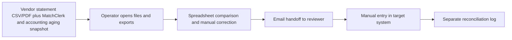
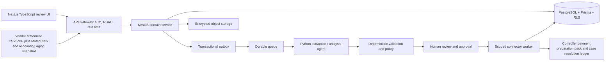

# AP Exception Agent — Ideation & Strategy

[Portfolio index](../README.md) · [Phase 1](01-ideation-and-strategy.md) · [Phase 2](02-roadmapping-and-scoping.md) · [Phase 3](03-requirements-prd-frd.md) · [Phase 4](04-sprint-execution-and-triage.md) · [Phase 5](05-testing-qa-and-uat.md) · [Phase 6](06-launch-gtm-and-telemetry.md)

**Document control:** AE-P1, revision 1.0, authored 2026-10-17. Status: proposed portfolio design; implementation, customer research, tests and stakeholder approvals have not been performed.

**Source boundary:** Named expansion, source p. 20: statement reconciliation, duplicate/fraud flags and payment-run preparation. Remaining details are proposed. [Primary document](../../MatchClerk-Project-Implementation.pdf). Proposed architecture and assumptions are explicitly recorded in [the evidence register](../source-and-assumptions.md).

## [PM] Source objective and discovery hypothesis

Controllers compare supplier statements with aging exports and investigate duplicate or disputed invoices in disconnected spreadsheets. Reconcile vendor statements to AP records, investigate duplicate or suspicious invoices, and assemble evidence-backed payment preparation packs for human release. The beachhead is Existing MatchClerk customers above 1,000 invoices/month with a controller and at least one AP specialist. Discovery statements below are research hypotheses, not completed interviews or observed customer outcomes.

| BR ID | Business requirement | Success evidence |
| --- | --- | --- |
| AE-BR-01 | Reconcile vendor statements to AP records, investigate duplicate or suspicious invoices, and assemble evidence-backed payment preparation packs for human release. | ≥8 cases/hour with zero uncleared high-risk items in released packs |
| AE-BR-02 | Preserve accountable human control and tenant isolation | Fraud outputs are review signals, never accusations. Packs contain bill references and amounts; no bank execution endpoint or bank account changes. |
| AE-BR-03 | Recover safely from malformed input, duplicate events and partial failure | No duplicate external side effect; each failed operation is discoverable and recoverable |
| AE-BR-04 | Make operating value measurable | Statement line linkage precision ≥95% on labeled data; ≥50% lower median investigation time; zero held items in an approved pack. |

### Competitive analysis

Primary vendor documentation reviewed 2026-10-17. Capability descriptions are limited to published material; tradeoff judgments are our inference. Prices and missing features are not inferred from silence. Broad-suite competitors can serve SMEs: the source's blanket market-gap assertion is a hypothesis requiring validation.

| Alternative | Published capability | Fit / evaluation question | Proposed differentiation to test |
| --- | --- | --- | --- |
| [Medius](https://www.medius.com/solutions/medius-accounts-payable-automation/statement-reconciliation/) | Supplier statement matching and discrepancy workflows | Strong direct alternative for reconciliation; compare onboarding and SME economics | AP Exception Agent: Reconcile vendor statements to AP records, investigate duplicate or suspicious invoices, and assemble evidence-backed payment preparation packs for human release. Test evidence quality and implementation effort with the same customer scenario. |
| [AppZen](https://support.appzen.com/hc/en-us/categories/12786047634067-Autonomous-AP-APIs) | Invoice processing, audit, coding and ERP integration | Enterprise AP automation is broader than an exception-only add-on | AP Exception Agent: Reconcile vendor statements to AP records, investigate duplicate or suspicious invoices, and assemble evidence-backed payment preparation packs for human release. Test evidence quality and implementation effort with the same customer scenario. |
| [Stampli](https://www.stampli.com/ap-automation-platform/) | Line-level matching, coding, approvals and ERP posting | Direct competitor for contextual AP collaboration; validate implementation effort | AP Exception Agent: Reconcile vendor statements to AP records, investigate duplicate or suspicious invoices, and assemble evidence-backed payment preparation packs for human release. Test evidence quality and implementation effort with the same customer scenario. |

### Personas

These are designed research archetypes. Names do not represent interviewed customers.

| Persona / role | Goals | Pain points | Daily workflow | Technical proficiency |
| --- | --- | --- | --- | --- |
| Ava — Controller | Release only defensible payment preparation packs | Unclear duplicate and fraud explanations | Aging review; high-risk clearance; pack approval | High accounting; medium technical |
| Leena — AP specialist | Reconcile statements and resolve disputes | Vendor PDFs and ledger exports disagree | Import statement; link missing bills; document resolution | High spreadsheet; medium accounting API |
| Sam — Owner/CFO | Reduce leakage without delaying trusted suppliers | No clear view of disputed liabilities | Weekly cash meeting; review held balances | Medium dashboards; low technical |

### Discovery and validation plan

| Method / sample | Concrete prompt or exercise | Decision threshold | Owner |
| --- | --- | --- | --- |
| Six buyer interviews across two target segments | Walk through the last exception case that was delayed; show the actual handoff and current time spent. | At least 4/6 demonstrate the same core pain and name a budget owner. | PM |
| Five observed operator sessions | Process five representative records using the current workflow; time active work separately from waiting. | Observed baseline replaces the ROI estimate; at least 3/5 complete the proposed flow without coaching. | PM + UX |
| Three technical discovery workshops | Inspect source fields, permissions, data exports and failure/replay behavior in a sandbox. | All mandatory source fields map and the human control boundary is feasible. | BSA + integration lead |
| Two design partners, 30-day pilot | Compare a consented baseline cohort with a parallel-run cohort; log every correction and failure. | Achieve the product gates in Phase 5 before GA; no fabricated case study claim. | Pilot success lead |

## [PM] Vision, positioning and business case

**Vision:** For Existing MatchClerk customers above 1,000 invoices/month with a controller and at least one AP specialist. AP Exception Agent is a supervised operational product that reconcile vendor statements to AP records, investigate duplicate or suspicious invoices, and assemble evidence-backed payment preparation packs for human release. Its value is measured by evidence-backed exception cases resolved per controller hour, with explicit evidence and human accountability.

**Value proposition:** Replace fragmented manual handoffs with one traceable work queue, typed validation and an authorized next action. The defensible wedge to test is faster deployment into the customer's existing process and clearer control evidence. Competitive superiority has not been demonstrated.

**Commercial model:** Proposed monthly subscription of USD 1,000.00 for the modeled 300 exception cases; implementation USD 1,000.00. MatchClerk prices are source recommendations; expansion prices are portfolio hypotheses. No market-size estimate is invented.

| ROI input or output | Illustrative value | Calculation / interpretation |
| --- | --- | --- |
| Monthly eligible volume | 300 exception cases | Model assumption; replace with pilot logs |
| Active manual handling | 15 → 5 minutes/exception case | Excludes waiting and assumes human review remains |
| Loaded labor rate | USD 40/hour | Illustrative input; not a wage benchmark |
| Gross monthly capacity value | USD 2,000.00 | 300 × (15-5) / 60 × 40 |
| Net monthly value after fee | USD 1,000.00 | 2,000.00 - 1,000.00; recovered capacity is not automatically cash savings |
| Customer implementation payback | 1.00 months | One-time fee / net monthly capacity value; validate with buyer |
| Modeled monthly COGS | USD 170.00 | 300 × 0.20 variable processing + 60 infrastructure + 50 allocated support |
| Modeled gross margin | 83.0% | Revenue less modeled COGS; excludes sales/R&D; support allocation must be validated |
| 50% realization sensitivity | USD 0.00 net/month | Half the modeled labor benefit; do not expand if measured customer value is negative |

For Full AP, component subscriptions are bundled and the infrastructure allocation includes shared component operations. For every product, cloud/API licensing and human support must be re-estimated before a commercial commitment. Break-even volume at this labor model is 150 eligible records/month. A high gross-margin estimate alone does not establish demand.

## [BSA] As-Is and To-Be feasibility

| Gap | Target design | Feasibility proof / dependency | Residual risk |
| --- | --- | --- | --- |
| Manual interpretation and missing provenance | Typed extraction with page/row evidence; deterministic rule engine | Statement confidence ≥0.90; statement and ledger currency agree; every payable has a stable external ID; no open high-risk flag; reviewer differs from pack preparer. | Confidence must be evaluated on representative labeled inputs |
| No reliable handoff ownership | Role-based queue with statuses, owner and business deadline | Missing bill, disputed balance, fuzzy duplicate or changed payment details → HELD; suspected fraud requires controller clearance. | Review bottleneck if staffing is insufficient |
| Fragmented target writes | Scoped adapter with operation ledger and reconciliation | Requires MatchClerk invoice identity, read-only accounting aging sync and a 30-day statement sample. | Provider capabilities vary by subscription, region and API version |
| Spreadsheet access without strong isolation | Session-derived tenant, RLS, composite foreign keys and encrypted objects | Negative tenant/role tests plus restore drill before launch | Application roles and pooled DB sessions require careful reset |
| No closed-loop value evidence | Outcome events joined to source lineage and adoption cohorts | Pilot baseline plus telemetry definitions in Phase 6 | Attribution can overstate savings without a comparable baseline |

**Architectural decision:** Deploy a modular NestJS service and independent Python workers, rather than separate microservices for every feature. Use PostgreSQL as the durable source of truth, AWS SQS for ordinary background work, Redis for rate-limit counters and cache, and S3 SSE-KMS for evidence. Long-lived work state stays in PostgreSQL; queues deliver work, not authoritative approval state. Source stack options are resolved in [platform architecture](../platform-architecture.md); no implementation is claimed.

**Product-specific feasibility constraint:** Reconcile signed statement balance = opening balance + invoices - credits - payments. A 0.01 currency-unit residual is permitted for rounding; higher residuals create a case. Exact duplicates are held; fuzzy similarity ≥0.90 only raises a review flag.

**Investment gate:** Fund the pilot only after the source-field mapping, control boundary and two design-partner commitments are validated. PM owns demand and economic evidence; BSA owns integration and data feasibility. Stop expansion if high-severity control defects persist or the measured benefit is below the subscription cost for two pilot reviews.
