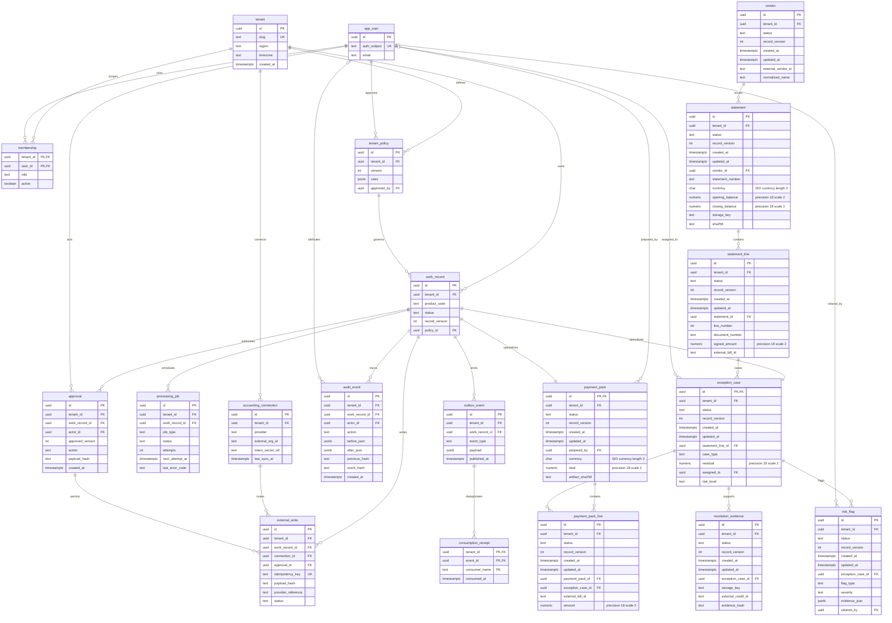
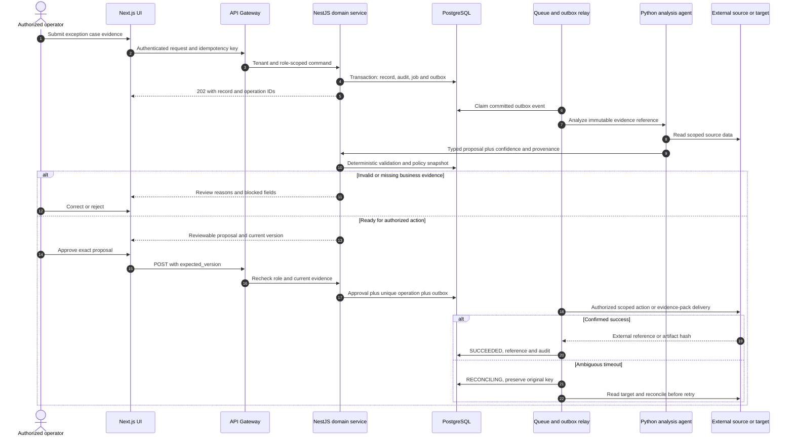
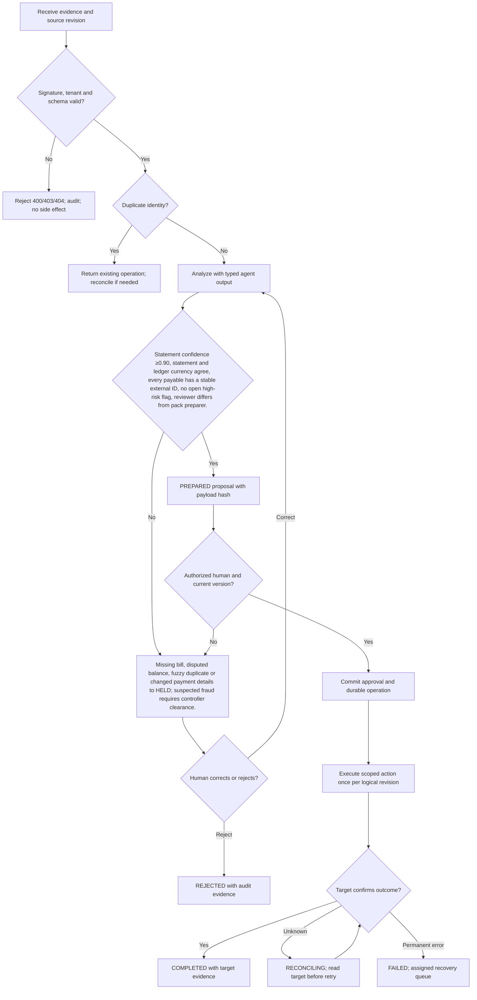

# AP Exception Agent — Requirements — PRD, BRD & FRD

[Portfolio index](../README.md) · [Phase 1](01-ideation-and-strategy.md) · [Phase 2](02-roadmapping-and-scoping.md) · [Phase 3](03-requirements-prd-frd.md) · [Phase 4](04-sprint-execution-and-triage.md) · [Phase 5](05-testing-qa-and-uat.md) · [Phase 6](06-launch-gtm-and-telemetry.md)

**Document control:** AE-P3, revision 1.0, authored 2026-10-17. Status: proposed portfolio design; implementation, customer research, tests and stakeholder approvals have not been performed.

**Source boundary:** Named expansion, source p. 20: statement reconciliation, duplicate/fraud flags and payment-run preparation. Remaining details are proposed. [Primary document](../../MatchClerk-Project-Implementation.pdf). Proposed architecture and assumptions are explicitly recorded in [the evidence register](../source-and-assumptions.md).

## Scope, actors and requirement identity

| BR ID | Business requirement | Success evidence |
| --- | --- | --- |
| AE-BR-01 | Reconcile vendor statements to AP records, investigate duplicate or suspicious invoices, and assemble evidence-backed payment preparation packs for human release. | ≥8 cases/hour with zero uncleared high-risk items in released packs |
| AE-BR-02 | Preserve accountable human control and tenant isolation | Fraud outputs are review signals, never accusations. Packs contain bill references and amounts; no bank execution endpoint or bank account changes. |
| AE-BR-03 | Recover safely from malformed input, duplicate events and partial failure | No duplicate external side effect; each failed operation is discoverable and recoverable |
| AE-BR-04 | Make operating value measurable | Statement line linkage precision ≥95% on labeled data; ≥50% lower median investigation time; zero held items in an approved pack. |

FR-1 through FR-8 map one-to-one to US-1 through US-8 below. Stories 1–6 support BR-01/02, story 7 supports BR-02/04 and story 8 supports BR-03. Every action also inherits tenant isolation, audit and idempotency requirements. A proposed acceptance criterion is not an executed test result.

## [PM] User stories and strict acceptance criteria

### AE-US-1 / AE-FR-1 — Statement intake

As a AP specialist, I want to import a supplier statement, so that I can create a reproducible reconciliation.

```gherkin
Feature: AP Exception Agent Statement intake
  Scenario: Statement intake business contract
    Given a February statement and vendor V-77 are selected
    When I upload a statement totaling 12500.00 USD
    Then a statement hash and immutable opening-balance snapshot are recorded

  Scenario: Reject unauthorized or stale changes
    Given the actor lacks tenant or role permission, or the submitted version is stale
    When the same business action is attempted
    Then cross-tenant access returns 404, a disallowed role returns 403, and a stale mutation returns 409
    And no domain row, approval, or external side effect is committed
```

**Database assertion:** statement.statement_number='STMT-2027-02'; statement.closing_balance=12500.00. **API:** POST `/api/v1/exception-cases`. Read-only endpoints do not require a submitted mutation version; their negative case covers tenant and role access. 

### AE-US-2 / AE-FR-2 — Line reconciliation

As a AP specialist, I want to link statement lines to ledger bills, so that I can find missing and disputed amounts.

```gherkin
Feature: AP Exception Agent Line reconciliation
  Scenario: Line reconciliation business contract
    Given the statement has INV-1042 and the ledger contains its exact vendor and amount
    When reconciliation runs
    Then the line links to the external bill and a 25.00 unexplained residual opens a case

  Scenario: Reject unauthorized or stale changes
    Given the actor lacks tenant or role permission, or the submitted version is stale
    When the same business action is attempted
    Then cross-tenant access returns 404, a disallowed role returns 403, and a stale mutation returns 409
    And no domain row, approval, or external side effect is committed
```

**Database assertion:** statement_line.external_bill_id IS NOT NULL; exception_case.residual=25.00. **API:** POST `/api/v1/exception-cases/{id}/reconcile`. Read-only endpoints do not require a submitted mutation version; their negative case covers tenant and role access. 

### AE-US-3 / AE-FR-3 — Duplicate hold

As a controller, I want to hold an exact duplicate invoice, so that I can avoid preparing the same liability twice.

```gherkin
Feature: AP Exception Agent Duplicate hold
  Scenario: Duplicate hold business contract
    Given two ledger records share vendor, normalized invoice number, currency and amount
    When the duplicate rule evaluates them
    Then one duplicate group is created and both candidates are excluded pending review

  Scenario: Reject unauthorized or stale changes
    Given the actor lacks tenant or role permission, or the submitted version is stale
    When the same business action is attempted
    Then cross-tenant access returns 404, a disallowed role returns 403, and a stale mutation returns 409
    And no domain row, approval, or external side effect is committed
```

**Database assertion:** risk_flag.flag_type='EXACT_DUPLICATE'; exception_case.status='HELD'. **API:** POST `/api/v1/exception-cases/{id}/duplicate-check`. Read-only endpoints do not require a submitted mutation version; their negative case covers tenant and role access. 

### AE-US-4 / AE-FR-4 — Risk review

As a controller, I want to review suspicious payment-detail changes, so that I can require independent evidence.

```gherkin
Feature: AP Exception Agent Risk review
  Scenario: Risk review business contract
    Given a statement text suggests new bank details
    When the classifier inspects the document
    Then a high-risk flag appears with source evidence and no account master is changed

  Scenario: Reject unauthorized or stale changes
    Given the actor lacks tenant or role permission, or the submitted version is stale
    When the same business action is attempted
    Then cross-tenant access returns 404, a disallowed role returns 403, and a stale mutation returns 409
    And no domain row, approval, or external side effect is committed
```

**Database assertion:** risk_flag.severity='HIGH'; external_write count=0. **API:** POST `/api/v1/exception-cases/{id}/risk-review`. Read-only endpoints do not require a submitted mutation version; their negative case covers tenant and role access. 

### AE-US-5 / AE-FR-5 — Evidence resolution

As a AP specialist, I want to attach a credit note and propose resolution, so that I can explain a balance discrepancy.

```gherkin
Feature: AP Exception Agent Evidence resolution
  Scenario: Evidence resolution business contract
    Given a 25.00 discrepancy has a valid credit note
    When I attach its accounting reference and resubmit
    Then the residual becomes zero and the case enters READY_FOR_APPROVAL

  Scenario: Reject unauthorized or stale changes
    Given the actor lacks tenant or role permission, or the submitted version is stale
    When the same business action is attempted
    Then cross-tenant access returns 404, a disallowed role returns 403, and a stale mutation returns 409
    And no domain row, approval, or external side effect is committed
```

**Database assertion:** exception_case.residual=0.00; resolution_evidence count=1. **API:** PATCH `/api/v1/exception-cases/{id}/resolution`. Read-only endpoints do not require a submitted mutation version; their negative case covers tenant and role access. 

### AE-US-6 / AE-FR-6 — Pack preparation

As a AP specialist, I want to prepare a pack of cleared bills, so that I can support the controller cash review.

```gherkin
Feature: AP Exception Agent Pack preparation
  Scenario: Pack preparation business contract
    Given one cleared and one held case exist
    When I generate a payment preparation pack
    Then only the cleared case contributes an amount and the held case is listed as excluded

  Scenario: Reject unauthorized or stale changes
    Given the actor lacks tenant or role permission, or the submitted version is stale
    When the same business action is attempted
    Then cross-tenant access returns 404, a disallowed role returns 403, and a stale mutation returns 409
    And no domain row, approval, or external side effect is committed
```

**Database assertion:** payment_pack_line count=1; held case has no pack line. **API:** POST `/api/v1/payment-packs`. Read-only endpoints do not require a submitted mutation version; their negative case covers tenant and role access. 

### AE-US-7 / AE-FR-7 — Independent signoff

As a controller, I want to approve a pack prepared by another user, so that I can preserve separation of duties.

```gherkin
Feature: AP Exception Agent Independent signoff
  Scenario: Independent signoff business contract
    Given the pack preparer is the requesting user
    When that same user attempts approval
    Then 403 SOD_VIOLATION is returned and the pack remains PREPARED

  Scenario: Reject unauthorized or stale changes
    Given the actor lacks tenant or role permission, or the submitted version is stale
    When the same business action is attempted
    Then cross-tenant access returns 404, a disallowed role returns 403, and a stale mutation returns 409
    And no domain row, approval, or external side effect is committed
```

**Database assertion:** payment_pack.status='PREPARED'; approval count=0. **API:** POST `/api/v1/payment-packs/{id}/approve`. Read-only endpoints do not require a submitted mutation version; their negative case covers tenant and role access. 

### AE-US-8 / AE-FR-8 — Pack delivery recovery

As a controller, I want to download a stable approved pack, so that I can avoid inconsistent instructions.

```gherkin
Feature: AP Exception Agent Pack delivery recovery
  Scenario: Pack delivery recovery business contract
    Given an approved pack has content hash H1
    When the download request is repeated
    Then the same H1 artifact is returned and no payment transaction is initiated

  Scenario: Reject unauthorized or stale changes
    Given the actor lacks tenant or role permission, or the submitted version is stale
    When the same business action is attempted
    Then cross-tenant access returns 404, a disallowed role returns 403, and a stale mutation returns 409
    And no domain row, approval, or external side effect is committed
```

**Database assertion:** payment_pack.artifact_sha256 unchanged; external_write count=0. **API:** GET `/api/v1/payment-packs/{id}/download`. Read-only endpoints do not require a submitted mutation version; their negative case covers tenant and role access. Recovery acceptance: replay the source event or request and confirm the original operation identity and side-effect count.

## [BSA] Domain model and entity relationships

This diagram includes domain tables and the shared control tables required by this product. UUIDs are internal keys; external IDs remain text. Every domain table includes tenant_id, status, record_version and timestamps. Approval-bearing aggregate tables (exception_case, payment_pack) share their ID with work_record.id; API/domain updates keep both states synchronized in one transaction. A work_record specializes into exactly one aggregate type, not every linked type simultaneously.



### Physical constraints and integrity rules

| Rule | Concrete implementation |
| --- | --- |
| Tenant-safe foreign keys | Tenant-owned tables have UNIQUE(tenant_id,id); intra-tenant foreign keys use (tenant_id,parent_id) → parent(tenant_id,id), even where the ER diagram abbreviates the key. Global app_user/tenant keys are exceptions; actor scope additionally references membership(tenant_id,user_id). |
| Money and quantity | numeric(18,2) for currency amounts; numeric(18,4) for quantities/unit prices; numeric(9,6) for ratios; JSON monetary values are decimal strings. ISO-4217 currency is char(3). Round only at declared posting boundaries. |
| Optimistic mutation | UPDATE work_record SET record_version=record_version+1 WHERE tenant_id=session_tenant AND id=record_id AND record_version=expected_version; zero rows → 409 STALE_VERSION. |
| Approval binding | approval stores approved_version and SHA-256 of canonical mutation payload. Unique work_record_id + approved_version + action prevents duplicate authorization. Revoke validity when business evidence changes. |
| Write identity | external_write.idempotency_key is unique and immutable; bind it to tenant, connection, record, action and business revision. A reused key with changed payload returns 409 IDEMPOTENCY_CONFLICT. |
| Event delivery | Create domain update, audit row, processing_job and outbox row in one PostgreSQL transaction. Consumption receipt unique key is (tenant_id,event_id,consumer_name). Delivery is at-least-once. |
| Audit immutability | Application roles cannot UPDATE/DELETE audit_event; daily signed hash manifest in locked object storage. System events have null actor_id and explicit service identity in after_json. |
| Indexes | CREATE INDEX on domain aggregate (tenant_id,status,created_at DESC); processing_job (status,next_attempt_at); audit_event (tenant_id,work_record_id,created_at); external_write (tenant_id,provider_reference). |
| Domain invariants | Reconcile signed statement balance = opening balance + invoices - credits - payments. A 0.01 currency-unit residual is permitted for rounding; higher residuals create a case. Exact duplicates are held; fuzzy similarity ≥0.90 only raises a review flag. |
| Retention deletion | Evidence objects and operational rows follow tenant policy; audit personal identifiers are minimized and removed under verified deletion unless a documented legal hold applies. Hashes are not assumed anonymous. |

### API contract and source-to-target mapping

REST JSON over HTTPS, versioned at /api/v1. Authenticate via HttpOnly OIDC-backed session for UI and scoped service credentials for callbacks. Tenant identity never comes from a client body. All mutating requests carry Idempotency-Key; updates also carry expected_version. Body size limit is 1 MB JSON; files use signed upload. Example UUIDs are synthetic fixtures, not live data. API requests below show action inputs; the intake payload is also specified separately.

**Canonical intake example:** `{"statement_number":"STMT-2027-02","vendor_external_id":"V-77","currency":"USD","closing_balance":"12500.00","lines":[{"document_number":"INV-1042","signed_amount":"1020.00"}]}`

| FRD / API ID | Method and endpoint | Request JSON | Success JSON / status | Internal target mapping | Errors |
| --- | --- | --- | --- | --- | --- |
| AE-FR-1 / API-1 | POST /api/v1/exception-cases | `{"statement_number":"STMT-2027-02","vendor_external_id":"V-77","currency":"USD","closing_balance":"12500.00","lines":[{"document_number":"INV-1042","signed_amount":"1020.00"}]}` | 202 `{"id":"22222222-2222-4222-8222-222222222222","operation_id":"33333333-3333-4333-8333-333333333333","status":"RECEIVED","record_version":1,"statement_reference":"STMT-2027-02"}` | statement.statement_number | 400 SCHEMA_INVALID; 403 POLICY_DENIED; 409 STALE_VERSION; 422 RULE_VIOLATION; 429 RATE_LIMITED |
| AE-FR-2 / API-2 | POST /api/v1/exception-cases/{id}/reconcile | `{"ledger_snapshot_id":"AGE-2027-02-28"}` | 202 `{"id":"22222222-2222-4222-8222-222222222222","operation_id":"33333333-3333-4333-8333-333333333333","status":"RECONCILING","record_version":4,"residual":"25.00","matched_line_count":1}` | statement_line.signed_amount | 400 SCHEMA_INVALID; 403 POLICY_DENIED; 409 STALE_VERSION; 422 RULE_VIOLATION; 429 RATE_LIMITED |
| AE-FR-3 / API-3 | POST /api/v1/exception-cases/{id}/duplicate-check | `{"expected_version":2}` | 202 `{"id":"22222222-2222-4222-8222-222222222222","operation_id":"33333333-3333-4333-8333-333333333333","status":"HELD","record_version":3,"flag_type":"EXACT_DUPLICATE","held":true}` | statement_line.external_bill_id | 400 SCHEMA_INVALID; 403 POLICY_DENIED; 409 STALE_VERSION; 422 RULE_VIOLATION; 429 RATE_LIMITED |
| AE-FR-4 / API-4 | POST /api/v1/exception-cases/{id}/risk-review | `{"flag_type":"PAYMENT_DETAIL_CHANGE"}` | 202 `{"id":"22222222-2222-4222-8222-222222222222","operation_id":"33333333-3333-4333-8333-333333333333","status":"HELD","record_version":4,"risk_level":"HIGH","bank_master_changed":false}` | exception_case.residual | 400 SCHEMA_INVALID; 403 POLICY_DENIED; 409 STALE_VERSION; 422 RULE_VIOLATION; 429 RATE_LIMITED |
| AE-FR-5 / API-5 | PATCH /api/v1/exception-cases/{id}/resolution | `{"expected_version":3,"external_credit_id":"CN-25","residual":"0.00"}` | 200 `{"id":"22222222-2222-4222-8222-222222222222","operation_id":"33333333-3333-4333-8333-333333333333","status":"READY_FOR_APPROVAL","record_version":4,"residual":"0.00"}` | payment_pack_line.amount | 400 SCHEMA_INVALID; 403 POLICY_DENIED; 409 STALE_VERSION; 422 RULE_VIOLATION; 429 RATE_LIMITED |
| AE-FR-6 / API-6 | POST /api/v1/payment-packs | `{"case_ids":["22222222-2222-4222-8222-222222222222"],"currency":"USD"}` | 202 `{"id":"22222222-2222-4222-8222-222222222222","operation_id":"33333333-3333-4333-8333-333333333333","status":"PREPARED","record_version":4,"included_case_count":1,"excluded_held_count":1}` | payment_pack_line.amount | 400 SCHEMA_INVALID; 403 POLICY_DENIED; 409 STALE_VERSION; 422 RULE_VIOLATION; 429 RATE_LIMITED |
| AE-FR-7 / API-7 | POST /api/v1/payment-packs/{id}/approve | `{"expected_version":4}` | 202 `{"id":"22222222-2222-4222-8222-222222222222","operation_id":"33333333-3333-4333-8333-333333333333","status":"APPROVED","record_version":5,"requires_independent_actor":true}` | payment_pack_line.amount | 400 SCHEMA_INVALID; 403 POLICY_DENIED; 409 STALE_VERSION; 422 RULE_VIOLATION; 429 RATE_LIMITED |
| AE-FR-8 / API-8 | GET /api/v1/payment-packs/{id}/download | `null` | 200 `{"id":"22222222-2222-4222-8222-222222222222","result":"ARTIFACT_READY","record_version":4,"download_url":"/api/v1/evidence/pack-fixture/content","expires_at":"2027-02-28T12:01:00Z","sha256":"bbbbbbbbbbbbbbbbbbbbbbbbbbbbbbbbbbbbbbbbbbbbbbbbbbbbbbbbbbbbbbbb"}` | payment_pack_line.amount | 400 SCHEMA_INVALID; 403 POLICY_DENIED; 409 STALE_VERSION; 422 RULE_VIOLATION; 429 RATE_LIMITED |

For 202 responses, the body reflects **acceptance state**, not final downstream success. Updates accepted at expected_version 4 return revision 5; intake creates revision 1. Independent scenario fixtures explain differing versions between rows. Clients use returned versions, not a hard-coded constant. A GET result with an artifact returns JSON metadata (download_url, expires_at, sha256); the binary is fetched through the authenticated evidence gateway. A full record response contains the fields from the domain ERD, validation reasons and provenance. Read-only policy-denial and budget checks return their decision without performing the proposed action.

| Source field / system | API field or derivation | Target table.column | Transformation and rejection rule |
| --- | --- | --- | --- |
| Statement document reference | statement_number | statement.statement_number | Vendor-scoped normalization |
| Statement debit/credit | lines[].signed_amount | statement_line.signed_amount | Invoices positive; credits/payments negative |
| Accounting Bill.Id | external_bill_id | statement_line.external_bill_id | Exact tenant/vendor/currency evidence required |
| Balance difference | residual | exception_case.residual | Decimal closing minus reconciled balance |
| Cleared liability | amount | payment_pack_line.amount | Exclude every uncleared HIGH risk flag |

| Contract | Exact rule / example |
| --- | --- |
| Error envelope | `{"error":{"code":"STALE_VERSION","message":"Record changed after review","retryable":false,"request_id":"req-fixture-17","current_version":5}}` |
| Additional statuses | 401 AUTH_REQUIRED; 404 RECORD_NOT_FOUND; 413 FILE_TOO_LARGE; 415 UNSUPPORTED_MEDIA; 424 DEPENDENCY_UNAVAILABLE; 503 TEMPORARY_UNAVAILABLE. Domain detail codes include those in the Phase 4 triage log. |
| Upload safety | PDF/PNG up to 25 MB per file; ZIP up to 25 MB compressed, 100 MB expanded, 100 members and depth 1. Reject executable MIME, path traversal, encrypted archives and malicious files; scan before extraction. |
| Paging | GET collection uses limit ≤100 and opaque cursor; deterministic created_at,id order; no unbounded full-tenant export. |
| Webhook signature | Verify provider signature on raw body before parsing. Persist provider event identity before returning 202. Provider-authenticated replay is deduplicated, not dropped based only on age. |
| Provider failure | 429 honors Retry-After; 5xx/network retries use jittered backoff. Timeout with unknown write outcome enters RECONCILING and must not issue an immediate second create. |

## [BSA] System sequence



For a product with an internal evidence-pack or event output, the final external participant means the authorized consumer or artifact store; it does not imply a financial write. Fraud outputs are review signals, never accusations. Packs contain bill references and amounts; no bank execution endpoint or bank account changes.

## [BSA] Business rules and UAT/system decision flow



**State contract:** RECEIVED → ANALYZING → NEEDS_REVIEW or PREPARED → APPROVED → RUNNING → COMPLETED. Domain-specific states (such as HELD; suspected fraud requires controller clearance.) refine the control state; raw status transitions are never accepted from clients. REJECTED is terminal for that business revision. A corrected record creates a new revision and invalidates prior approval. FAILED/RECONCILING are explicit recovery states; only service commands with allowed transitions can change them.

## [PM & BSA] Formal sign-off record

| Document / control | Accountable stakeholder | Acceptance evidence | Decision / signature state |
| --- | --- | --- | --- |
| BRD: BR-01 to BR-04 | Economic buyer / PM | Validated problem, baseline, price and control ownership | Review required; no stakeholder signature recorded |
| PRD: US-1 to US-8 | Product owner + customer process owner | Story walkthrough and five-scenario UAT acceptance | Review required; no stakeholder signature recorded |
| FRD: API, ERD and process model | BSA + engineering lead | Mapping workshop, contract tests and migration review | Review required; no stakeholder signature recorded |
| Architecture and threat controls | Solutions architect + security owner | Capability spikes, tenant tests and restore evidence | Review required; no stakeholder signature recorded |
| Financial side-effect boundary | Customer controller | Approval, duplicate and reconciliation evidence | Review required; no stakeholder signature recorded |

Approval requires named reviewer, UTC decision timestamp, artifact revision and evidence link in the actual delivery system. This portfolio records the review mechanism without fabricating approval.
