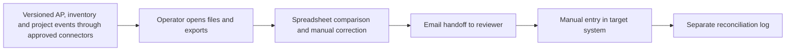
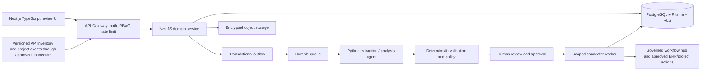

# Enterprise AI Systems — Ideation & Strategy

[Portfolio index](../README.md) · [Phase 1](01-ideation-and-strategy.md) · [Phase 2](02-roadmapping-and-scoping.md) · [Phase 3](03-requirements-prd-frd.md) · [Phase 4](04-sprint-execution-and-triage.md) · [Phase 5](05-testing-qa-and-uat.md) · [Phase 6](06-launch-gtm-and-telemetry.md)

**Document control:** ES-P1, revision 1.0, authored 2026-10-17. Status: proposed portfolio design; implementation, customer research, tests and stakeholder approvals have not been performed.

**Source boundary:** Service/solution tier, source p. 20: cross-department AP/inventory/project hub, job-costing sync and custom multi-agent retainers. Reference architecture is proposed. [Primary document](../../MatchClerk-Project-Implementation.pdf). Proposed architecture and assumptions are explicitly recorded in [the evidence register](../source-and-assumptions.md).

## [PM] Source objective and discovery hypothesis

Multi-entity customers accumulate disconnected automations, unclear tool permissions and inconsistent exception handling across departments. Orchestrate governed cross-department workflows across AP, inventory and project operations with reusable connectors, scoped agents and auditable human approvals. The beachhead is Existing Manasflow customers with multiple entities, three or more systems and an IT owner sponsoring a governed integration engagement. Discovery statements below are research hypotheses, not completed interviews or observed customer outcomes.

| BR ID | Business requirement | Success evidence |
| --- | --- | --- |
| ES-BR-01 | Orchestrate governed cross-department workflows across AP, inventory and project operations with reusable connectors, scoped agents and auditable human approvals. | ≥95% completion after human decisions, with zero unauthorized tool actions |
| ES-BR-02 | Preserve accountable human control and tenant isolation | Custom engagement, not a claim of a shipped universal ERP product. Agents propose typed actions; a deterministic policy service authorizes execution. Banking tools are excluded. |
| ES-BR-03 | Recover safely from malformed input, duplicate events and partial failure | No duplicate external side effect; each failed operation is discoverable and recoverable |
| ES-BR-04 | Make operating value measurable | ≥99% schema-valid intake; ≥95% successful business completion excluding human rejection; zero unapproved external mutations; ≥80% runs within approved cost budget. |

### Competitive analysis

Primary vendor documentation reviewed 2026-10-17. Capability descriptions are limited to published material; tradeoff judgments are our inference. Prices and missing features are not inferred from silence. Broad-suite competitors can serve SMEs: the source's blanket market-gap assertion is a hypothesis requiring validation.

| Alternative | Published capability | Fit / evaluation question | Proposed differentiation to test |
| --- | --- | --- | --- |
| [Workato](https://docs.workato.com/en/agentic/agent-studio/agent-orchestration) | Enterprise agent orchestration | Platform alternative; implementation ownership remains a buying consideration | Enterprise AI Systems: Orchestrate governed cross-department workflows across AP, inventory and project operations with reusable connectors, scoped agents and auditable human approvals. Test evidence quality and implementation effort with the same customer scenario. |
| [Microsoft Power Automate](https://learn.microsoft.com/flow/) | Cloud and desktop workflow automation | Low-code alternative; estimate connector governance and operating ownership | Enterprise AI Systems: Orchestrate governed cross-department workflows across AP, inventory and project operations with reusable connectors, scoped agents and auditable human approvals. Test evidence quality and implementation effort with the same customer scenario. |
| [UiPath](https://www.uipath.com/product/automation-suite) | Self-hosted automation and agentic platform | Broad automation platform; compare total operating cost and governed tool access | Enterprise AI Systems: Orchestrate governed cross-department workflows across AP, inventory and project operations with reusable connectors, scoped agents and auditable human approvals. Test evidence quality and implementation effort with the same customer scenario. |

### Personas

These are designed research archetypes. Names do not represent interviewed customers.

| Persona / role | Goals | Pain points | Daily workflow | Technical proficiency |
| --- | --- | --- | --- | --- |
| Ibrahim — IT integration owner | Operate dependable cross-system workflows | Unknown connector behavior and orphaned automations | Review integration health; approve changes; handle incidents | High APIs, identity and cloud |
| Ava — Finance process owner | Keep controls intact across departments | Agents bypass established approval boundaries | Review blocked runs; approve financial actions | High process knowledge; medium technical |
| Mei — Operations transformation lead | Reduce handoffs with measurable outcomes | Pilot automations never become repeatable services | Map process; monitor cycle time; lead adoption | High workflow design; medium data |

### Discovery and validation plan

| Method / sample | Concrete prompt or exercise | Decision threshold | Owner |
| --- | --- | --- | --- |
| Six buyer interviews across two target segments | Walk through the last workflow run that was delayed; show the actual handoff and current time spent. | At least 4/6 demonstrate the same core pain and name a budget owner. | PM |
| Five observed operator sessions | Process five representative records using the current workflow; time active work separately from waiting. | Observed baseline replaces the ROI estimate; at least 3/5 complete the proposed flow without coaching. | PM + UX |
| Three technical discovery workshops | Inspect source fields, permissions, data exports and failure/replay behavior in a sandbox. | All mandatory source fields map and the human control boundary is feasible. | BSA + integration lead |
| Two design partners, 30-day pilot | Compare a consented baseline cohort with a parallel-run cohort; log every correction and failure. | Achieve the product gates in Phase 5 before GA; no fabricated case study claim. | Pilot success lead |

## [PM] Vision, positioning and business case

**Vision:** For Existing Manasflow customers with multiple entities, three or more systems and an IT owner sponsoring a governed integration engagement. Enterprise AI Systems is a supervised operational product that orchestrate governed cross-department workflows across AP, inventory and project operations with reusable connectors, scoped agents and auditable human approvals. Its value is measured by governed cross-system workflows completed with validated business outcome, with explicit evidence and human accountability.

**Value proposition:** Replace fragmented manual handoffs with one traceable work queue, typed validation and an authorized next action. The defensible wedge to test is faster deployment into the customer's existing process and clearer control evidence. Competitive superiority has not been demonstrated.

**Commercial model:** Proposed monthly subscription of USD 8,000.00 for the modeled 3,000 workflow runs; implementation USD 20,000.00. MatchClerk prices are source recommendations; expansion prices are portfolio hypotheses. No market-size estimate is invented.

| ROI input or output | Illustrative value | Calculation / interpretation |
| --- | --- | --- |
| Monthly eligible volume | 3,000 workflow runs | Model assumption; replace with pilot logs |
| Active manual handling | 8 → 2 minutes/workflow run | Excludes waiting and assumes human review remains |
| Loaded labor rate | USD 50/hour | Illustrative input; not a wage benchmark |
| Gross monthly capacity value | USD 15,000.00 | 3000 × (8-2) / 60 × 50 |
| Net monthly value after fee | USD 7,000.00 | 15,000.00 - 8,000.00; recovered capacity is not automatically cash savings |
| Customer implementation payback | 2.86 months | One-time fee / net monthly capacity value; validate with buyer |
| Modeled monthly COGS | USD 2,550.00 | 3000 × 0.15 variable processing + 900 infrastructure + 1200 allocated support |
| Modeled gross margin | 68.1% | Revenue less modeled COGS; excludes sales/R&D; support allocation must be validated |
| 50% realization sensitivity | USD -500.00 net/month | Half the modeled labor benefit; do not expand if measured customer value is negative |

For Full AP, component subscriptions are bundled and the infrastructure allocation includes shared component operations. For every product, cloud/API licensing and human support must be re-estimated before a commercial commitment. Break-even volume at this labor model is 1600 eligible records/month. A high gross-margin estimate alone does not establish demand.

## [BSA] As-Is and To-Be feasibility

| Gap | Target design | Feasibility proof / dependency | Residual risk |
| --- | --- | --- | --- |
| Manual interpretation and missing provenance | Typed extraction with page/row evidence; deterministic rule engine | Workflow version published; tenant and entity scopes valid; source schema verified; tool allowlist satisfied; cost budget available; human approval precedes every external mutation. | Confidence must be evaluated on representative labeled inputs |
| No reliable handoff ownership | Role-based queue with statuses, owner and business deadline | Unsupported schema, denied tool, cost cap, stale approval or failed compensation → PAUSED_REVIEW; no autonomous widening of permissions. | Review bottleneck if staffing is insufficient |
| Fragmented target writes | Scoped adapter with operation ledger and reconciliation | Requires an agreed statement of work, named data owners, connector sandboxes and signed workflow control policies. | Provider capabilities vary by subscription, region and API version |
| Spreadsheet access without strong isolation | Session-derived tenant, RLS, composite foreign keys and encrypted objects | Negative tenant/role tests plus restore drill before launch | Application roles and pooled DB sessions require careful reset |
| No closed-loop value evidence | Outcome events joined to source lineage and adoption cohorts | Pilot baseline plus telemetry definitions in Phase 6 | Attribution can overstate savings without a comparable baseline |

**Architectural decision:** Deploy a modular NestJS service and independent Python workers, rather than separate microservices for every feature. Use PostgreSQL as the durable source of truth, AWS SQS for ordinary background work, Redis for rate-limit counters and cache, and S3 SSE-KMS for evidence. Enterprise workflows additionally use Temporal for multi-day waits and explicit compensation. Source stack options are resolved in [platform architecture](../platform-architecture.md); no implementation is claimed.

**Product-specific feasibility constraint:** Use a durable workflow engine for multi-day approval waits and compensation. Every tool action has a typed schema, tenant/entity scope, stable idempotency reference and immutable authorization evidence. Partial completion is visible; compensation is a separate authorized action.

**Investment gate:** Fund the pilot only after the source-field mapping, control boundary and two design-partner commitments are validated. PM owns demand and economic evidence; BSA owns integration and data feasibility. Stop expansion if high-severity control defects persist or the measured benefit is below the subscription cost for two pilot reviews.
