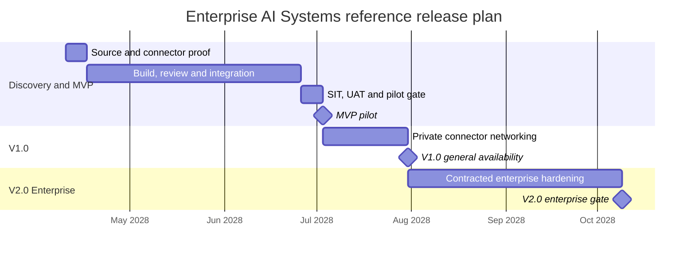

# Enterprise AI Systems — Roadmapping & Scoping

[Portfolio index](../README.md) · [Phase 1](01-ideation-and-strategy.md) · [Phase 2](02-roadmapping-and-scoping.md) · [Phase 3](03-requirements-prd-frd.md) · [Phase 4](04-sprint-execution-and-triage.md) · [Phase 5](05-testing-qa-and-uat.md) · [Phase 6](06-launch-gtm-and-telemetry.md)

**Document control:** ES-P2, revision 1.0, authored 2026-10-17. Status: proposed portfolio design; implementation, customer research, tests and stakeholder approvals have not been performed.

**Source boundary:** Service/solution tier, source p. 20: cross-department AP/inventory/project hub, job-costing sync and custom multi-agent retainers. Reference architecture is proposed. [Primary document](../../MatchClerk-Project-Implementation.pdf). Proposed architecture and assumptions are explicitly recorded in [the evidence register](../source-and-assumptions.md).

## [PM] Release strategy and roadmap

Planning baseline starts 2028-04-10; these are scenario dates, not funded delivery promises. One six-week core MatchClerk build follows the source; expansion MVP durations are estimates. Dependencies and shared specialist capacity can move dates. All changes pass the gates in Phase 5.

| Quarter | Milestone / target date | Scope | Exit gate / owner |
| --- | --- | --- | --- |
| 2028 Q2 | Discovery starts 2028-04-10 | Integration evidence, baseline research and architecture decisions | Two partners plus source capability proof / PM + BSA |
| 2028 Q3 | MVP → 2028-07-03 | Workflow registry; schema contracts; entity-scoped event intake; durable orchestration; typed tool policy; human action approval; replay ledger; audit and runbooks | All Must stories accepted and no critical control defect / PM + BSA |
| 2028 Q3 | V1.0 → 2028-07-31 | Private connector networking, SSO/SCIM provisioning and departmental cost allocation | Two paid cohorts meet outcome and service targets / PM |
| 2028 Q4 | V2.0 Enterprise → 2028-10-09 | Dedicated tenant cells, regional failover and reusable enterprise workflow catalog | Contracted connector proof, restore test, security evidence and revised capacity plan / architect |

MatchClerk portfolio V1.0 consolidates the source's weeks 7–10 v1.1 scope; version names here are planning labels. The [portfolio index](../README.md) shows the proposed expansion sequence. An MVP date cannot imply every downstream connector is available.

## [PM] MoSCoW scope contract

| Priority | Committed decision | Rationale / release treatment |
| --- | --- | --- |
| Must-have | Workflow registry; schema contracts; entity-scoped event intake; durable orchestration; typed tool policy; human action approval; replay ledger; audit and runbooks | Needed for the core outcome or a financial/tenant control; absent capability blocks pilot release |
| Should-have | Private networking; enterprise SSO; workflow cost allocation | Improves adoption or efficiency; can ship after control gates are stable |
| Could-have | Self-service workflow designer after two production patterns stabilize | Experiment only after pilot demand and measurable incremental value |
| Won’t-have in this planning horizon | Unrestricted agent tools; autonomous treasury; universal ERP promise; automatic policy relaxation | Explicitly excluded; a new business case and control design are required to reconsider |

### RICE model: ten ranked features

Reach is eligible workflow runs affected per quarter in one representative account; total potential quarterly reach is 3000. Features overlap, so reach values must not be summed. Impact uses 3=massive, 2=high, 1=medium, 0.5=low; confidence is a fraction; effort is cross-functional person-weeks. **Score = reach × impact × confidence / effort.** Inputs are estimates, not measured adoption. A high score cannot displace mandatory security, approval or integrity controls.

| Rank | Feature | Reach / quarter | Impact | Confidence | Effort / person-weeks | Final score |
| --- | --- | --- | --- | --- | --- | --- |
| 1 | Workflow contract registry | 3000 | 3 | 85% | 3 | 2550.00 |
| 2 | Scoped event ingestion | 2700 | 3 | 80% | 4 | 1620.00 |
| 3 | Durable orchestration | 2550 | 3 | 80% | 4 | 1530.00 |
| 4 | Typed tool policy engine | 2400 | 2 | 80% | 3 | 1280.00 |
| 5 | Human mutation approval | 2250 | 3 | 75% | 4 | 1265.63 |
| 6 | Replay and compensation ledger | 2100 | 2 | 80% | 3 | 1120.00 |
| 7 | Business outcome telemetry | 1800 | 2 | 70% | 3 | 840.00 |
| 8 | Enterprise SSO and SCIM | 1500 | 1 | 65% | 2 | 487.50 |
| 9 | Private connector network | 900 | 1 | 60% | 2 | 270.00 |
| 10 | Self-service workflow design | 600 | 0.5 | 50% | 6 | 25.00 |

**Sequencing rule:** Deliver Must controls and integration proof first, then highest-scoring feasible workflow features. Re-score after the first 100 eligible records or four pilot weeks, whichever comes first. Record changes with evidence in the next Phase 1 revision.

## [BSA] Non-functional requirements

All values are proposed acceptance targets unless identified as source-derived. Percentiles are calculated on successful and failed eligible operations, with timeouts included at their timeout value; do not hide failed work from latency reporting.

| ID | Dimension | Concrete requirement | Measurement / release proof |
| --- | --- | --- | --- |
| ES-NFR-01 | Capacity | 25 tenants × 3,000 workflow runs/month; 250 concurrent UI sessions. | Load a representative 100,000-row tenant history; run a 60-minute mixed workload. |
| ES-NFR-02 | Throughput and queue | API accepts 10 requests/sec sustained. Expensive new jobs: 0.25/sec sustained and 0.5/sec for 60 sec; 32 worker slots scaling to 64. | Rate-limit excess costly work explicitly with 429 + Retry-After; maintain queue wait p95 <15 sec under the declared profile. |
| ES-NFR-03 | API latency | Read p95 ≤400 ms / p99 ≤1000 ms; accepted mutations p95 ≤600 ms / p99 ≤1500 ms. | Excludes agent/provider processing from synchronous handler; measure full async journey separately. |
| ES-NFR-04 | Agent and end-to-end latency | Agent p95 <120 sec; automated intake-to-review-ready p95 <300 sec for supported-size inputs. | Human waiting is excluded from automated duration and reported separately. Background jobs have 15-minute hard timeout and explicit recovery state. |
| ES-NFR-05 | Availability | MVP 99.5% monthly 24×7 API availability; GA target 99.9% after observed pilot reliability. | MVP error budget 216 min per 30-day month; GA 43.2 min. Source business-hour-weighted 99.5% is retained as a comparison, with calendar coverage proposed here. |
| ES-NFR-06 | Identity and authorization | OIDC login; MFA for OWNER and CONTROLLER; explicit RBAC on every request; short-lived sessions; 10-minute single-use email action nonce. | GET never approves. Link opens review; authenticated POST plus CSRF control performs action. Test every role and tenant negative case. |
| ES-NFR-07 | Encryption and isolation | TLS 1.2+; AES-256 managed encryption for DB/S3; KMS envelope encryption for OAuth tokens; tenant RLS with FORCE ROW LEVEL SECURITY. | Session-derived tenant only; composite tenant foreign keys; signed object URLs expire in 60 sec; no public bucket. |
| ES-NFR-08 | SOC 2 control readiness | Access reviews quarterly, change approvals, incident records, vendor DPAs and recovery evidence; no claim of SOC 2 certification. | Security owner maintains control/evidence register; audit report required before any certification claim. |
| ES-NFR-09 | Recovery and durability | Database PITR 30 days; RPO ≤15 min and RTO ≤4 hours; restore drill before launch and quarterly. | SQS retention 14 days, DLQ redrive via operation ledger; object versioning; encrypted backup restore proof. |
| ES-NFR-10 | Privacy and AI handling | Raw evidence default retention 24 months; active-store deletion within 30 days of verified offboarding request; backups age out within another 30 days unless legal hold. | Region-pinned EU deployment by default; approved inference vendors only; no training on tenant data; zero retention only when contractually supported. |
| ES-NFR-11 | Accessibility | WCAG 2.1 AA on onboarding, review and approval; full keyboard path and screen-reader labels. | Manual keyboard/screen-reader review plus automated checks; no critical accessibility blocker. |
| ES-NFR-12 | Correctness and observability | Decimal money; UTC timestamps plus tenant timezone; source lineage, actor and operation IDs on each mutation. | No duplicate external effects under replay tests; no prompt/PDF/token content in application logs. |

**Dependency constraint:** Requires an agreed statement of work, named data owners, connector sandboxes and signed workflow control policies. **Business-rule constraint:** Use a durable workflow engine for multi-day approval waits and compensation. Every tool action has a typed schema, tenant/entity scope, stable idempotency reference and immutable authorization evidence. Partial completion is visible; compensation is a separate authorized action. API licenses and entitlement checks are paid dependencies, not assumed free infrastructure. Current provider constraints and the architecture decision record live in [platform architecture](../platform-architecture.md).
