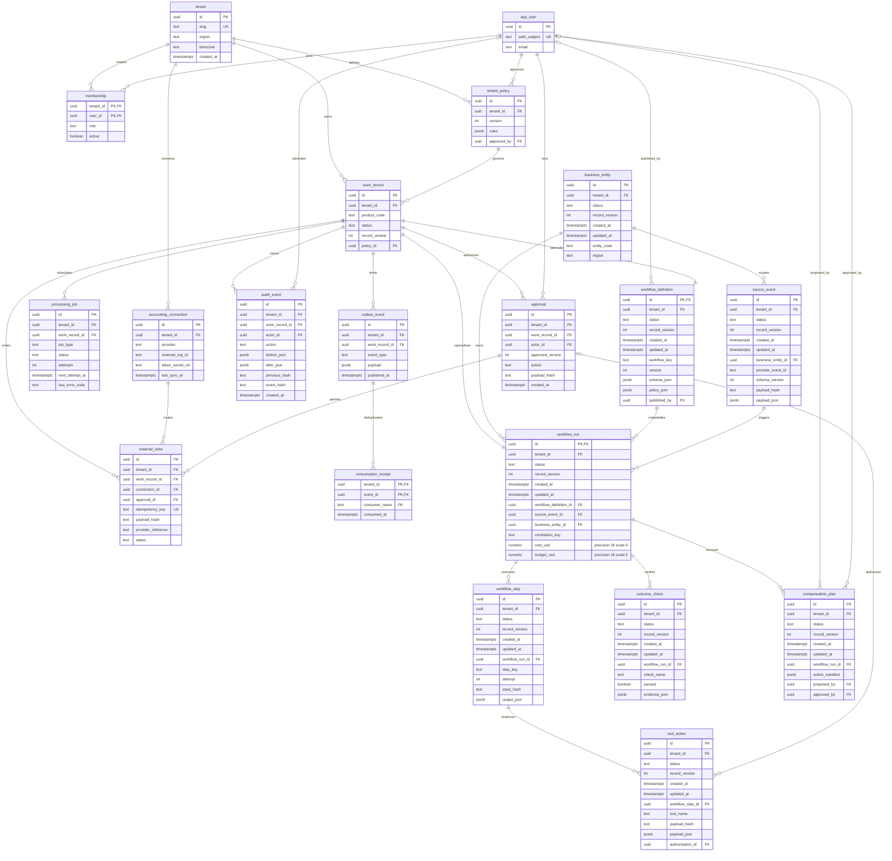
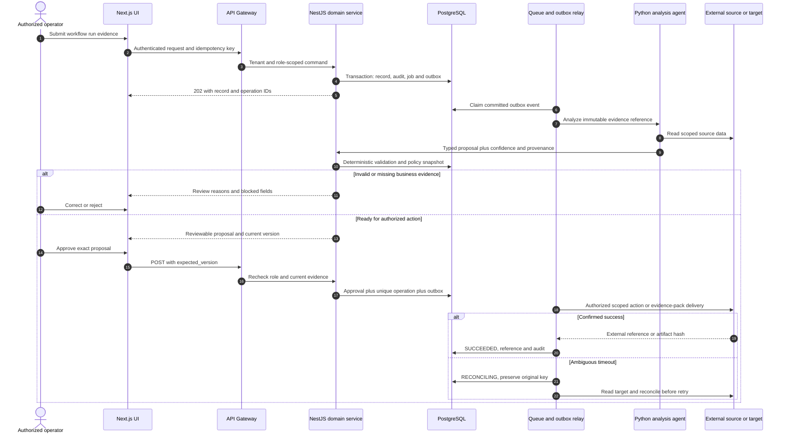
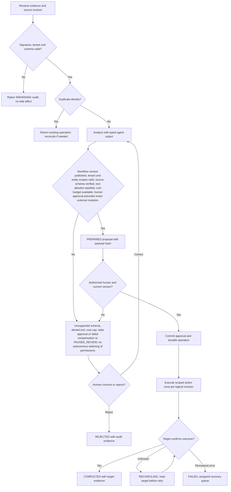

# Enterprise AI Systems — Requirements — PRD, BRD & FRD

[Portfolio index](../README.md) · [Phase 1](01-ideation-and-strategy.md) · [Phase 2](02-roadmapping-and-scoping.md) · [Phase 3](03-requirements-prd-frd.md) · [Phase 4](04-sprint-execution-and-triage.md) · [Phase 5](05-testing-qa-and-uat.md) · [Phase 6](06-launch-gtm-and-telemetry.md)

**Document control:** ES-P3, revision 1.0, authored 2026-10-17. Status: proposed portfolio design; implementation, customer research, tests and stakeholder approvals have not been performed.

**Source boundary:** Service/solution tier, source p. 20: cross-department AP/inventory/project hub, job-costing sync and custom multi-agent retainers. Reference architecture is proposed. [Primary document](../../MatchClerk-Project-Implementation.pdf). Proposed architecture and assumptions are explicitly recorded in [the evidence register](../source-and-assumptions.md).

## Scope, actors and requirement identity

| BR ID | Business requirement | Success evidence |
| --- | --- | --- |
| ES-BR-01 | Orchestrate governed cross-department workflows across AP, inventory and project operations with reusable connectors, scoped agents and auditable human approvals. | ≥95% completion after human decisions, with zero unauthorized tool actions |
| ES-BR-02 | Preserve accountable human control and tenant isolation | Custom engagement, not a claim of a shipped universal ERP product. Agents propose typed actions; a deterministic policy service authorizes execution. Banking tools are excluded. |
| ES-BR-03 | Recover safely from malformed input, duplicate events and partial failure | No duplicate external side effect; each failed operation is discoverable and recoverable |
| ES-BR-04 | Make operating value measurable | ≥99% schema-valid intake; ≥95% successful business completion excluding human rejection; zero unapproved external mutations; ≥80% runs within approved cost budget. |

FR-1 through FR-8 map one-to-one to US-1 through US-8 below. Stories 1–6 support BR-01/02, story 7 supports BR-02/04 and story 8 supports BR-03. Every action also inherits tenant isolation, audit and idempotency requirements. A proposed acceptance criterion is not an executed test result.

## [PM] User stories and strict acceptance criteria

### ES-US-1 / ES-FR-1 — Workflow registration

As a IT integration owner, I want to publish a versioned workflow contract, so that I can control deployed behavior.

```gherkin
Feature: Enterprise AI Systems Workflow registration
  Scenario: Workflow registration business contract
    Given AP-to-inventory workflow version 3 passed review
    When I publish its signed schema and action policy
    Then only version 3 is active for the selected tenant/entity scope

  Scenario: Reject unauthorized or stale changes
    Given the actor lacks tenant or role permission, or the submitted version is stale
    When the same business action is attempted
    Then cross-tenant access returns 404, a disallowed role returns 403, and a stale mutation returns 409
    And no domain row, approval, or external side effect is committed
```

**Database assertion:** workflow_definition.version=3; workflow_definition.status='PUBLISHED'. **API:** POST `/api/v1/workflow-definitions`. Read-only endpoints do not require a submitted mutation version; their negative case covers tenant and role access. 

### ES-US-2 / ES-FR-2 — Scoped intake

As a IT integration owner, I want to validate incoming business events, so that I can stop malformed cross-system updates.

```gherkin
Feature: Enterprise AI Systems Scoped intake
  Scenario: Scoped intake business contract
    Given an event carries schema_version 2 and an allowed entity
    When its signature and schema are verified
    Then one workflow run is created with source hash and correlation key

  Scenario: Reject unauthorized or stale changes
    Given the actor lacks tenant or role permission, or the submitted version is stale
    When the same business action is attempted
    Then cross-tenant access returns 404, a disallowed role returns 403, and a stale mutation returns 409
    And no domain row, approval, or external side effect is committed
```

**Database assertion:** workflow_run.correlation_key='FLOW-PO501-R1'; source_event count=1. **API:** POST `/api/v1/workflow-runs`. Read-only endpoints do not require a submitted mutation version; their negative case covers tenant and role access. 

### ES-US-3 / ES-FR-3 — Tool restrictions

As a finance process owner, I want to deny tools outside the approved policy, so that I can prevent unintended system actions.

```gherkin
Feature: Enterprise AI Systems Tool restrictions
  Scenario: Tool restrictions business contract
    Given a planner proposes a bank transfer tool absent from its allowlist
    When the policy service evaluates the proposal
    Then the action is denied and the run pauses with no external call

  Scenario: Reject unauthorized or stale changes
    Given the actor lacks tenant or role permission, or the submitted version is stale
    When the same business action is attempted
    Then cross-tenant access returns 404, a disallowed role returns 403, and a stale mutation returns 409
    And no domain row, approval, or external side effect is committed
```

**Database assertion:** tool_action.status='DENIED'; external_write count=0. **API:** POST `/api/v1/workflow-runs/{id}/policy-evaluations`. Read-only endpoints do not require a submitted mutation version; their negative case covers tenant and role access. 

### ES-US-4 / ES-FR-4 — Human control

As a finance process owner, I want to approve a typed external mutation, so that I can retain financial accountability.

```gherkin
Feature: Enterprise AI Systems Human control
  Scenario: Human control business contract
    Given a valid inventory adjustment proposal references current source version 4
    When an authorized controller approves it
    Then the exact signed payload is authorized and later edits require a new approval

  Scenario: Reject unauthorized or stale changes
    Given the actor lacks tenant or role permission, or the submitted version is stale
    When the same business action is attempted
    Then cross-tenant access returns 404, a disallowed role returns 403, and a stale mutation returns 409
    And no domain row, approval, or external side effect is committed
```

**Database assertion:** approval.payload_hash equals tool_action.payload_hash. **API:** POST `/api/v1/workflow-runs/{id}/approve`. Read-only endpoints do not require a submitted mutation version; their negative case covers tenant and role access. 

### ES-US-5 / ES-FR-5 — Budget guard

As a IT integration owner, I want to cap agent compute per run, so that I can avoid runaway execution cost.

```gherkin
Feature: Enterprise AI Systems Budget guard
  Scenario: Budget guard business contract
    Given a run has a 0.50 USD model budget and accumulated cost 0.49
    When the next call is estimated at 0.05
    Then the call is blocked and the run enters PAUSED_REVIEW

  Scenario: Reject unauthorized or stale changes
    Given the actor lacks tenant or role permission, or the submitted version is stale
    When the same business action is attempted
    Then cross-tenant access returns 404, a disallowed role returns 403, and a stale mutation returns 409
    And no domain row, approval, or external side effect is committed
```

**Database assertion:** workflow_run.cost_usd=0.49; tool_action.status='BUDGET_BLOCKED'. **API:** POST `/api/v1/workflow-runs/{id}/budget-evaluations`. Read-only endpoints do not require a submitted mutation version; their negative case covers tenant and role access. 

### ES-US-6 / ES-FR-6 — Durable execution

As a operations transformation lead, I want to resume an approved workflow after a worker restart, so that I can avoid duplicated business actions.

```gherkin
Feature: Enterprise AI Systems Durable execution
  Scenario: Durable execution business contract
    Given action A completed and action B awaits approval
    When the worker restarts
    Then the workflow resumes from the persisted wait and action A is not repeated

  Scenario: Reject unauthorized or stale changes
    Given the actor lacks tenant or role permission, or the submitted version is stale
    When the same business action is attempted
    Then cross-tenant access returns 404, a disallowed role returns 403, and a stale mutation returns 409
    And no domain row, approval, or external side effect is committed
```

**Database assertion:** workflow_step A remains SUCCEEDED; external_write for A count=1. **API:** POST `/api/v1/workflow-runs/{id}/resume`. Read-only endpoints do not require a submitted mutation version; their negative case covers tenant and role access. 

### ES-US-7 / ES-FR-7 — Outcome evidence

As a operations transformation lead, I want to verify completion in target systems, so that I can measure actual operational value.

```gherkin
Feature: Enterprise AI Systems Outcome evidence
  Scenario: Outcome evidence business contract
    Given all steps report success with external references
    When the final reconciliation runs
    Then the run is COMPLETED only after target-state checks pass

  Scenario: Reject unauthorized or stale changes
    Given the actor lacks tenant or role permission, or the submitted version is stale
    When the same business action is attempted
    Then cross-tenant access returns 404, a disallowed role returns 403, and a stale mutation returns 409
    And no domain row, approval, or external side effect is committed
```

**Database assertion:** workflow_run.status='COMPLETED'; outcome_check.passed=true. **API:** GET `/api/v1/workflow-runs/{id}/outcomes`. Read-only endpoints do not require a submitted mutation version; their negative case covers tenant and role access. 

### ES-US-8 / ES-FR-8 — Compensation review

As a IT integration owner, I want to review a recovery plan after partial failure, so that I can restore consistent business state.

```gherkin
Feature: Enterprise AI Systems Compensation review
  Scenario: Compensation review business contract
    Given inventory updated but project sync failed
    When the retry limit is exhausted
    Then the run pauses with a proposed compensation and no unapproved reversal

  Scenario: Reject unauthorized or stale changes
    Given the actor lacks tenant or role permission, or the submitted version is stale
    When the same business action is attempted
    Then cross-tenant access returns 404, a disallowed role returns 403, and a stale mutation returns 409
    And no domain row, approval, or external side effect is committed
```

**Database assertion:** workflow_run.status='PAUSED_REVIEW'; compensation_plan.status='PROPOSED'. **API:** POST `/api/v1/workflow-runs/{id}/compensation-plans`. Read-only endpoints do not require a submitted mutation version; their negative case covers tenant and role access. Recovery acceptance: replay the source event or request and confirm the original operation identity and side-effect count.

## [BSA] Domain model and entity relationships

This diagram includes domain tables and the shared control tables required by this product. UUIDs are internal keys; external IDs remain text. Every domain table includes tenant_id, status, record_version and timestamps. Approval-bearing aggregate tables (workflow_definition, workflow_run) share their ID with work_record.id; API/domain updates keep both states synchronized in one transaction. A work_record specializes into exactly one aggregate type, not every linked type simultaneously.



### Physical constraints and integrity rules

| Rule | Concrete implementation |
| --- | --- |
| Tenant-safe foreign keys | Tenant-owned tables have UNIQUE(tenant_id,id); intra-tenant foreign keys use (tenant_id,parent_id) → parent(tenant_id,id), even where the ER diagram abbreviates the key. Global app_user/tenant keys are exceptions; actor scope additionally references membership(tenant_id,user_id). |
| Money and quantity | numeric(18,2) for currency amounts; numeric(18,4) for quantities/unit prices; numeric(9,6) for ratios; JSON monetary values are decimal strings. ISO-4217 currency is char(3). Round only at declared posting boundaries. |
| Optimistic mutation | UPDATE work_record SET record_version=record_version+1 WHERE tenant_id=session_tenant AND id=record_id AND record_version=expected_version; zero rows → 409 STALE_VERSION. |
| Approval binding | approval stores approved_version and SHA-256 of canonical mutation payload. Unique work_record_id + approved_version + action prevents duplicate authorization. Revoke validity when business evidence changes. |
| Write identity | external_write.idempotency_key is unique and immutable; bind it to tenant, connection, record, action and business revision. A reused key with changed payload returns 409 IDEMPOTENCY_CONFLICT. |
| Event delivery | Create domain update, audit row, processing_job and outbox row in one PostgreSQL transaction. Consumption receipt unique key is (tenant_id,event_id,consumer_name). Delivery is at-least-once. |
| Audit immutability | Application roles cannot UPDATE/DELETE audit_event; daily signed hash manifest in locked object storage. System events have null actor_id and explicit service identity in after_json. |
| Indexes | CREATE INDEX on domain aggregate (tenant_id,status,created_at DESC); processing_job (status,next_attempt_at); audit_event (tenant_id,work_record_id,created_at); external_write (tenant_id,provider_reference). |
| Domain invariants | Use a durable workflow engine for multi-day approval waits and compensation. Every tool action has a typed schema, tenant/entity scope, stable idempotency reference and immutable authorization evidence. Partial completion is visible; compensation is a separate authorized action. |
| Retention deletion | Evidence objects and operational rows follow tenant policy; audit personal identifiers are minimized and removed under verified deletion unless a documented legal hold applies. Hashes are not assumed anonymous. |

### API contract and source-to-target mapping

REST JSON over HTTPS, versioned at /api/v1. Authenticate via HttpOnly OIDC-backed session for UI and scoped service credentials for callbacks. Tenant identity never comes from a client body. All mutating requests carry Idempotency-Key; updates also carry expected_version. Body size limit is 1 MB JSON; files use signed upload. Example UUIDs are synthetic fixtures, not live data. API requests below show action inputs; the intake payload is also specified separately.

**Canonical intake example:** `{"correlation_key":"FLOW-PO501-R1","workflow_key":"ap-inventory-project","workflow_version":3,"entity_code":"ENTITY-EU-1","schema_version":2,"event":{"type":"receipt.attested","po_external_id":"PO-501","accepted_qty":"7.0000"},"budget_usd":"0.50"}`

| FRD / API ID | Method and endpoint | Request JSON | Success JSON / status | Internal target mapping | Errors |
| --- | --- | --- | --- | --- | --- |
| ES-FR-1 / API-1 | POST /api/v1/workflow-definitions | `{"workflow_key":"ap-inventory-project","version":3,"action_allowlist":["inventory.adjust","project.cost_sync"]}` | 201 `{"id":"22222222-2222-4222-8222-222222222222","operation_id":"33333333-3333-4333-8333-333333333333","status":"PUBLISHED","record_version":1,"workflow_key":"ap-inventory-project","workflow_version":3}` | workflow_run.correlation_key | 400 SCHEMA_INVALID; 403 POLICY_DENIED; 409 STALE_VERSION; 422 RULE_VIOLATION; 429 RATE_LIMITED |
| ES-FR-2 / API-2 | POST /api/v1/workflow-runs | `{"correlation_key":"FLOW-PO501-R1","workflow_key":"ap-inventory-project","workflow_version":3,"entity_code":"ENTITY-EU-1","schema_version":2,"event":{"type":"receipt.attested","po_external_id":"PO-501","accepted_qty":"7.0000"},"budget_usd":"0.50"}` | 202 `{"id":"22222222-2222-4222-8222-222222222222","operation_id":"33333333-3333-4333-8333-333333333333","status":"RECEIVED","record_version":4,"correlation_key":"FLOW-PO501-R1"}` | workflow_run.business_entity_id | 400 SCHEMA_INVALID; 403 POLICY_DENIED; 409 STALE_VERSION; 422 RULE_VIOLATION; 429 RATE_LIMITED |
| ES-FR-3 / API-3 | POST /api/v1/workflow-runs/{id}/policy-evaluations | `{"tool_name":"bank.transfer","payload_hash":"dddddddddddddddddddddddddddddddddddddddddddddddddddddddddddddddd"}` | 200 `{"id":"22222222-2222-4222-8222-222222222222","operation_id":"33333333-3333-4333-8333-333333333333","status":"DENIED","record_version":4,"allowed":false,"reason_code":"TOOL_NOT_ALLOWED"}` | workflow_definition.version | 400 SCHEMA_INVALID; 403 POLICY_DENIED; 409 STALE_VERSION; 422 RULE_VIOLATION; 429 RATE_LIMITED |
| ES-FR-4 / API-4 | POST /api/v1/workflow-runs/{id}/approve | `{"expected_version":4,"payload_hash":"aaaaaaaaaaaaaaaaaaaaaaaaaaaaaaaaaaaaaaaaaaaaaaaaaaaaaaaaaaaaaaaa"}` | 202 `{"id":"22222222-2222-4222-8222-222222222222","operation_id":"33333333-3333-4333-8333-333333333333","status":"APPROVED","record_version":5,"payload_hash":"aaaaaaaaaaaaaaaaaaaaaaaaaaaaaaaaaaaaaaaaaaaaaaaaaaaaaaaaaaaaaaaa"}` | source_event.payload_json | 400 SCHEMA_INVALID; 403 POLICY_DENIED; 409 STALE_VERSION; 422 RULE_VIOLATION; 429 RATE_LIMITED |
| ES-FR-5 / API-5 | POST /api/v1/workflow-runs/{id}/budget-evaluations | `{"estimated_next_cost_usd":"0.05"}` | 200 `{"id":"22222222-2222-4222-8222-222222222222","operation_id":"33333333-3333-4333-8333-333333333333","status":"BUDGET_BLOCKED","record_version":4,"cost_usd":"0.49","estimated_next_cost_usd":"0.05","budget_usd":"0.50"}` | tool_action.payload_hash | 400 SCHEMA_INVALID; 403 POLICY_DENIED; 409 STALE_VERSION; 422 RULE_VIOLATION; 429 RATE_LIMITED |
| ES-FR-6 / API-6 | POST /api/v1/workflow-runs/{id}/resume | `{"expected_version":5}` | 202 `{"id":"22222222-2222-4222-8222-222222222222","operation_id":"33333333-3333-4333-8333-333333333333","status":"RUNNING","record_version":6,"resumed_from":"WAITING_FOR_APPROVAL"}` | tool_action.payload_hash | 400 SCHEMA_INVALID; 403 POLICY_DENIED; 409 STALE_VERSION; 422 RULE_VIOLATION; 429 RATE_LIMITED |
| ES-FR-7 / API-7 | GET /api/v1/workflow-runs/{id}/outcomes | `null` | 200 `{"id":"22222222-2222-4222-8222-222222222222","result":"OUTCOMES_RETURNED","record_version":4,"checks":[{"name":"target_reconciliation","passed":true}]}` | tool_action.payload_hash | 400 SCHEMA_INVALID; 403 POLICY_DENIED; 409 STALE_VERSION; 422 RULE_VIOLATION; 429 RATE_LIMITED |
| ES-FR-8 / API-8 | POST /api/v1/workflow-runs/{id}/compensation-plans | `{"reason":"Project sync retry limit exhausted"}` | 201 `{"id":"22222222-2222-4222-8222-222222222222","operation_id":"33333333-3333-4333-8333-333333333333","status":"PROPOSED","record_version":4,"approval_required":true}` | tool_action.payload_hash | 400 SCHEMA_INVALID; 403 POLICY_DENIED; 409 STALE_VERSION; 422 RULE_VIOLATION; 429 RATE_LIMITED |

For 202 responses, the body reflects **acceptance state**, not final downstream success. Updates accepted at expected_version 4 return revision 5; intake creates revision 1. Independent scenario fixtures explain differing versions between rows. Clients use returned versions, not a hard-coded constant. A GET result with an artifact returns JSON metadata (download_url, expires_at, sha256); the binary is fetched through the authenticated evidence gateway. A full record response contains the fields from the domain ERD, validation reasons and provenance. Read-only policy-denial and budget checks return their decision without performing the proposed action.

| Source field / system | API field or derivation | Target table.column | Transformation and rejection rule |
| --- | --- | --- | --- |
| Provider event ID | correlation_key | workflow_run.correlation_key | Unique tenant+entity+workflow+correlation |
| Entity master | entity_code | workflow_run.business_entity_id | Resolve entity allowed by token scope |
| Published contract version | workflow_version | workflow_definition.version | Reject unpublished or retired version |
| Typed event body | event | source_event.payload_json | Validate signed schema before persistence |
| Signed proposal content | payload_hash | tool_action.payload_hash | Bind approval to canonical JSON SHA-256 |

| Contract | Exact rule / example |
| --- | --- |
| Error envelope | `{"error":{"code":"STALE_VERSION","message":"Record changed after review","retryable":false,"request_id":"req-fixture-17","current_version":5}}` |
| Additional statuses | 401 AUTH_REQUIRED; 404 RECORD_NOT_FOUND; 413 FILE_TOO_LARGE; 415 UNSUPPORTED_MEDIA; 424 DEPENDENCY_UNAVAILABLE; 503 TEMPORARY_UNAVAILABLE. Domain detail codes include those in the Phase 4 triage log. |
| Upload safety | PDF/PNG up to 25 MB per file; ZIP up to 25 MB compressed, 100 MB expanded, 100 members and depth 1. Reject executable MIME, path traversal, encrypted archives and malicious files; scan before extraction. |
| Paging | GET collection uses limit ≤100 and opaque cursor; deterministic created_at,id order; no unbounded full-tenant export. |
| Webhook signature | Verify provider signature on raw body before parsing. Persist provider event identity before returning 202. Provider-authenticated replay is deduplicated, not dropped based only on age. |
| Provider failure | 429 honors Retry-After; 5xx/network retries use jittered backoff. Timeout with unknown write outcome enters RECONCILING and must not issue an immediate second create. |

## [BSA] System sequence



For a product with an internal evidence-pack or event output, the final external participant means the authorized consumer or artifact store; it does not imply a financial write. Custom engagement, not a claim of a shipped universal ERP product. Agents propose typed actions; a deterministic policy service authorizes execution. Banking tools are excluded.

## [BSA] Business rules and UAT/system decision flow



**State contract:** RECEIVED → ANALYZING → NEEDS_REVIEW or PREPARED → APPROVED → RUNNING → COMPLETED. Domain-specific states (such as PAUSED_REVIEW; no autonomous widening of permissions.) refine the control state; raw status transitions are never accepted from clients. REJECTED is terminal for that business revision. A corrected record creates a new revision and invalidates prior approval. FAILED/RECONCILING are explicit recovery states; only service commands with allowed transitions can change them.

## [PM & BSA] Formal sign-off record

| Document / control | Accountable stakeholder | Acceptance evidence | Decision / signature state |
| --- | --- | --- | --- |
| BRD: BR-01 to BR-04 | Economic buyer / PM | Validated problem, baseline, price and control ownership | Review required; no stakeholder signature recorded |
| PRD: US-1 to US-8 | Product owner + customer process owner | Story walkthrough and five-scenario UAT acceptance | Review required; no stakeholder signature recorded |
| FRD: API, ERD and process model | BSA + engineering lead | Mapping workshop, contract tests and migration review | Review required; no stakeholder signature recorded |
| Architecture and threat controls | Solutions architect + security owner | Capability spikes, tenant tests and restore evidence | Review required; no stakeholder signature recorded |
| Financial side-effect boundary | Customer controller | Approval, duplicate and reconciliation evidence | Review required; no stakeholder signature recorded |

Approval requires named reviewer, UTC decision timestamp, artifact revision and evidence link in the actual delivery system. This portfolio records the review mechanism without fabricating approval.
