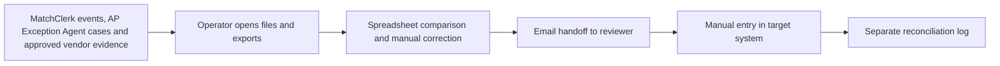
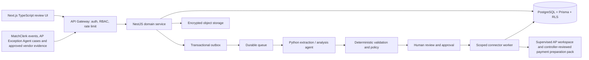

# Full AP Digital Employee — Ideation & Strategy

[Portfolio index](../README.md) · [Phase 1](01-ideation-and-strategy.md) · [Phase 2](02-roadmapping-and-scoping.md) · [Phase 3](03-requirements-prd-frd.md) · [Phase 4](04-sprint-execution-and-triage.md) · [Phase 5](05-testing-qa-and-uat.md) · [Phase 6](06-launch-gtm-and-telemetry.md)

**Document control:** FA-P1, revision 1.0, authored 2026-10-17. Status: proposed portfolio design; implementation, customer research, tests and stakeholder approvals have not been performed.

**Source boundary:** Umbrella upsell named on source p. 2, supported by the expansion path on p. 20. Proposed as an orchestration bundle, not a second invoice engine. [Primary document](../../MatchClerk-Project-Implementation.pdf). Proposed architecture and assumptions are explicitly recorded in [the evidence register](../source-and-assumptions.md).

## [PM] Source objective and discovery hypothesis

After invoice entry is automated, AP work still fragments across onboarding, exception ownership, approval chasing and weekly payment preparation. Coordinate invoice processing, exception handling, vendor onboarding controls and payment preparation into a supervised AP operating workspace. The beachhead is Growing MatchClerk accounts with 1,000–5,000 invoices/month, multiple AP users and a finance leader responsible for end-to-end control. Discovery statements below are research hypotheses, not completed interviews or observed customer outcomes.

| BR ID | Business requirement | Success evidence |
| --- | --- | --- |
| FA-BR-01 | Coordinate invoice processing, exception handling, vendor onboarding controls and payment preparation into a supervised AP operating workspace. | ≥90% of weekly AP cycles complete by agreed cutoff |
| FA-BR-02 | Preserve accountable human control and tenant isolation | This bundle delegates to MatchClerk and AP Exception Agent APIs. It never independently writes a duplicate bill or executes a bank payment. |
| FA-BR-03 | Recover safely from malformed input, duplicate events and partial failure | No duplicate external side effect; each failed operation is discoverable and recoverable |
| FA-BR-04 | Make operating value measurable | ≥30% fewer aged AP work items; ≥90% tasks have a named owner; zero approval bypass across component holds. |

### Competitive analysis

Primary vendor documentation reviewed 2026-10-17. Capability descriptions are limited to published material; tradeoff judgments are our inference. Prices and missing features are not inferred from silence. Broad-suite competitors can serve SMEs: the source's blanket market-gap assertion is a hypothesis requiring validation.

| Alternative | Published capability | Fit / evaluation question | Proposed differentiation to test |
| --- | --- | --- | --- |
| [BILL](https://www.bill.com/product/accounts-payable/) | Invoice capture, approvals and two/three-way matching | Broader AP/payment suite; validate plan and connector fit in a demo | Full AP Digital Employee: Coordinate invoice processing, exception handling, vendor onboarding controls and payment preparation into a supervised AP operating workspace. Test evidence quality and implementation effort with the same customer scenario. |
| [Tipalti](https://tipalti.com/accounts-payable-software/) | AP automation, supplier management and international payments | Global payment breadth exceeds the proposed supervised SME scope | Full AP Digital Employee: Coordinate invoice processing, exception handling, vendor onboarding controls and payment preparation into a supervised AP operating workspace. Test evidence quality and implementation effort with the same customer scenario. |
| [Stampli](https://www.stampli.com/ap-automation-platform/) | Line-level matching, coding, approvals and ERP posting | Direct competitor for contextual AP collaboration; validate implementation effort | Full AP Digital Employee: Coordinate invoice processing, exception handling, vendor onboarding controls and payment preparation into a supervised AP operating workspace. Test evidence quality and implementation effort with the same customer scenario. |

### Personas

These are designed research archetypes. Names do not represent interviewed customers.

| Persona / role | Goals | Pain points | Daily workflow | Technical proficiency |
| --- | --- | --- | --- | --- |
| Ava — Controller | Run weekly AP with visible controls | Approvals lack complete supporting evidence | Review cycle; clear escalations; approve pack | High finance; medium technical |
| Leena — AP team lead | Balance workload and meet cutoffs | Invisible ownership across disconnected tools | Assign queue; chase blockers; prepare cycle | High workflow systems |
| Sam — Owner/CFO | Scale AP capacity without weakening control | Automation value stops at invoice entry | Weekly cash review; monthly service review | Medium dashboards |

### Discovery and validation plan

| Method / sample | Concrete prompt or exercise | Decision threshold | Owner |
| --- | --- | --- | --- |
| Six buyer interviews across two target segments | Walk through the last AP work item that was delayed; show the actual handoff and current time spent. | At least 4/6 demonstrate the same core pain and name a budget owner. | PM |
| Five observed operator sessions | Process five representative records using the current workflow; time active work separately from waiting. | Observed baseline replaces the ROI estimate; at least 3/5 complete the proposed flow without coaching. | PM + UX |
| Three technical discovery workshops | Inspect source fields, permissions, data exports and failure/replay behavior in a sandbox. | All mandatory source fields map and the human control boundary is feasible. | BSA + integration lead |
| Two design partners, 30-day pilot | Compare a consented baseline cohort with a parallel-run cohort; log every correction and failure. | Achieve the product gates in Phase 5 before GA; no fabricated case study claim. | Pilot success lead |

## [PM] Vision, positioning and business case

**Vision:** For Growing MatchClerk accounts with 1,000–5,000 invoices/month, multiple AP users and a finance leader responsible for end-to-end control. Full AP Digital Employee is a supervised operational product that coordinate invoice processing, exception handling, vendor onboarding controls and payment preparation into a supervised AP operating workspace. Its value is measured by ap cycles completed on time with all control evidence attached, with explicit evidence and human accountability.

**Value proposition:** Replace fragmented manual handoffs with one traceable work queue, typed validation and an authorized next action. The defensible wedge to test is faster deployment into the customer's existing process and clearer control evidence. Competitive superiority has not been demonstrated.

**Commercial model:** Proposed monthly subscription of USD 3,000.00 for the modeled 300 AP work items; implementation USD 3,000.00. MatchClerk prices are source recommendations; expansion prices are portfolio hypotheses. No market-size estimate is invented.

| ROI input or output | Illustrative value | Calculation / interpretation |
| --- | --- | --- |
| Monthly eligible volume | 300 AP work items | Model assumption; replace with pilot logs |
| Active manual handling | 30 → 10 minutes/AP work item | Excludes waiting and assumes human review remains |
| Loaded labor rate | USD 40/hour | Illustrative input; not a wage benchmark |
| Gross monthly capacity value | USD 4,000.00 | 300 × (30-10) / 60 × 40 |
| Net monthly value after fee | USD 1,000.00 | 4,000.00 - 3,000.00; recovered capacity is not automatically cash savings |
| Customer implementation payback | 3.00 months | One-time fee / net monthly capacity value; validate with buyer |
| Modeled monthly COGS | USD 590.00 | 300 × 0.30 variable processing + 300 infrastructure + 200 allocated support |
| Modeled gross margin | 80.3% | Revenue less modeled COGS; excludes sales/R&D; support allocation must be validated |
| 50% realization sensitivity | USD -1,000.00 net/month | Half the modeled labor benefit; do not expand if measured customer value is negative |

For Full AP, component subscriptions are bundled and the infrastructure allocation includes shared component operations. For every product, cloud/API licensing and human support must be re-estimated before a commercial commitment. Break-even volume at this labor model is 226 eligible records/month. A high gross-margin estimate alone does not establish demand.

## [BSA] As-Is and To-Be feasibility

| Gap | Target design | Feasibility proof / dependency | Residual risk |
| --- | --- | --- | --- |
| Manual interpretation and missing provenance | Typed extraction with page/row evidence; deterministic rule engine | All required component tasks complete; vendor evidence verified; held exceptions cleared; controller independent of preparer; component versions still current. | Confidence must be evaluated on representative labeled inputs |
| No reliable handoff ownership | Role-based queue with statuses, owner and business deadline | Any component hold, revoked vendor verification or stale approval → BLOCKED; no pack release while a linked task is unresolved. | Review bottleneck if staffing is insufficient |
| Fragmented target writes | Scoped adapter with operation ledger and reconciliation | Requires stable MatchClerk, AP Exception Agent and Vendor Onboarding Agent interfaces; receiving integration is optional by tenant. | Provider capabilities vary by subscription, region and API version |
| Spreadsheet access without strong isolation | Session-derived tenant, RLS, composite foreign keys and encrypted objects | Negative tenant/role tests plus restore drill before launch | Application roles and pooled DB sessions require careful reset |
| No closed-loop value evidence | Outcome events joined to source lineage and adoption cohorts | Pilot baseline plus telemetry definitions in Phase 6 | Attribution can overstate savings without a comparable baseline |

**Architectural decision:** Deploy a modular NestJS service and independent Python workers, rather than separate microservices for every feature. Use PostgreSQL as the durable source of truth, AWS SQS for ordinary background work, Redis for rate-limit counters and cache, and S3 SSE-KMS for evidence. Long-lived work state stays in PostgreSQL; queues deliver work, not authoritative approval state. Source stack options are resolved in [platform architecture](../platform-architecture.md); no implementation is claimed.

**Product-specific feasibility constraint:** State derives from component revisions, not just cached labels. A credit-note case reopening invalidates the parent release. Vendor onboarding validates evidence through an independent controller; bank details remain outside the product write scope.

**Investment gate:** Fund the pilot only after the source-field mapping, control boundary and two design-partner commitments are validated. PM owns demand and economic evidence; BSA owns integration and data feasibility. Stop expansion if high-severity control defects persist or the measured benefit is below the subscription cost for two pilot reviews.
