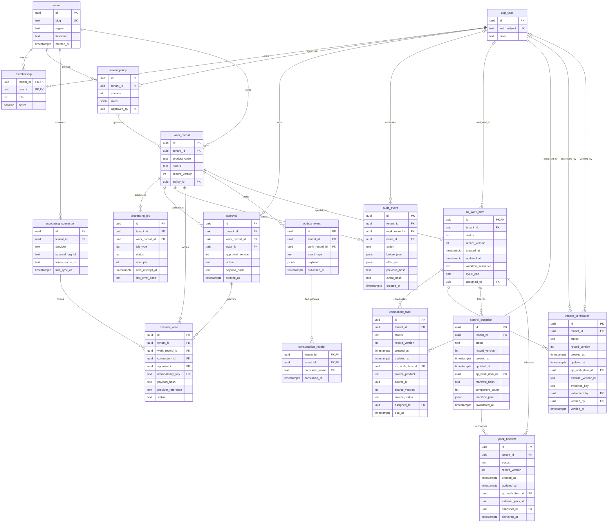
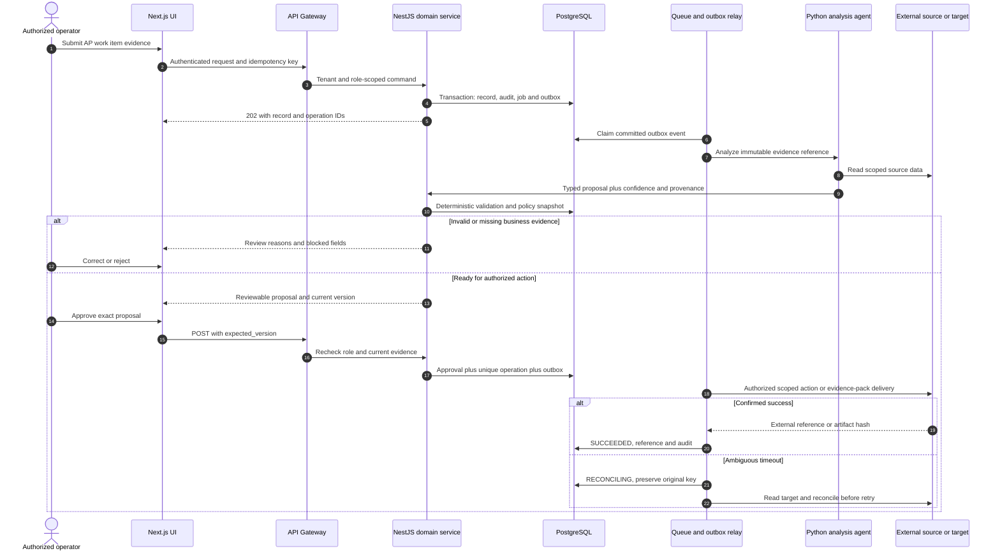
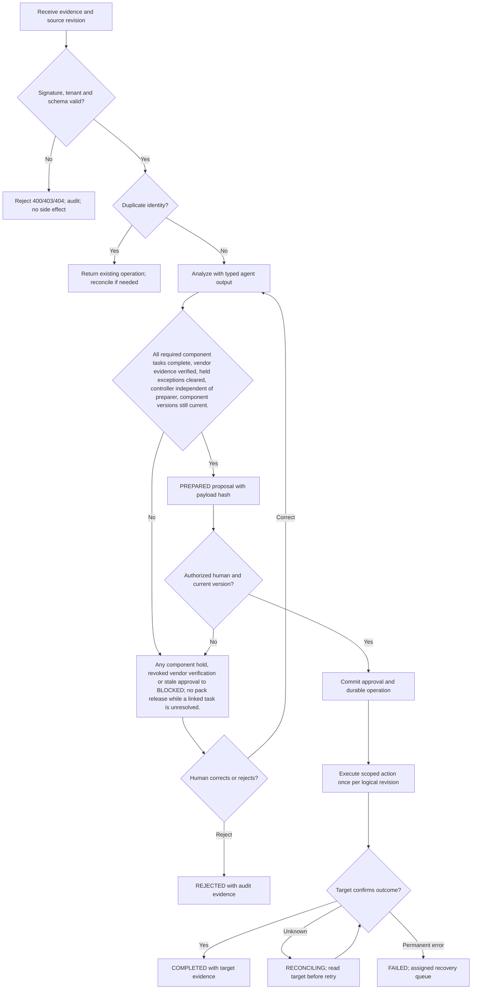

# Full AP Digital Employee — Requirements — PRD, BRD & FRD

[Portfolio index](../README.md) · [Phase 1](01-ideation-and-strategy.md) · [Phase 2](02-roadmapping-and-scoping.md) · [Phase 3](03-requirements-prd-frd.md) · [Phase 4](04-sprint-execution-and-triage.md) · [Phase 5](05-testing-qa-and-uat.md) · [Phase 6](06-launch-gtm-and-telemetry.md)

**Document control:** FA-P3, revision 1.0, authored 2026-10-17. Status: proposed portfolio design; implementation, customer research, tests and stakeholder approvals have not been performed.

**Source boundary:** Umbrella upsell named on source p. 2, supported by the expansion path on p. 20. Proposed as an orchestration bundle, not a second invoice engine. [Primary document](../../MatchClerk-Project-Implementation.pdf). Proposed architecture and assumptions are explicitly recorded in [the evidence register](../source-and-assumptions.md).

## Scope, actors and requirement identity

| BR ID | Business requirement | Success evidence |
| --- | --- | --- |
| FA-BR-01 | Coordinate invoice processing, exception handling, vendor onboarding controls and payment preparation into a supervised AP operating workspace. | ≥90% of weekly AP cycles complete by agreed cutoff |
| FA-BR-02 | Preserve accountable human control and tenant isolation | This bundle delegates to MatchClerk and AP Exception Agent APIs. It never independently writes a duplicate bill or executes a bank payment. |
| FA-BR-03 | Recover safely from malformed input, duplicate events and partial failure | No duplicate external side effect; each failed operation is discoverable and recoverable |
| FA-BR-04 | Make operating value measurable | ≥30% fewer aged AP work items; ≥90% tasks have a named owner; zero approval bypass across component holds. |

FR-1 through FR-8 map one-to-one to US-1 through US-8 below. Stories 1–6 support BR-01/02, story 7 supports BR-02/04 and story 8 supports BR-03. Every action also inherits tenant isolation, audit and idempotency requirements. A proposed acceptance criterion is not an executed test result.

## [PM] User stories and strict acceptance criteria

### FA-US-1 / FA-FR-1 — Unified queue

As a AP team lead, I want to open one queue of invoice and exception work, so that I can avoid losing work between tools.

```gherkin
Feature: Full AP Digital Employee Unified queue
  Scenario: Unified queue business contract
    Given MatchClerk emits one invoice hold and the exception agent emits one case
    When both signed events arrive
    Then two linked tasks appear under one AP cycle with original source IDs

  Scenario: Reject unauthorized or stale changes
    Given the actor lacks tenant or role permission, or the submitted version is stale
    When the same business action is attempted
    Then cross-tenant access returns 404, a disallowed role returns 403, and a stale mutation returns 409
    And no domain row, approval, or external side effect is committed
```

**Database assertion:** component_task count=2; ap_work_item.workflow_reference='APCYCLE-2027-06'. **API:** POST `/api/v1/ap-work-items`. Read-only endpoints do not require a submitted mutation version; their negative case covers tenant and role access. 

### FA-US-2 / FA-FR-2 — Ownership

As a AP team lead, I want to assign each blocker an owner and deadline, so that I can meet the weekly cutoff.

```gherkin
Feature: Full AP Digital Employee Ownership
  Scenario: Ownership business contract
    Given a cycle contains an unassigned task
    When I assign Leena and a due timestamp
    Then the task records one owner and overdue monitoring uses the tenant business calendar

  Scenario: Reject unauthorized or stale changes
    Given the actor lacks tenant or role permission, or the submitted version is stale
    When the same business action is attempted
    Then cross-tenant access returns 404, a disallowed role returns 403, and a stale mutation returns 409
    And no domain row, approval, or external side effect is committed
```

**Database assertion:** component_task.assigned_to IS NOT NULL; due_at IS NOT NULL. **API:** PATCH `/api/v1/ap-work-items/{id}/assignment`. Read-only endpoints do not require a submitted mutation version; their negative case covers tenant and role access. 

### FA-US-3 / FA-FR-3 — Vendor verification

As a controller, I want to verify onboarding evidence separately from intake, so that I can protect the vendor master.

```gherkin
Feature: Full AP Digital Employee Vendor verification
  Scenario: Vendor verification business contract
    Given a clerk submitted vendor registration evidence
    When a controller reviews the evidence
    Then verification status becomes VERIFIED and no bank master update is sent

  Scenario: Reject unauthorized or stale changes
    Given the actor lacks tenant or role permission, or the submitted version is stale
    When the same business action is attempted
    Then cross-tenant access returns 404, a disallowed role returns 403, and a stale mutation returns 409
    And no domain row, approval, or external side effect is committed
```

**Database assertion:** vendor_verification.status='VERIFIED'; external_write count=0. **API:** POST `/api/v1/ap-work-items/{id}/vendor-verifications`. Read-only endpoints do not require a submitted mutation version; their negative case covers tenant and role access. 

### FA-US-4 / FA-FR-4 — Hold propagation

As a controller, I want to block a cycle containing an open exception, so that I can prevent incomplete payment preparation.

```gherkin
Feature: Full AP Digital Employee Hold propagation
  Scenario: Hold propagation business contract
    Given one linked exception has risk HIGH and state HELD
    When a user requests cycle completion
    Then the cycle becomes BLOCKED and identifies the exact source case

  Scenario: Reject unauthorized or stale changes
    Given the actor lacks tenant or role permission, or the submitted version is stale
    When the same business action is attempted
    Then cross-tenant access returns 404, a disallowed role returns 403, and a stale mutation returns 409
    And no domain row, approval, or external side effect is committed
```

**Database assertion:** ap_work_item.status='BLOCKED'; component_task.source_status='HELD'. **API:** POST `/api/v1/ap-work-items/{id}/evaluate`. Read-only endpoints do not require a submitted mutation version; their negative case covers tenant and role access. 

### FA-US-5 / FA-FR-5 — Cycle preparation

As a AP team lead, I want to assemble completed tasks into a release proposal, so that I can reduce manual evidence collation.

```gherkin
Feature: Full AP Digital Employee Cycle preparation
  Scenario: Cycle preparation business contract
    Given all component tasks are complete and evidence revisions match
    When I prepare the cycle
    Then a fixed control snapshot and component revision manifest are stored

  Scenario: Reject unauthorized or stale changes
    Given the actor lacks tenant or role permission, or the submitted version is stale
    When the same business action is attempted
    Then cross-tenant access returns 404, a disallowed role returns 403, and a stale mutation returns 409
    And no domain row, approval, or external side effect is committed
```

**Database assertion:** control_snapshot.manifest_hash IS NOT NULL; ap_work_item.status='PREPARED'. **API:** POST `/api/v1/ap-work-items/{id}/prepare`. Read-only endpoints do not require a submitted mutation version; their negative case covers tenant and role access. 

### FA-US-6 / FA-FR-6 — Separate approval

As a controller, I want to approve a prepared AP cycle, so that I can retain independent accountability.

```gherkin
Feature: Full AP Digital Employee Separate approval
  Scenario: Separate approval business contract
    Given the preparer and controller are different authenticated users
    When the controller approves current version 4
    Then one approval is stored and a pack handoff is queued without bill creation

  Scenario: Reject unauthorized or stale changes
    Given the actor lacks tenant or role permission, or the submitted version is stale
    When the same business action is attempted
    Then cross-tenant access returns 404, a disallowed role returns 403, and a stale mutation returns 409
    And no domain row, approval, or external side effect is committed
```

**Database assertion:** approval count=1; outbox_event.event_type='ap.cycle_approved'. **API:** POST `/api/v1/ap-work-items/{id}/approve`. Read-only endpoints do not require a submitted mutation version; their negative case covers tenant and role access. 

### FA-US-7 / FA-FR-7 — Evidence audit

As a auditor, I want to trace each cycle decision to its component evidence, so that I can reconstruct an AP control review.

```gherkin
Feature: Full AP Digital Employee Evidence audit
  Scenario: Evidence audit business contract
    Given a completed cycle has three component revisions
    When I open the control snapshot
    Then all source references and approver identity are visible with read-only access

  Scenario: Reject unauthorized or stale changes
    Given the actor lacks tenant or role permission, or the submitted version is stale
    When the same business action is attempted
    Then cross-tenant access returns 404, a disallowed role returns 403, and a stale mutation returns 409
    And no domain row, approval, or external side effect is committed
```

**Database assertion:** control_snapshot.component_count=3; audit_event append-only. **API:** GET `/api/v1/ap-work-items/{id}/audit`. Read-only endpoints do not require a submitted mutation version; their negative case covers tenant and role access. 

### FA-US-8 / FA-FR-8 — Reopened case

As a controller, I want to invalidate a cycle when an underlying case reopens, so that I can avoid using stale release evidence.

```gherkin
Feature: Full AP Digital Employee Reopened case
  Scenario: Reopened case business contract
    Given a cycle was prepared on case revision 3
    When case revision 4 reopens a hold
    Then the prior proposal becomes BLOCKED and cannot be approved

  Scenario: Reject unauthorized or stale changes
    Given the actor lacks tenant or role permission, or the submitted version is stale
    When the same business action is attempted
    Then cross-tenant access returns 404, a disallowed role returns 403, and a stale mutation returns 409
    And no domain row, approval, or external side effect is committed
```

**Database assertion:** ap_work_item.status='BLOCKED'; control_snapshot.invalidated_at IS NOT NULL. **API:** POST `/api/v1/webhooks/components`. Read-only endpoints do not require a submitted mutation version; their negative case covers tenant and role access. Recovery acceptance: replay the source event or request and confirm the original operation identity and side-effect count.

## [BSA] Domain model and entity relationships

This diagram includes domain tables and the shared control tables required by this product. UUIDs are internal keys; external IDs remain text. Every domain table includes tenant_id, status, record_version and timestamps. Approval-bearing aggregate tables (ap_work_item) share their ID with work_record.id; API/domain updates keep both states synchronized in one transaction. A work_record specializes into exactly one aggregate type, not every linked type simultaneously.



### Physical constraints and integrity rules

| Rule | Concrete implementation |
| --- | --- |
| Tenant-safe foreign keys | Tenant-owned tables have UNIQUE(tenant_id,id); intra-tenant foreign keys use (tenant_id,parent_id) → parent(tenant_id,id), even where the ER diagram abbreviates the key. Global app_user/tenant keys are exceptions; actor scope additionally references membership(tenant_id,user_id). |
| Money and quantity | numeric(18,2) for currency amounts; numeric(18,4) for quantities/unit prices; numeric(9,6) for ratios; JSON monetary values are decimal strings. ISO-4217 currency is char(3). Round only at declared posting boundaries. |
| Optimistic mutation | UPDATE work_record SET record_version=record_version+1 WHERE tenant_id=session_tenant AND id=record_id AND record_version=expected_version; zero rows → 409 STALE_VERSION. |
| Approval binding | approval stores approved_version and SHA-256 of canonical mutation payload. Unique work_record_id + approved_version + action prevents duplicate authorization. Revoke validity when business evidence changes. |
| Write identity | external_write.idempotency_key is unique and immutable; bind it to tenant, connection, record, action and business revision. A reused key with changed payload returns 409 IDEMPOTENCY_CONFLICT. |
| Event delivery | Create domain update, audit row, processing_job and outbox row in one PostgreSQL transaction. Consumption receipt unique key is (tenant_id,event_id,consumer_name). Delivery is at-least-once. |
| Audit immutability | Application roles cannot UPDATE/DELETE audit_event; daily signed hash manifest in locked object storage. System events have null actor_id and explicit service identity in after_json. |
| Indexes | CREATE INDEX on domain aggregate (tenant_id,status,created_at DESC); processing_job (status,next_attempt_at); audit_event (tenant_id,work_record_id,created_at); external_write (tenant_id,provider_reference). |
| Domain invariants | State derives from component revisions, not just cached labels. A credit-note case reopening invalidates the parent release. Vendor onboarding validates evidence through an independent controller; bank details remain outside the product write scope. |
| Retention deletion | Evidence objects and operational rows follow tenant policy; audit personal identifiers are minimized and removed under verified deletion unless a documented legal hold applies. Hashes are not assumed anonymous. |

### API contract and source-to-target mapping

REST JSON over HTTPS, versioned at /api/v1. Authenticate via HttpOnly OIDC-backed session for UI and scoped service credentials for callbacks. Tenant identity never comes from a client body. All mutating requests carry Idempotency-Key; updates also carry expected_version. Body size limit is 1 MB JSON; files use signed upload. Example UUIDs are synthetic fixtures, not live data. API requests below show action inputs; the intake payload is also specified separately.

**Canonical intake example:** `{"workflow_reference":"APCYCLE-2027-06","cycle_end":"2027-06-18","component_refs":[{"product":"matchclerk","source_id":"11111111-1111-4111-8111-111111111111","source_version":4}],"external_vendor_id":"V-77"}`

| FRD / API ID | Method and endpoint | Request JSON | Success JSON / status | Internal target mapping | Errors |
| --- | --- | --- | --- | --- | --- |
| FA-FR-1 / API-1 | POST /api/v1/ap-work-items | `{"workflow_reference":"APCYCLE-2027-06","cycle_end":"2027-06-18","component_refs":[{"product":"matchclerk","source_id":"11111111-1111-4111-8111-111111111111","source_version":4}],"external_vendor_id":"V-77"}` | 202 `{"id":"22222222-2222-4222-8222-222222222222","operation_id":"33333333-3333-4333-8333-333333333333","status":"RECEIVED","record_version":1,"component_count":2}` | component_task.source_id | 400 SCHEMA_INVALID; 403 POLICY_DENIED; 409 STALE_VERSION; 422 RULE_VIOLATION; 429 RATE_LIMITED |
| FA-FR-2 / API-2 | PATCH /api/v1/ap-work-items/{id}/assignment | `{"expected_version":1,"assigned_to":"44444444-4444-4444-8444-444444444444","due_at":"2027-06-18T14:00:00Z"}` | 200 `{"id":"22222222-2222-4222-8222-222222222222","operation_id":"33333333-3333-4333-8333-333333333333","status":"ASSIGNED","record_version":2,"assigned_to":"44444444-4444-4444-8444-444444444444"}` | component_task.source_version | 400 SCHEMA_INVALID; 403 POLICY_DENIED; 409 STALE_VERSION; 422 RULE_VIOLATION; 429 RATE_LIMITED |
| FA-FR-3 / API-3 | POST /api/v1/ap-work-items/{id}/vendor-verifications | `{"external_vendor_id":"V-77","check_decision":"VERIFY","evidence_key":"vendor-evidence/registration.pdf","expected_version":3}` | 201 `{"id":"22222222-2222-4222-8222-222222222222","operation_id":"33333333-3333-4333-8333-333333333333","status":"VERIFIED","record_version":4,"verification_status":"VERIFIED"}` | ap_work_item.cycle_end | 400 SCHEMA_INVALID; 403 POLICY_DENIED; 409 STALE_VERSION; 422 RULE_VIOLATION; 429 RATE_LIMITED |
| FA-FR-4 / API-4 | POST /api/v1/ap-work-items/{id}/evaluate | `{"expected_version":3}` | 202 `{"id":"22222222-2222-4222-8222-222222222222","operation_id":"33333333-3333-4333-8333-333333333333","status":"BLOCKED","record_version":4,"reason_codes":["COMPONENT_HELD"]}` | vendor_verification.evidence_key | 400 SCHEMA_INVALID; 403 POLICY_DENIED; 409 STALE_VERSION; 422 RULE_VIOLATION; 429 RATE_LIMITED |
| FA-FR-5 / API-5 | POST /api/v1/ap-work-items/{id}/prepare | `{"expected_version":4}` | 202 `{"id":"22222222-2222-4222-8222-222222222222","operation_id":"33333333-3333-4333-8333-333333333333","status":"PREPARED","record_version":5,"manifest_hash":"cccccccccccccccccccccccccccccccccccccccccccccccccccccccccccccccc"}` | pack_handoff.external_pack_id | 400 SCHEMA_INVALID; 403 POLICY_DENIED; 409 STALE_VERSION; 422 RULE_VIOLATION; 429 RATE_LIMITED |
| FA-FR-6 / API-6 | POST /api/v1/ap-work-items/{id}/approve | `{"expected_version":4}` | 202 `{"id":"22222222-2222-4222-8222-222222222222","operation_id":"33333333-3333-4333-8333-333333333333","status":"APPROVED","record_version":5,"event_type":"ap.cycle_approved"}` | pack_handoff.external_pack_id | 400 SCHEMA_INVALID; 403 POLICY_DENIED; 409 STALE_VERSION; 422 RULE_VIOLATION; 429 RATE_LIMITED |
| FA-FR-7 / API-7 | GET /api/v1/ap-work-items/{id}/audit | `null` | 200 `{"id":"22222222-2222-4222-8222-222222222222","result":"AUDIT_RETURNED","record_version":4,"component_count":3,"manifest_hash":"cccccccccccccccccccccccccccccccccccccccccccccccccccccccccccccccc"}` | pack_handoff.external_pack_id | 400 SCHEMA_INVALID; 403 POLICY_DENIED; 409 STALE_VERSION; 422 RULE_VIOLATION; 429 RATE_LIMITED |
| FA-FR-8 / API-8 | POST /api/v1/webhooks/components | `{"event_id":"AE-CASE-77-V4","source_version":4,"status":"HELD"}` | 202 `{"id":"22222222-2222-4222-8222-222222222222","operation_id":"33333333-3333-4333-8333-333333333333","status":"EVENT_ACCEPTED","record_version":4,"accepted":true,"source_version":4}` | pack_handoff.external_pack_id | 400 SCHEMA_INVALID; 403 POLICY_DENIED; 409 STALE_VERSION; 422 RULE_VIOLATION; 429 RATE_LIMITED |

For 202 responses, the body reflects **acceptance state**, not final downstream success. Updates accepted at expected_version 4 return revision 5; intake creates revision 1. Independent scenario fixtures explain differing versions between rows. Clients use returned versions, not a hard-coded constant. A GET result with an artifact returns JSON metadata (download_url, expires_at, sha256); the binary is fetched through the authenticated evidence gateway. A full record response contains the fields from the domain ERD, validation reasons and provenance. Read-only policy-denial and budget checks return their decision without performing the proposed action.

| Source field / system | API field or derivation | Target table.column | Transformation and rejection rule |
| --- | --- | --- | --- |
| MatchClerk invoice event | component_refs[].source_id | component_task.source_id | Store canonical UUID; do not copy invoice lines |
| Component optimistic version | component_refs[].source_version | component_task.source_version | Monotonic; old revisions ignored |
| AP cutoff | cycle_end | ap_work_item.cycle_end | Tenant-local date; UTC due timestamps stored separately |
| Verification evidence | evidence_key | vendor_verification.evidence_key | Encrypted evidence; controller identity required |
| Exception pack Id | external_pack_id | pack_handoff.external_pack_id | Reference existing pack; never recreate its bills |

| Contract | Exact rule / example |
| --- | --- |
| Error envelope | `{"error":{"code":"STALE_VERSION","message":"Record changed after review","retryable":false,"request_id":"req-fixture-17","current_version":5}}` |
| Additional statuses | 401 AUTH_REQUIRED; 404 RECORD_NOT_FOUND; 413 FILE_TOO_LARGE; 415 UNSUPPORTED_MEDIA; 424 DEPENDENCY_UNAVAILABLE; 503 TEMPORARY_UNAVAILABLE. Domain detail codes include those in the Phase 4 triage log. |
| Upload safety | PDF/PNG up to 25 MB per file; ZIP up to 25 MB compressed, 100 MB expanded, 100 members and depth 1. Reject executable MIME, path traversal, encrypted archives and malicious files; scan before extraction. |
| Paging | GET collection uses limit ≤100 and opaque cursor; deterministic created_at,id order; no unbounded full-tenant export. |
| Webhook signature | Verify provider signature on raw body before parsing. Persist provider event identity before returning 202. Provider-authenticated replay is deduplicated, not dropped based only on age. |
| Provider failure | 429 honors Retry-After; 5xx/network retries use jittered backoff. Timeout with unknown write outcome enters RECONCILING and must not issue an immediate second create. |

## [BSA] System sequence



For a product with an internal evidence-pack or event output, the final external participant means the authorized consumer or artifact store; it does not imply a financial write. This bundle delegates to MatchClerk and AP Exception Agent APIs. It never independently writes a duplicate bill or executes a bank payment.

## [BSA] Business rules and UAT/system decision flow



**State contract:** RECEIVED → ANALYZING → NEEDS_REVIEW or PREPARED → APPROVED → RUNNING → COMPLETED. Domain-specific states (such as BLOCKED; no pack release while a linked task is unresolved.) refine the control state; raw status transitions are never accepted from clients. REJECTED is terminal for that business revision. A corrected record creates a new revision and invalidates prior approval. FAILED/RECONCILING are explicit recovery states; only service commands with allowed transitions can change them.

## [PM & BSA] Formal sign-off record

| Document / control | Accountable stakeholder | Acceptance evidence | Decision / signature state |
| --- | --- | --- | --- |
| BRD: BR-01 to BR-04 | Economic buyer / PM | Validated problem, baseline, price and control ownership | Review required; no stakeholder signature recorded |
| PRD: US-1 to US-8 | Product owner + customer process owner | Story walkthrough and five-scenario UAT acceptance | Review required; no stakeholder signature recorded |
| FRD: API, ERD and process model | BSA + engineering lead | Mapping workshop, contract tests and migration review | Review required; no stakeholder signature recorded |
| Architecture and threat controls | Solutions architect + security owner | Capability spikes, tenant tests and restore evidence | Review required; no stakeholder signature recorded |
| Financial side-effect boundary | Customer controller | Approval, duplicate and reconciliation evidence | Review required; no stakeholder signature recorded |

Approval requires named reviewer, UTC decision timestamp, artifact revision and evidence link in the actual delivery system. This portfolio records the review mechanism without fabricating approval.
