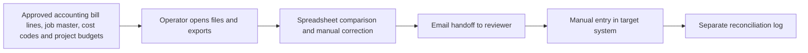
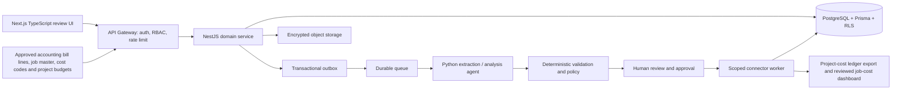

# Job-Costing / Project Ops Agents — Ideation & Strategy

[Portfolio index](../README.md) · [Phase 1](01-ideation-and-strategy.md) · [Phase 2](02-roadmapping-and-scoping.md) · [Phase 3](03-requirements-prd-frd.md) · [Phase 4](04-sprint-execution-and-triage.md) · [Phase 5](05-testing-qa-and-uat.md) · [Phase 6](06-launch-gtm-and-telemetry.md)

**Document control:** JC-P1, revision 1.0, authored 2026-10-17. Status: proposed portfolio design; implementation, customer research, tests and stakeholder approvals have not been performed.

**Source boundary:** Expansion capability, source p. 20: contractor job-costing sync and job-costing/project-ops agent offer. Detailed allocation controls are proposed. [Primary document](../../MatchClerk-Project-Implementation.pdf). Proposed architecture and assumptions are explicitly recorded in [the evidence register](../source-and-assumptions.md).

## [PM] Source objective and discovery hypothesis

Contractor invoices are coded inconsistently across accounting and project tools, producing late or duplicated job-cost reports. Map approved AP costs to valid jobs and cost codes, synchronize controlled project-cost entries, and highlight budget variance with source evidence. The beachhead is Specialty contractors with 15–150 employees, 10–100 active jobs and heavy MatchClerk job/class usage. Discovery statements below are research hypotheses, not completed interviews or observed customer outcomes.

| BR ID | Business requirement | Success evidence |
| --- | --- | --- |
| JC-BR-01 | Map approved AP costs to valid jobs and cost codes, synchronize controlled project-cost entries, and highlight budget variance with source evidence. | ≥95% of eligible spend mapped within one business day |
| JC-BR-02 | Preserve accountable human control and tenant isolation | AP remains the accounting system of record. Project entries use source-bill/line IDs to prevent a second financial expense; forecasts are separate from actuals. |
| JC-BR-03 | Recover safely from malformed input, duplicate events and partial failure | No duplicate external side effect; each failed operation is discoverable and recoverable |
| JC-BR-04 | Make operating value measurable | Allocation conservation 100%; ≥95% valid job/code mappings; project sync freshness p95 <15 minutes; zero duplicated source cost. |

### Competitive analysis

Primary vendor documentation reviewed 2026-10-17. Capability descriptions are limited to published material; tradeoff judgments are our inference. Prices and missing features are not inferred from silence. Broad-suite competitors can serve SMEs: the source's blanket market-gap assertion is a hypothesis requiring validation.

| Alternative | Published capability | Fit / evaluation question | Proposed differentiation to test |
| --- | --- | --- | --- |
| [Buildertrend](https://buildertrend.com/help-article/job-costing-budget-overview/) | Job cost and budget management for builders | Broader construction platform; compare integration versus replacement | Job-Costing / Project Ops Agents: Map approved AP costs to valid jobs and cost codes, synchronize controlled project-cost entries, and highlight budget variance with source evidence. Test evidence quality and implementation effort with the same customer scenario. |
| [Sage Construction](https://www.sage.com/en-us/sage-construction-us/job-costing/) | Construction job costing and accounting | Accounting-centered alternative; assess chart-of-cost-code migration | Job-Costing / Project Ops Agents: Map approved AP costs to valid jobs and cost codes, synchronize controlled project-cost entries, and highlight budget variance with source evidence. Test evidence quality and implementation effort with the same customer scenario. |
| [Procore](https://www.procore.com/financial-management) | Connected construction project financial and cost management | Broader construction platform; evaluate AP-to-project integration requirements | Job-Costing / Project Ops Agents: Map approved AP costs to valid jobs and cost codes, synchronize controlled project-cost entries, and highlight budget variance with source evidence. Test evidence quality and implementation effort with the same customer scenario. |

### Personas

These are designed research archetypes. Names do not represent interviewed customers.

| Persona / role | Goals | Pain points | Daily workflow | Technical proficiency |
| --- | --- | --- | --- | --- |
| Hannah — Project accountant | Keep job costs complete and reconciled | Missing job codes and duplicate imports | Review AP coding; allocate costs; reconcile job export | High accounting and spreadsheets |
| Marcus — Project manager | See actual spend against approved budget | Late cost visibility and unapproved change orders | Review job dashboard; resolve code questions | Medium construction tools |
| Ava — Controller | Reconcile project cost to ledger totals | Project reports use inconsistent tax bases | Close review; approve allocations; verify controls | High accounting systems |

### Discovery and validation plan

| Method / sample | Concrete prompt or exercise | Decision threshold | Owner |
| --- | --- | --- | --- |
| Six buyer interviews across two target segments | Walk through the last cost allocation that was delayed; show the actual handoff and current time spent. | At least 4/6 demonstrate the same core pain and name a budget owner. | PM |
| Five observed operator sessions | Process five representative records using the current workflow; time active work separately from waiting. | Observed baseline replaces the ROI estimate; at least 3/5 complete the proposed flow without coaching. | PM + UX |
| Three technical discovery workshops | Inspect source fields, permissions, data exports and failure/replay behavior in a sandbox. | All mandatory source fields map and the human control boundary is feasible. | BSA + integration lead |
| Two design partners, 30-day pilot | Compare a consented baseline cohort with a parallel-run cohort; log every correction and failure. | Achieve the product gates in Phase 5 before GA; no fabricated case study claim. | Pilot success lead |

## [PM] Vision, positioning and business case

**Vision:** For Specialty contractors with 15–150 employees, 10–100 active jobs and heavy MatchClerk job/class usage. Job-Costing / Project Ops Agents is a supervised operational product that map approved AP costs to valid jobs and cost codes, synchronize controlled project-cost entries, and highlight budget variance with source evidence. Its value is measured by approved ap spend mapped to valid jobs within one business day, with explicit evidence and human accountability.

**Value proposition:** Replace fragmented manual handoffs with one traceable work queue, typed validation and an authorized next action. The defensible wedge to test is faster deployment into the customer's existing process and clearer control evidence. Competitive superiority has not been demonstrated.

**Commercial model:** Proposed monthly subscription of USD 1,500.00 for the modeled 1,500 cost allocations; implementation USD 2,500.00. MatchClerk prices are source recommendations; expansion prices are portfolio hypotheses. No market-size estimate is invented.

| ROI input or output | Illustrative value | Calculation / interpretation |
| --- | --- | --- |
| Monthly eligible volume | 1,500 cost allocations | Model assumption; replace with pilot logs |
| Active manual handling | 4 → 1 minutes/cost allocation | Excludes waiting and assumes human review remains |
| Loaded labor rate | USD 40/hour | Illustrative input; not a wage benchmark |
| Gross monthly capacity value | USD 3,000.00 | 1500 × (4-1) / 60 × 40 |
| Net monthly value after fee | USD 1,500.00 | 3,000.00 - 1,500.00; recovered capacity is not automatically cash savings |
| Customer implementation payback | 1.67 months | One-time fee / net monthly capacity value; validate with buyer |
| Modeled monthly COGS | USD 250.00 | 1500 × 0.04 variable processing + 90 infrastructure + 100 allocated support |
| Modeled gross margin | 83.3% | Revenue less modeled COGS; excludes sales/R&D; support allocation must be validated |
| 50% realization sensitivity | USD 0.00 net/month | Half the modeled labor benefit; do not expand if measured customer value is negative |

For Full AP, component subscriptions are bundled and the infrastructure allocation includes shared component operations. For every product, cloud/API licensing and human support must be re-estimated before a commercial commitment. Break-even volume at this labor model is 750 eligible records/month. A high gross-margin estimate alone does not establish demand.

## [BSA] As-Is and To-Be feasibility

| Gap | Target design | Feasibility proof / dependency | Residual risk |
| --- | --- | --- | --- |
| Manual interpretation and missing provenance | Typed extraction with page/row evidence; deterministic rule engine | Source bill posted/approved per connector contract; valid open job and cost code; allocations sum exactly to source amount; cost basis explicit; controller approves changes. | Confidence must be evaluated on representative labeled inputs |
| No reliable handoff ownership | Role-based queue with statuses, owner and business deadline | Closed job, unmapped code, allocation imbalance or stale source revision → NEEDS_REVIEW; no sync until resolved. | Review bottleneck if staffing is insufficient |
| Fragmented target writes | Scoped adapter with operation ledger and reconciliation | Requires stable job/cost-code master, approved bill events and a contracted project-cost adapter or reviewed CSV. | Provider capabilities vary by subscription, region and API version |
| Spreadsheet access without strong isolation | Session-derived tenant, RLS, composite foreign keys and encrypted objects | Negative tenant/role tests plus restore drill before launch | Application roles and pooled DB sessions require careful reset |
| No closed-loop value evidence | Outcome events joined to source lineage and adoption cohorts | Pilot baseline plus telemetry definitions in Phase 6 | Attribution can overstate savings without a comparable baseline |

**Architectural decision:** Deploy a modular NestJS service and independent Python workers, rather than separate microservices for every feature. Use PostgreSQL as the durable source of truth, AWS SQS for ordinary background work, Redis for rate-limit counters and cache, and S3 SSE-KMS for evidence. Long-lived work state stays in PostgreSQL; queues deliver work, not authoritative approval state. Source stack options are resolved in [platform architecture](../platform-architecture.md); no implementation is claimed.

**Product-specific feasibility constraint:** Allocate tax-exclusive net line cost to job budgets by default; distribute tax separately only when tenant policy capitalizes it. Percentage splits round in minor units using largest remainder with stable tie-breaking by allocation UUID.

**Investment gate:** Fund the pilot only after the source-field mapping, control boundary and two design-partner commitments are validated. PM owns demand and economic evidence; BSA owns integration and data feasibility. Stop expansion if high-severity control defects persist or the measured benefit is below the subscription cost for two pilot reviews.
