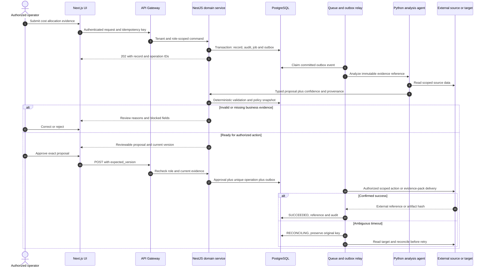
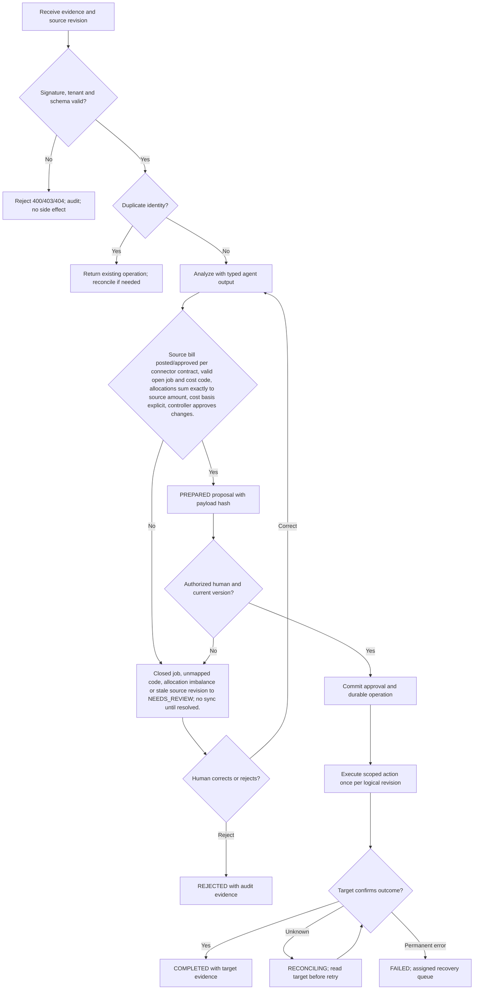

# Job-Costing / Project Ops Agents — Requirements — PRD, BRD & FRD

[Portfolio index](../README.md) · [Phase 1](01-ideation-and-strategy.md) · [Phase 2](02-roadmapping-and-scoping.md) · [Phase 3](03-requirements-prd-frd.md) · [Phase 4](04-sprint-execution-and-triage.md) · [Phase 5](05-testing-qa-and-uat.md) · [Phase 6](06-launch-gtm-and-telemetry.md)

**Document control:** JC-P3, revision 1.0, authored 2026-10-17. Status: proposed portfolio design; implementation, customer research, tests and stakeholder approvals have not been performed.

**Source boundary:** Expansion capability, source p. 20: contractor job-costing sync and job-costing/project-ops agent offer. Detailed allocation controls are proposed. [Primary document](../../MatchClerk-Project-Implementation.pdf). Proposed architecture and assumptions are explicitly recorded in [the evidence register](../source-and-assumptions.md).

## Scope, actors and requirement identity

| BR ID | Business requirement | Success evidence |
| --- | --- | --- |
| JC-BR-01 | Map approved AP costs to valid jobs and cost codes, synchronize controlled project-cost entries, and highlight budget variance with source evidence. | ≥95% of eligible spend mapped within one business day |
| JC-BR-02 | Preserve accountable human control and tenant isolation | AP remains the accounting system of record. Project entries use source-bill/line IDs to prevent a second financial expense; forecasts are separate from actuals. |
| JC-BR-03 | Recover safely from malformed input, duplicate events and partial failure | No duplicate external side effect; each failed operation is discoverable and recoverable |
| JC-BR-04 | Make operating value measurable | Allocation conservation 100%; ≥95% valid job/code mappings; project sync freshness p95 <15 minutes; zero duplicated source cost. |

FR-1 through FR-8 map one-to-one to US-1 through US-8 below. Stories 1–6 support BR-01/02, story 7 supports BR-02/04 and story 8 supports BR-03. Every action also inherits tenant isolation, audit and idempotency requirements. A proposed acceptance criterion is not an executed test result.

## [PM] User stories and strict acceptance criteria

### JC-US-1 / JC-FR-1 — Master sync

As a project accountant, I want to synchronize valid jobs and cost codes, so that I can avoid coding to inactive projects.

```gherkin
Feature: Job-Costing / Project Ops Agents Master sync
  Scenario: Master sync business contract
    Given JOB-42 is open and cost code MAT-01 is active
    When the job master refreshes
    Then both mappings appear with source revision and sync timestamp

  Scenario: Reject unauthorized or stale changes
    Given the actor lacks tenant or role permission, or the submitted version is stale
    When the same business action is attempted
    Then cross-tenant access returns 404, a disallowed role returns 403, and a stale mutation returns 409
    And no domain row, approval, or external side effect is committed
```

**Database assertion:** job.job_code='JOB-42'; cost_code.code='MAT-01'. **API:** POST `/api/v1/jobs/sync`. Read-only endpoints do not require a submitted mutation version; their negative case covers tenant and role access. 

### JC-US-2 / JC-FR-2 — Bill lineage

As a project accountant, I want to import approved bill lines once, so that I can preserve accounting provenance.

```gherkin
Feature: Job-Costing / Project Ops Agents Bill lineage
  Scenario: Bill lineage business contract
    Given bill B-1042 line 1 is approved for 1020.00
    When its event is replayed twice
    Then one source line exists and its provider, bill ID and line ID remain visible

  Scenario: Reject unauthorized or stale changes
    Given the actor lacks tenant or role permission, or the submitted version is stale
    When the same business action is attempted
    Then cross-tenant access returns 404, a disallowed role returns 403, and a stale mutation returns 409
    And no domain row, approval, or external side effect is committed
```

**Database assertion:** source_cost_line.external_bill_id='B-1042'; source_cost_line count=1. **API:** POST `/api/v1/cost-allocations`. Read-only endpoints do not require a submitted mutation version; their negative case covers tenant and role access. 

### JC-US-3 / JC-FR-3 — Valid allocation

As a project accountant, I want to allocate a line to jobs and cost codes, so that I can keep job costs accurate.

```gherkin
Feature: Job-Costing / Project Ops Agents Valid allocation
  Scenario: Valid allocation business contract
    Given source net cost is 1020.00 and two open jobs exist
    When I split 60 percent and 40 percent
    Then allocations are 612.00 and 408.00 and sum exactly to the source

  Scenario: Reject unauthorized or stale changes
    Given the actor lacks tenant or role permission, or the submitted version is stale
    When the same business action is attempted
    Then cross-tenant access returns 404, a disallowed role returns 403, and a stale mutation returns 409
    And no domain row, approval, or external side effect is committed
```

**Database assertion:** allocation_line sum(amount)=1020.00; amounts 612.00 and 408.00. **API:** PATCH `/api/v1/cost-allocations/{id}/lines`. Read-only endpoints do not require a submitted mutation version; their negative case covers tenant and role access. 

### JC-US-4 / JC-FR-4 — Closed job hold

As a project manager, I want to block charges to a closed job, so that I can prevent misleading project reports.

```gherkin
Feature: Job-Costing / Project Ops Agents Closed job hold
  Scenario: Closed job hold business contract
    Given JOB-42 is closed
    When an allocation targets its MAT-01 code
    Then the allocation enters NEEDS_REVIEW and no project export is queued

  Scenario: Reject unauthorized or stale changes
    Given the actor lacks tenant or role permission, or the submitted version is stale
    When the same business action is attempted
    Then cross-tenant access returns 404, a disallowed role returns 403, and a stale mutation returns 409
    And no domain row, approval, or external side effect is committed
```

**Database assertion:** cost_allocation.status='NEEDS_REVIEW'; external_write count=0. **API:** POST `/api/v1/cost-allocations/{id}/evaluate`. Read-only endpoints do not require a submitted mutation version; their negative case covers tenant and role access. 

### JC-US-5 / JC-FR-5 — Budget variance

As a project manager, I want to compare actual commitments and budget on the same basis, so that I can spot cost overruns.

```gherkin
Feature: Job-Costing / Project Ops Agents Budget variance
  Scenario: Budget variance business contract
    Given approved budget is 10000.00 and actual net costs reach 11000.00
    When the dashboard refreshes
    Then a 1000.00 adverse variance and 10 percent overrun are displayed without mixing forecasts

  Scenario: Reject unauthorized or stale changes
    Given the actor lacks tenant or role permission, or the submitted version is stale
    When the same business action is attempted
    Then cross-tenant access returns 404, a disallowed role returns 403, and a stale mutation returns 409
    And no domain row, approval, or external side effect is committed
```

**Database assertion:** job_budget.actual_cost=11000.00; variance=1000.00. **API:** GET `/api/v1/jobs/{id}/budget`. Read-only endpoints do not require a submitted mutation version; their negative case covers tenant and role access. 

### JC-US-6 / JC-FR-6 — Approval and sync

As a controller, I want to approve balanced allocations for project export, so that I can control downstream cost changes.

```gherkin
Feature: Job-Costing / Project Ops Agents Approval and sync
  Scenario: Approval and sync business contract
    Given source revision 4 is current and allocations balance
    When I approve the allocation
    Then one export is queued using a stable source-line allocation reference

  Scenario: Reject unauthorized or stale changes
    Given the actor lacks tenant or role permission, or the submitted version is stale
    When the same business action is attempted
    Then cross-tenant access returns 404, a disallowed role returns 403, and a stale mutation returns 409
    And no domain row, approval, or external side effect is committed
```

**Database assertion:** approval count=1; export_batch.source_revision=4. **API:** POST `/api/v1/cost-allocations/{id}/approve`. Read-only endpoints do not require a submitted mutation version; their negative case covers tenant and role access. 

### JC-US-7 / JC-FR-7 — Audit reconciliation

As a auditor, I want to reconcile exported project cost to source bills, so that I can explain every project amount.

```gherkin
Feature: Job-Costing / Project Ops Agents Audit reconciliation
  Scenario: Audit reconciliation business contract
    Given an exported allocation totals 1020.00
    When I inspect lineage
    Then source bill, line, allocation split, tax policy and reviewer are visible

  Scenario: Reject unauthorized or stale changes
    Given the actor lacks tenant or role permission, or the submitted version is stale
    When the same business action is attempted
    Then cross-tenant access returns 404, a disallowed role returns 403, and a stale mutation returns 409
    And no domain row, approval, or external side effect is committed
```

**Database assertion:** audit_event.action='ALLOCATION_APPROVED'; export_batch.reconciliation_total=1020.00. **API:** GET `/api/v1/cost-allocations/{id}/audit`. Read-only endpoints do not require a submitted mutation version; their negative case covers tenant and role access. 

### JC-US-8 / JC-FR-8 — Bill revision recovery

As a project accountant, I want to adjust a changed source bill without duplicating cost, so that I can keep projects aligned with accounting.

```gherkin
Feature: Job-Costing / Project Ops Agents Bill revision recovery
  Scenario: Bill revision recovery business contract
    Given 1020.00 was already exported and source changes to 1000.00
    When the revised event arrives
    Then a negative 20.00 adjustment proposal is created for review and the original export stays immutable

  Scenario: Reject unauthorized or stale changes
    Given the actor lacks tenant or role permission, or the submitted version is stale
    When the same business action is attempted
    Then cross-tenant access returns 404, a disallowed role returns 403, and a stale mutation returns 409
    And no domain row, approval, or external side effect is committed
```

**Database assertion:** cost_adjustment.delta_amount=-20.00; original export unchanged. **API:** POST `/api/v1/cost-allocations/{id}/source-revisions`. Read-only endpoints do not require a submitted mutation version; their negative case covers tenant and role access. Recovery acceptance: replay the source event or request and confirm the original operation identity and side-effect count.

## [BSA] Domain model and entity relationships

This diagram includes domain tables and the shared control tables required by this product. UUIDs are internal keys; external IDs remain text. Every domain table includes tenant_id, status, record_version and timestamps. Approval-bearing aggregate tables (cost_allocation) share their ID with work_record.id; API/domain updates keep both states synchronized in one transaction. A work_record specializes into exactly one aggregate type, not every linked type simultaneously.

```mermaid
erDiagram
    tenant {
        uuid id PK
        text slug UK
        text region
        text timezone
        timestamptz created_at
    }
    app_user {
        uuid id PK
        text auth_subject UK
        text email
    }
    membership {
        uuid tenant_id PK,FK
        uuid user_id PK,FK
        text role
        boolean active
    }
    tenant_policy {
        uuid id PK
        uuid tenant_id FK
        int version
        jsonb rules
        uuid approved_by FK
    }
    accounting_connection {
        uuid id PK
        uuid tenant_id FK
        text provider
        text external_org_id
        text token_secret_ref
        timestamptz last_sync_at
    }
    work_record {
        uuid id PK
        uuid tenant_id FK
        text product_code
        text status
        int record_version
        uuid policy_id FK
    }
    processing_job {
        uuid id PK
        uuid tenant_id FK
        uuid work_record_id FK
        text job_type
        text status
        int attempts
        timestamptz next_attempt_at
        text last_error_code
    }
    approval {
        uuid id PK
        uuid tenant_id FK
        uuid work_record_id FK
        uuid actor_id FK
        int approved_version
        text action
        text payload_hash
        timestamptz created_at
    }
    audit_event {
        uuid id PK
        uuid tenant_id FK
        uuid work_record_id FK
        uuid actor_id FK
        text action
        jsonb before_json
        jsonb after_json
        text previous_hash
        text event_hash
        timestamptz created_at
    }
    external_write {
        uuid id PK
        uuid tenant_id FK
        uuid work_record_id FK
        uuid connection_id FK
        uuid approval_id FK
        text idempotency_key UK
        text payload_hash
        text provider_reference
        text status
    }
    outbox_event {
        uuid id PK
        uuid tenant_id FK
        uuid work_record_id FK
        text event_type
        jsonb payload
        timestamptz published_at
    }
    consumption_receipt {
        uuid tenant_id PK,FK
        uuid event_id PK,FK
        text consumer_name PK
        timestamptz consumed_at
    }
    tenant ||--o{ membership : scopes
    app_user ||--o{ membership : joins
    tenant ||--o{ tenant_policy : defines
    app_user ||--o{ tenant_policy : approves
    tenant ||--o{ accounting_connection : connects
    tenant ||--o{ work_record : owns
    tenant_policy ||--o{ work_record : governs
    work_record ||--o{ processing_job : schedules
    work_record ||--o{ approval : authorizes
    app_user ||--o{ approval : acts
    work_record ||--o{ audit_event : traces
    app_user |o--o{ audit_event : attributes
    work_record ||--o{ external_write : writes
    accounting_connection ||--o{ external_write : routes
    approval ||--o{ external_write : permits
    work_record ||--o{ outbox_event : emits
    outbox_event ||--o{ consumption_receipt : deduplicates
    work_record ||--|| cost_allocation : specializes
    job {
        uuid id PK
        uuid tenant_id FK
        text status
        int record_version
        timestamptz created_at
        timestamptz updated_at
        text external_job_id
        text job_code
        text name
        text job_status
    }
    cost_code {
        uuid id PK
        uuid tenant_id FK
        text status
        int record_version
        timestamptz created_at
        timestamptz updated_at
        uuid job_id FK
        text code
        boolean active
    }
    source_cost_line {
        uuid id PK
        uuid tenant_id FK
        text status
        int record_version
        timestamptz created_at
        timestamptz updated_at
        text provider
        text external_bill_id
        text external_line_id
        int source_revision
        numeric net_amount "precision 18 scale 2"
        numeric tax_amount "precision 18 scale 2"
        char currency "ISO currency length 3"
    }
    cost_allocation {
        uuid id PK,FK
        uuid tenant_id FK
        text status
        int record_version
        timestamptz created_at
        timestamptz updated_at
        uuid source_cost_line_id FK
        text allocation_reference
        int source_revision
        text tax_policy
    }
    allocation_line {
        uuid id PK
        uuid tenant_id FK
        text status
        int record_version
        timestamptz created_at
        timestamptz updated_at
        uuid cost_allocation_id FK
        uuid job_id FK
        uuid cost_code_id FK
        numeric amount "precision 18 scale 2"
        numeric split_pct "precision 9 scale 6"
    }
    job_budget {
        uuid id PK
        uuid tenant_id FK
        text status
        int record_version
        timestamptz created_at
        timestamptz updated_at
        uuid job_id FK
        numeric approved_budget "precision 18 scale 2"
        numeric actual_cost "precision 18 scale 2"
        numeric committed_cost "precision 18 scale 2"
        char currency "ISO currency length 3"
    }
    export_batch {
        uuid id PK
        uuid tenant_id FK
        text status
        int record_version
        timestamptz created_at
        timestamptz updated_at
        uuid cost_allocation_id FK
        int source_revision
        text artifact_hash
        numeric reconciliation_total "precision 18 scale 2"
        text external_reference
    }
    cost_adjustment {
        uuid id PK
        uuid tenant_id FK
        text status
        int record_version
        timestamptz created_at
        timestamptz updated_at
        uuid cost_allocation_id FK
        int source_revision
        numeric delta_amount "precision 18 scale 2"
        text reason
    }
    job ||--o{ cost_code : defines
    source_cost_line ||--o{ cost_allocation : allocates
    cost_allocation ||--o{ allocation_line : splits
    job ||--o{ allocation_line : charges
    cost_code ||--o{ allocation_line : codes
    job ||--o{ job_budget : budgets
    cost_allocation ||--o{ export_batch : exports
    cost_allocation ||--o{ cost_adjustment : corrects


```



### Physical constraints and integrity rules

| Rule | Concrete implementation |
| --- | --- |
| Tenant-safe foreign keys | Tenant-owned tables have UNIQUE(tenant_id,id); intra-tenant foreign keys use (tenant_id,parent_id) → parent(tenant_id,id), even where the ER diagram abbreviates the key. Global app_user/tenant keys are exceptions; actor scope additionally references membership(tenant_id,user_id). |
| Money and quantity | numeric(18,2) for currency amounts; numeric(18,4) for quantities/unit prices; numeric(9,6) for ratios; JSON monetary values are decimal strings. ISO-4217 currency is char(3). Round only at declared posting boundaries. |
| Optimistic mutation | UPDATE work_record SET record_version=record_version+1 WHERE tenant_id=session_tenant AND id=record_id AND record_version=expected_version; zero rows → 409 STALE_VERSION. |
| Approval binding | approval stores approved_version and SHA-256 of canonical mutation payload. Unique work_record_id + approved_version + action prevents duplicate authorization. Revoke validity when business evidence changes. |
| Write identity | external_write.idempotency_key is unique and immutable; bind it to tenant, connection, record, action and business revision. A reused key with changed payload returns 409 IDEMPOTENCY_CONFLICT. |
| Event delivery | Create domain update, audit row, processing_job and outbox row in one PostgreSQL transaction. Consumption receipt unique key is (tenant_id,event_id,consumer_name). Delivery is at-least-once. |
| Audit immutability | Application roles cannot UPDATE/DELETE audit_event; daily signed hash manifest in locked object storage. System events have null actor_id and explicit service identity in after_json. |
| Indexes | CREATE INDEX on domain aggregate (tenant_id,status,created_at DESC); processing_job (status,next_attempt_at); audit_event (tenant_id,work_record_id,created_at); external_write (tenant_id,provider_reference). |
| Domain invariants | Allocate tax-exclusive net line cost to job budgets by default; distribute tax separately only when tenant policy capitalizes it. Percentage splits round in minor units using largest remainder with stable tie-breaking by allocation UUID. |
| Retention deletion | Evidence objects and operational rows follow tenant policy; audit personal identifiers are minimized and removed under verified deletion unless a documented legal hold applies. Hashes are not assumed anonymous. |

### API contract and source-to-target mapping

REST JSON over HTTPS, versioned at /api/v1. Authenticate via HttpOnly OIDC-backed session for UI and scoped service credentials for callbacks. Tenant identity never comes from a client body. All mutating requests carry Idempotency-Key; updates also carry expected_version. Body size limit is 1 MB JSON; files use signed upload. Example UUIDs are synthetic fixtures, not live data. API requests below show action inputs; the intake payload is also specified separately.

**Canonical intake example:** `{"allocation_reference":"ALLOC-J42-001","external_bill_id":"B-1042","external_line_id":"1","source_revision":4,"currency":"USD","net_amount":"1020.00","allocations":[{"job_code":"JOB-42","cost_code":"MAT-01","amount":"612.00"},{"job_code":"JOB-43","cost_code":"MAT-01","amount":"408.00"}]}`

| FRD / API ID | Method and endpoint | Request JSON | Success JSON / status | Internal target mapping | Errors |
| --- | --- | --- | --- | --- | --- |
| JC-FR-1 / API-1 | POST /api/v1/jobs/sync | `{"provider":"PROJECT_CSV","source_revision":4}` | 202 `{"id":"22222222-2222-4222-8222-222222222222","operation_id":"33333333-3333-4333-8333-333333333333","status":"SYNC_QUEUED","record_version":1,"job_code":"JOB-42","cost_code":"MAT-01"}` | source_cost_line external identity | 400 SCHEMA_INVALID; 403 POLICY_DENIED; 409 STALE_VERSION; 422 RULE_VIOLATION; 429 RATE_LIMITED |
| JC-FR-2 / API-2 | POST /api/v1/cost-allocations | `{"allocation_reference":"ALLOC-J42-001","external_bill_id":"B-1042","external_line_id":"1","source_revision":4,"currency":"USD","net_amount":"1020.00","allocations":[{"job_code":"JOB-42","cost_code":"MAT-01","amount":"612.00"},{"job_code":"JOB-43","cost_code":"MAT-01","amount":"408.00"}]}` | 202 `{"id":"22222222-2222-4222-8222-222222222222","operation_id":"33333333-3333-4333-8333-333333333333","status":"RECEIVED","record_version":4,"source_revision":4,"net_amount":"1020.00"}` | allocation_line.job_id | 400 SCHEMA_INVALID; 403 POLICY_DENIED; 409 STALE_VERSION; 422 RULE_VIOLATION; 429 RATE_LIMITED |
| JC-FR-3 / API-3 | PATCH /api/v1/cost-allocations/{id}/lines | `{"expected_version":2,"allocations":[{"job_code":"JOB-42","cost_code":"MAT-01","amount":"612.00"},{"job_code":"JOB-43","cost_code":"MAT-01","amount":"408.00"}]}` | 200 `{"id":"22222222-2222-4222-8222-222222222222","operation_id":"33333333-3333-4333-8333-333333333333","status":"READY_FOR_APPROVAL","record_version":3,"allocation_total":"1020.00","balanced":true}` | allocation_line.cost_code_id | 400 SCHEMA_INVALID; 403 POLICY_DENIED; 409 STALE_VERSION; 422 RULE_VIOLATION; 429 RATE_LIMITED |
| JC-FR-4 / API-4 | POST /api/v1/cost-allocations/{id}/evaluate | `{"expected_version":3}` | 202 `{"id":"22222222-2222-4222-8222-222222222222","operation_id":"33333333-3333-4333-8333-333333333333","status":"NEEDS_REVIEW","record_version":4,"reason_code":"JOB_CLOSED"}` | source_cost_line.net_amount | 400 SCHEMA_INVALID; 403 POLICY_DENIED; 409 STALE_VERSION; 422 RULE_VIOLATION; 429 RATE_LIMITED |
| JC-FR-5 / API-5 | GET /api/v1/jobs/{id}/budget | `null` | 200 `{"id":"22222222-2222-4222-8222-222222222222","result":"BUDGET_RETURNED","record_version":4,"approved_budget":"10000.00","actual_cost":"11000.00","variance":"1000.00","overrun_pct":"10.00"}` | allocation_line.amount | 400 SCHEMA_INVALID; 403 POLICY_DENIED; 409 STALE_VERSION; 422 RULE_VIOLATION; 429 RATE_LIMITED |
| JC-FR-6 / API-6 | POST /api/v1/cost-allocations/{id}/approve | `{"expected_version":4}` | 202 `{"id":"22222222-2222-4222-8222-222222222222","operation_id":"33333333-3333-4333-8333-333333333333","status":"APPROVED","record_version":5,"source_revision":4}` | allocation_line.amount | 400 SCHEMA_INVALID; 403 POLICY_DENIED; 409 STALE_VERSION; 422 RULE_VIOLATION; 429 RATE_LIMITED |
| JC-FR-7 / API-7 | GET /api/v1/cost-allocations/{id}/audit | `null` | 200 `{"id":"22222222-2222-4222-8222-222222222222","result":"AUDIT_RETURNED","record_version":4,"source_bill":"B-1042","tax_policy":"NET_ONLY"}` | allocation_line.amount | 400 SCHEMA_INVALID; 403 POLICY_DENIED; 409 STALE_VERSION; 422 RULE_VIOLATION; 429 RATE_LIMITED |
| JC-FR-8 / API-8 | POST /api/v1/cost-allocations/{id}/source-revisions | `{"source_revision":5,"net_amount":"1000.00"}` | 202 `{"id":"22222222-2222-4222-8222-222222222222","operation_id":"33333333-3333-4333-8333-333333333333","status":"ADJUSTMENT_PROPOSED","record_version":4,"delta_amount":"-20.00","source_revision":5}` | allocation_line.amount | 400 SCHEMA_INVALID; 403 POLICY_DENIED; 409 STALE_VERSION; 422 RULE_VIOLATION; 429 RATE_LIMITED |

For 202 responses, the body reflects **acceptance state**, not final downstream success. Updates accepted at expected_version 4 return revision 5; intake creates revision 1. Independent scenario fixtures explain differing versions between rows. Clients use returned versions, not a hard-coded constant. A GET result with an artifact returns JSON metadata (download_url, expires_at, sha256); the binary is fetched through the authenticated evidence gateway. A full record response contains the fields from the domain ERD, validation reasons and provenance. Read-only policy-denial and budget checks return their decision without performing the proposed action.

| Source field / system | API field or derivation | Target table.column | Transformation and rejection rule |
| --- | --- | --- | --- |
| Accounting bill and line IDs | external_bill_id + external_line_id | source_cost_line external identity | Unique tenant+provider+bill+line |
| Job master code | allocations[].job_code | allocation_line.job_id | Resolve open job at approval time |
| Project cost code | allocations[].cost_code | allocation_line.cost_code_id | Cost code must belong to selected job |
| Bill net amount | net_amount | source_cost_line.net_amount | Tax separate; no binary floats |
| Split value | allocations[].amount | allocation_line.amount | Sum exact in minor units before approval |

| Contract | Exact rule / example |
| --- | --- |
| Error envelope | `{"error":{"code":"STALE_VERSION","message":"Record changed after review","retryable":false,"request_id":"req-fixture-17","current_version":5}}` |
| Additional statuses | 401 AUTH_REQUIRED; 404 RECORD_NOT_FOUND; 413 FILE_TOO_LARGE; 415 UNSUPPORTED_MEDIA; 424 DEPENDENCY_UNAVAILABLE; 503 TEMPORARY_UNAVAILABLE. Domain detail codes include those in the Phase 4 triage log. |
| Upload safety | PDF/PNG up to 25 MB per file; ZIP up to 25 MB compressed, 100 MB expanded, 100 members and depth 1. Reject executable MIME, path traversal, encrypted archives and malicious files; scan before extraction. |
| Paging | GET collection uses limit ≤100 and opaque cursor; deterministic created_at,id order; no unbounded full-tenant export. |
| Webhook signature | Verify provider signature on raw body before parsing. Persist provider event identity before returning 202. Provider-authenticated replay is deduplicated, not dropped based only on age. |
| Provider failure | 429 honors Retry-After; 5xx/network retries use jittered backoff. Timeout with unknown write outcome enters RECONCILING and must not issue an immediate second create. |

## [BSA] System sequence



For a product with an internal evidence-pack or event output, the final external participant means the authorized consumer or artifact store; it does not imply a financial write. AP remains the accounting system of record. Project entries use source-bill/line IDs to prevent a second financial expense; forecasts are separate from actuals.

## [BSA] Business rules and UAT/system decision flow



**State contract:** RECEIVED → ANALYZING → NEEDS_REVIEW or PREPARED → APPROVED → RUNNING → COMPLETED. Domain-specific states (such as NEEDS_REVIEW; no sync until resolved.) refine the control state; raw status transitions are never accepted from clients. REJECTED is terminal for that business revision. A corrected record creates a new revision and invalidates prior approval. FAILED/RECONCILING are explicit recovery states; only service commands with allowed transitions can change them.

## [PM & BSA] Formal sign-off record

| Document / control | Accountable stakeholder | Acceptance evidence | Decision / signature state |
| --- | --- | --- | --- |
| BRD: BR-01 to BR-04 | Economic buyer / PM | Validated problem, baseline, price and control ownership | Review required; no stakeholder signature recorded |
| PRD: US-1 to US-8 | Product owner + customer process owner | Story walkthrough and five-scenario UAT acceptance | Review required; no stakeholder signature recorded |
| FRD: API, ERD and process model | BSA + engineering lead | Mapping workshop, contract tests and migration review | Review required; no stakeholder signature recorded |
| Architecture and threat controls | Solutions architect + security owner | Capability spikes, tenant tests and restore evidence | Review required; no stakeholder signature recorded |
| Financial side-effect boundary | Customer controller | Approval, duplicate and reconciliation evidence | Review required; no stakeholder signature recorded |

Approval requires named reviewer, UTC decision timestamp, artifact revision and evidence link in the actual delivery system. This portfolio records the review mechanism without fabricating approval.
