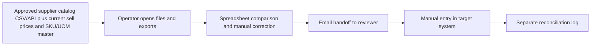
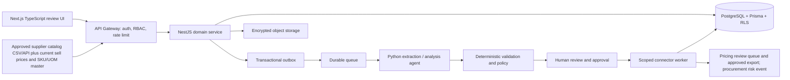

# MarginGuard — Ideation & Strategy

[Portfolio index](../README.md) · [Phase 1](01-ideation-and-strategy.md) · [Phase 2](02-roadmapping-and-scoping.md) · [Phase 3](03-requirements-prd-frd.md) · [Phase 4](04-sprint-execution-and-triage.md) · [Phase 5](05-testing-qa-and-uat.md) · [Phase 6](06-launch-gtm-and-telemetry.md)

**Document control:** MG-P1, revision 1.0, authored 2026-10-17. Status: proposed portfolio design; implementation, customer research, tests and stakeholder approvals have not been performed.

**Source boundary:** Named attachment, source p. 20: catalog price watch. Supplier-cost and margin-impact details below are proposed interpretations, not source claims. [Primary document](../../MatchClerk-Project-Implementation.pdf). Proposed architecture and assumptions are explicitly recorded in [the evidence register](../source-and-assumptions.md).

## [PM] Source objective and discovery hypothesis

Distributors discover supplier cost increases after quoting or purchasing, and spreadsheet catalog comparisons obscure unit and currency differences. Watch supplier catalog cost changes, calculate their effect on product gross margin, and route evidence-backed price or supplier review proposals to a human owner. The beachhead is Wholesale distributors with 1,000–10,000 active SKUs, repeat supplier catalogs and an accountable pricing manager. Discovery statements below are research hypotheses, not completed interviews or observed customer outcomes.

| BR ID | Business requirement | Success evidence |
| --- | --- | --- |
| MG-BR-01 | Watch supplier catalog cost changes, calculate their effect on product gross margin, and route evidence-backed price or supplier review proposals to a human owner. | ≥80% of material cost alerts reviewed within two business days |
| MG-BR-02 | Preserve accountable human control and tenant isolation | Margin estimates are operational calculations. Agents explain source deltas; a pricing owner approves every exported price recommendation. |
| MG-BR-03 | Recover safely from malformed input, duplicate events and partial failure | No duplicate external side effect; each failed operation is discoverable and recoverable |
| MG-BR-04 | Make operating value measurable | ≥99% arithmetic correctness; ≥95% alert precision for material supplier changes; ≥80% review SLA attainment. |

### Competitive analysis

Primary vendor documentation reviewed 2026-10-17. Capability descriptions are limited to published material; tradeoff judgments are our inference. Prices and missing features are not inferred from silence. Broad-suite competitors can serve SMEs: the source's blanket market-gap assertion is a hypothesis requiring validation.

| Alternative | Published capability | Fit / evaluation question | Proposed differentiation to test |
| --- | --- | --- | --- |
| [Pricefx](https://www.pricefx.com/platform/price-management/) | Price management supporting margin control | Broader pricing platform; MarginGuard starts with supplier-cost change detection | MarginGuard: Watch supplier catalog cost changes, calculate their effect on product gross margin, and route evidence-backed price or supplier review proposals to a human owner. Test evidence quality and implementation effort with the same customer scenario. |
| [Prisync](https://prisync.com/) | Competitor price tracking and dynamic pricing | Adjacent retail-price intelligence, rather than supplier-catalog reconciliation | MarginGuard: Watch supplier catalog cost changes, calculate their effect on product gross margin, and route evidence-backed price or supplier review proposals to a human owner. Test evidence quality and implementation effort with the same customer scenario. |
| [Flintfox](https://www.flintfox.com/resources/articles/price-management-guide-2/) | Price management supporting margin protection | Broader pricing solution; compare supplier-cost alerting and approved exports | MarginGuard: Watch supplier catalog cost changes, calculate their effect on product gross margin, and route evidence-backed price or supplier review proposals to a human owner. Test evidence quality and implementation effort with the same customer scenario. |

### Personas

These are designed research archetypes. Names do not represent interviewed customers.

| Persona / role | Goals | Pain points | Daily workflow | Technical proficiency |
| --- | --- | --- | --- | --- |
| Elena — Pricing manager | Protect margin before new quotes | Supplier increases appear late | Review alerts; verify catalog; approve price export | High spreadsheets; medium pricing tools |
| Nadia — Procurement manager | Challenge unexpected supplier changes | Different pack sizes create false deltas | Check supplier evidence; negotiate; monitor trend | High purchasing systems |
| Sam — Owner/CFO | See verified exposure without inflated savings | Dashboards overstate theoretical benefit | Monthly margin review and realized outcomes | Medium financial dashboards |

### Discovery and validation plan

| Method / sample | Concrete prompt or exercise | Decision threshold | Owner |
| --- | --- | --- | --- |
| Six buyer interviews across two target segments | Walk through the last catalog line change that was delayed; show the actual handoff and current time spent. | At least 4/6 demonstrate the same core pain and name a budget owner. | PM |
| Five observed operator sessions | Process five representative records using the current workflow; time active work separately from waiting. | Observed baseline replaces the ROI estimate; at least 3/5 complete the proposed flow without coaching. | PM + UX |
| Three technical discovery workshops | Inspect source fields, permissions, data exports and failure/replay behavior in a sandbox. | All mandatory source fields map and the human control boundary is feasible. | BSA + integration lead |
| Two design partners, 30-day pilot | Compare a consented baseline cohort with a parallel-run cohort; log every correction and failure. | Achieve the product gates in Phase 5 before GA; no fabricated case study claim. | Pilot success lead |

## [PM] Vision, positioning and business case

**Vision:** For Wholesale distributors with 1,000–10,000 active SKUs, repeat supplier catalogs and an accountable pricing manager. MarginGuard is a supervised operational product that watch supplier catalog cost changes, calculate their effect on product gross margin, and route evidence-backed price or supplier review proposals to a human owner. Its value is measured by verified at-risk gross margin value reviewed before the next purchase, with explicit evidence and human accountability.

**Value proposition:** Replace fragmented manual handoffs with one traceable work queue, typed validation and an authorized next action. The defensible wedge to test is faster deployment into the customer's existing process and clearer control evidence. Competitive superiority has not been demonstrated.

**Commercial model:** Proposed monthly subscription of USD 1,000.00 for the modeled 1,000 catalog line changes; implementation USD 1,500.00. MatchClerk prices are source recommendations; expansion prices are portfolio hypotheses. No market-size estimate is invented.

| ROI input or output | Illustrative value | Calculation / interpretation |
| --- | --- | --- |
| Monthly eligible volume | 1,000 catalog line changes | Model assumption; replace with pilot logs |
| Active manual handling | 5 → 1 minutes/catalog line change | Excludes waiting and assumes human review remains |
| Loaded labor rate | USD 45/hour | Illustrative input; not a wage benchmark |
| Gross monthly capacity value | USD 3,000.00 | 1000 × (5-1) / 60 × 45 |
| Net monthly value after fee | USD 2,000.00 | 3,000.00 - 1,000.00; recovered capacity is not automatically cash savings |
| Customer implementation payback | 0.75 months | One-time fee / net monthly capacity value; validate with buyer |
| Modeled monthly COGS | USD 130.00 | 1000 × 0.03 variable processing + 50 infrastructure + 50 allocated support |
| Modeled gross margin | 87.0% | Revenue less modeled COGS; excludes sales/R&D; support allocation must be validated |
| 50% realization sensitivity | USD 500.00 net/month | Half the modeled labor benefit; do not expand if measured customer value is negative |

For Full AP, component subscriptions are bundled and the infrastructure allocation includes shared component operations. For every product, cloud/API licensing and human support must be re-estimated before a commercial commitment. Break-even volume at this labor model is 334 eligible records/month. A high gross-margin estimate alone does not establish demand.

## [BSA] As-Is and To-Be feasibility

| Gap | Target design | Feasibility proof / dependency | Residual risk |
| --- | --- | --- | --- |
| Manual interpretation and missing provenance | Typed extraction with page/row evidence; deterministic rule engine | Exact tenant/supplier/SKU/UOM/currency mapping; catalog effective date valid; baseline not stale; change ≥3% or margin falls below 25%; analyst confirms recommendation. | Confidence must be evaluated on representative labeled inputs |
| No reliable handoff ownership | Role-based queue with statuses, owner and business deadline | Unknown unit, stale FX, missing sell price or overlapping catalog validity → NEEDS_REVIEW; no automatic storefront repricing. | Review bottleneck if staffing is insufficient |
| Fragmented target writes | Scoped adapter with operation ledger and reconciliation | Requires authoritative SKU/UOM mapping, supplier catalog consent and sell-price data. Procurement integration is optional. | Provider capabilities vary by subscription, region and API version |
| Spreadsheet access without strong isolation | Session-derived tenant, RLS, composite foreign keys and encrypted objects | Negative tenant/role tests plus restore drill before launch | Application roles and pooled DB sessions require careful reset |
| No closed-loop value evidence | Outcome events joined to source lineage and adoption cohorts | Pilot baseline plus telemetry definitions in Phase 6 | Attribution can overstate savings without a comparable baseline |

**Architectural decision:** Deploy a modular NestJS service and independent Python workers, rather than separate microservices for every feature. Use PostgreSQL as the durable source of truth, AWS SQS for ordinary background work, Redis for rate-limit counters and cache, and S3 SSE-KMS for evidence. Long-lived work state stays in PostgreSQL; queues deliver work, not authoritative approval state. Source stack options are resolved in [platform architecture](../platform-architecture.md); no implementation is claimed.

**Product-specific feasibility constraint:** Gross margin = (net sell price - comparable unit cost) / net sell price. A cost increase from 100.00 to 104.00 at sell price 140.00 moves margin from 28.57% to 25.71%. Alert ≥3% cost change; hard review if resulting margin <25%. Never equate margin percentage with markup.

**Investment gate:** Fund the pilot only after the source-field mapping, control boundary and two design-partner commitments are validated. PM owns demand and economic evidence; BSA owns integration and data feasibility. Stop expansion if high-severity control defects persist or the measured benefit is below the subscription cost for two pilot reviews.
