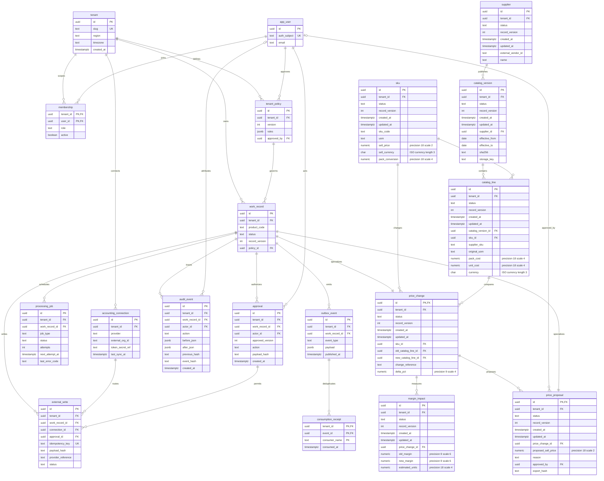
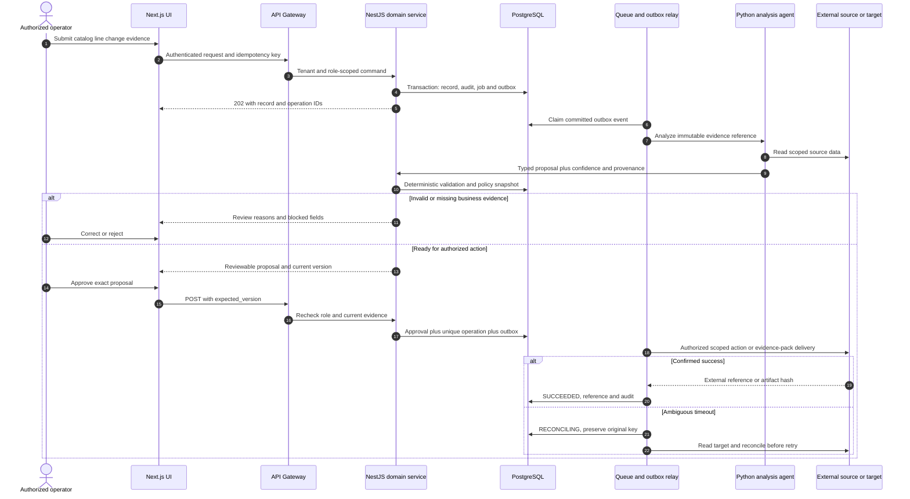
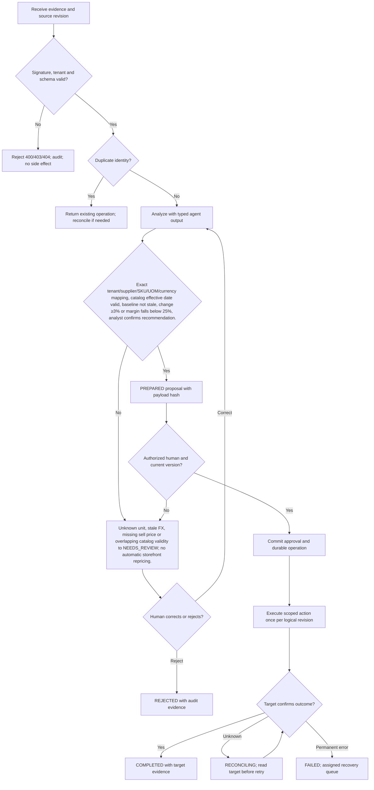

# MarginGuard — Requirements — PRD, BRD & FRD

[Portfolio index](../README.md) · [Phase 1](01-ideation-and-strategy.md) · [Phase 2](02-roadmapping-and-scoping.md) · [Phase 3](03-requirements-prd-frd.md) · [Phase 4](04-sprint-execution-and-triage.md) · [Phase 5](05-testing-qa-and-uat.md) · [Phase 6](06-launch-gtm-and-telemetry.md)

**Document control:** MG-P3, revision 1.0, authored 2026-10-17. Status: proposed portfolio design; implementation, customer research, tests and stakeholder approvals have not been performed.

**Source boundary:** Named attachment, source p. 20: catalog price watch. Supplier-cost and margin-impact details below are proposed interpretations, not source claims. [Primary document](../../MatchClerk-Project-Implementation.pdf). Proposed architecture and assumptions are explicitly recorded in [the evidence register](../source-and-assumptions.md).

## Scope, actors and requirement identity

| BR ID | Business requirement | Success evidence |
| --- | --- | --- |
| MG-BR-01 | Watch supplier catalog cost changes, calculate their effect on product gross margin, and route evidence-backed price or supplier review proposals to a human owner. | ≥80% of material cost alerts reviewed within two business days |
| MG-BR-02 | Preserve accountable human control and tenant isolation | Margin estimates are operational calculations. Agents explain source deltas; a pricing owner approves every exported price recommendation. |
| MG-BR-03 | Recover safely from malformed input, duplicate events and partial failure | No duplicate external side effect; each failed operation is discoverable and recoverable |
| MG-BR-04 | Make operating value measurable | ≥99% arithmetic correctness; ≥95% alert precision for material supplier changes; ≥80% review SLA attainment. |

FR-1 through FR-8 map one-to-one to US-1 through US-8 below. Stories 1–6 support BR-01/02, story 7 supports BR-02/04 and story 8 supports BR-03. Every action also inherits tenant isolation, audit and idempotency requirements. A proposed acceptance criterion is not an executed test result.

## [PM] User stories and strict acceptance criteria

### MG-US-1 / MG-FR-1 — Catalog intake

As a pricing manager, I want to import a dated supplier catalog, so that I can establish an auditable cost baseline.

```gherkin
Feature: MarginGuard Catalog intake
  Scenario: Catalog intake business contract
    Given supplier V-77 provides a CSV effective 2027-10-15
    When I import the file
    Then a version and hash are stored and invalid rows are quarantined

  Scenario: Reject unauthorized or stale changes
    Given the actor lacks tenant or role permission, or the submitted version is stale
    When the same business action is attempted
    Then cross-tenant access returns 404, a disallowed role returns 403, and a stale mutation returns 409
    And no domain row, approval, or external side effect is committed
```

**Database assertion:** catalog_version.effective_from='2027-10-15'; catalog_version.sha256 IS NOT NULL. **API:** POST `/api/v1/price-changes`. Read-only endpoints do not require a submitted mutation version; their negative case covers tenant and role access. 

### MG-US-2 / MG-FR-2 — Comparable units

As a procurement manager, I want to normalize supplier pack units, so that I can compare equivalent costs.

```gherkin
Feature: MarginGuard Comparable units
  Scenario: Comparable units business contract
    Given baseline is 100.00 per EA and new quote is 1248.00 per BOX of twelve
    When the mapped conversion is applied
    Then comparable new unit cost is 104.00 and original pack evidence remains visible

  Scenario: Reject unauthorized or stale changes
    Given the actor lacks tenant or role permission, or the submitted version is stale
    When the same business action is attempted
    Then cross-tenant access returns 404, a disallowed role returns 403, and a stale mutation returns 409
    And no domain row, approval, or external side effect is committed
```

**Database assertion:** catalog_line.unit_cost=104.0000; sku.uom='EA'. **API:** POST `/api/v1/price-changes/{id}/normalize`. Read-only endpoints do not require a submitted mutation version; their negative case covers tenant and role access. 

### MG-US-3 / MG-FR-3 — Cost delta

As a pricing manager, I want to detect material supplier increases, so that I can prioritize actionable reviews.

```gherkin
Feature: MarginGuard Cost delta
  Scenario: Cost delta business contract
    Given comparable baseline cost is 100.00 and new cost 104.00
    When the deterministic comparison runs
    Then the change is 4.00 percent and one material cost alert is opened

  Scenario: Reject unauthorized or stale changes
    Given the actor lacks tenant or role permission, or the submitted version is stale
    When the same business action is attempted
    Then cross-tenant access returns 404, a disallowed role returns 403, and a stale mutation returns 409
    And no domain row, approval, or external side effect is committed
```

**Database assertion:** price_change.delta_pct=4.0000; price_change.status='NEEDS_REVIEW'. **API:** POST `/api/v1/price-changes/{id}/evaluate`. Read-only endpoints do not require a submitted mutation version; their negative case covers tenant and role access. 

### MG-US-4 / MG-FR-4 — Margin effect

As a pricing manager, I want to see cost changes translated into gross margin, so that I can choose an informed response.

```gherkin
Feature: MarginGuard Margin effect
  Scenario: Margin effect business contract
    Given net sell price is 140.00 and cost increases from 100.00 to 104.00
    When the impact is computed
    Then old margin is 28.5714 percent and new margin 25.7143 percent with unrounded calculation retained

  Scenario: Reject unauthorized or stale changes
    Given the actor lacks tenant or role permission, or the submitted version is stale
    When the same business action is attempted
    Then cross-tenant access returns 404, a disallowed role returns 403, and a stale mutation returns 409
    And no domain row, approval, or external side effect is committed
```

**Database assertion:** margin_impact.old_margin=0.285714; margin_impact.new_margin=0.257143. **API:** GET `/api/v1/price-changes/{id}/margin-impact`. Read-only endpoints do not require a submitted mutation version; their negative case covers tenant and role access. 

### MG-US-5 / MG-FR-5 — Incomplete evidence hold

As a pricing manager, I want to hold changes with missing price evidence, so that I can avoid misleading recommendations.

```gherkin
Feature: MarginGuard Incomplete evidence hold
  Scenario: Incomplete evidence hold business contract
    Given SKU STEEL-A has no current sell price
    When a new catalog line arrives
    Then cost delta remains visible but margin is null and export is blocked

  Scenario: Reject unauthorized or stale changes
    Given the actor lacks tenant or role permission, or the submitted version is stale
    When the same business action is attempted
    Then cross-tenant access returns 404, a disallowed role returns 403, and a stale mutation returns 409
    And no domain row, approval, or external side effect is committed
```

**Database assertion:** margin_impact.new_margin IS NULL; price_change.status='NEEDS_REVIEW'. **API:** PATCH `/api/v1/price-changes/{id}/evidence`. Read-only endpoints do not require a submitted mutation version; their negative case covers tenant and role access. 

### MG-US-6 / MG-FR-6 — Approved recommendation

As a pricing manager, I want to approve a reviewed price proposal, so that I can control every price decision.

```gherkin
Feature: MarginGuard Approved recommendation
  Scenario: Approved recommendation business contract
    Given a 145.00 proposed sell price has complete evidence
    When I approve current version 4
    Then the proposal is locked and one approved-export job is queued

  Scenario: Reject unauthorized or stale changes
    Given the actor lacks tenant or role permission, or the submitted version is stale
    When the same business action is attempted
    Then cross-tenant access returns 404, a disallowed role returns 403, and a stale mutation returns 409
    And no domain row, approval, or external side effect is committed
```

**Database assertion:** price_proposal.proposed_sell_price=145.00; approval count=1. **API:** POST `/api/v1/price-changes/{id}/approve`. Read-only endpoints do not require a submitted mutation version; their negative case covers tenant and role access. 

### MG-US-7 / MG-FR-7 — Procurement signal

As a procurement manager, I want to attach a verified cost alert to an open request, so that I can review changed commitments.

```gherkin
Feature: MarginGuard Procurement signal
  Scenario: Procurement signal business contract
    Given an open procurement request uses STEEL-A at baseline 100.00
    When a verified 104.00 cost change is published
    Then the request receives a price-watch event and its buyer sees the evidence

  Scenario: Reject unauthorized or stale changes
    Given the actor lacks tenant or role permission, or the submitted version is stale
    When the same business action is attempted
    Then cross-tenant access returns 404, a disallowed role returns 403, and a stale mutation returns 409
    And no domain row, approval, or external side effect is committed
```

**Database assertion:** outbox_event.event_type='catalog.cost_changed'; consumption_receipt count=1. **API:** POST `/api/v1/price-changes/{id}/publish`. Read-only endpoints do not require a submitted mutation version; their negative case covers tenant and role access. 

### MG-US-8 / MG-FR-8 — Catalog replay

As a pricing manager, I want to reimport a supplier file safely, so that I can avoid repeated alerts.

```gherkin
Feature: MarginGuard Catalog replay
  Scenario: Catalog replay business contract
    Given catalog hash H1 was already processed
    When the same file is uploaded again
    Then the original catalog result is returned with no second price-change alert

  Scenario: Reject unauthorized or stale changes
    Given the actor lacks tenant or role permission, or the submitted version is stale
    When the same business action is attempted
    Then cross-tenant access returns 404, a disallowed role returns 403, and a stale mutation returns 409
    And no domain row, approval, or external side effect is committed
```

**Database assertion:** UNIQUE(tenant_id,supplier_id,sha256); price_change count unchanged. **API:** POST `/api/v1/price-changes/reimport`. Read-only endpoints do not require a submitted mutation version; their negative case covers tenant and role access. Recovery acceptance: replay the source event or request and confirm the original operation identity and side-effect count.

## [BSA] Domain model and entity relationships

This diagram includes domain tables and the shared control tables required by this product. UUIDs are internal keys; external IDs remain text. Every domain table includes tenant_id, status, record_version and timestamps. Approval-bearing aggregate tables (price_change, price_proposal) share their ID with work_record.id; API/domain updates keep both states synchronized in one transaction. A work_record specializes into exactly one aggregate type, not every linked type simultaneously.



### Physical constraints and integrity rules

| Rule | Concrete implementation |
| --- | --- |
| Tenant-safe foreign keys | Tenant-owned tables have UNIQUE(tenant_id,id); intra-tenant foreign keys use (tenant_id,parent_id) → parent(tenant_id,id), even where the ER diagram abbreviates the key. Global app_user/tenant keys are exceptions; actor scope additionally references membership(tenant_id,user_id). |
| Money and quantity | numeric(18,2) for currency amounts; numeric(18,4) for quantities/unit prices; numeric(9,6) for ratios; JSON monetary values are decimal strings. ISO-4217 currency is char(3). Round only at declared posting boundaries. |
| Optimistic mutation | UPDATE work_record SET record_version=record_version+1 WHERE tenant_id=session_tenant AND id=record_id AND record_version=expected_version; zero rows → 409 STALE_VERSION. |
| Approval binding | approval stores approved_version and SHA-256 of canonical mutation payload. Unique work_record_id + approved_version + action prevents duplicate authorization. Revoke validity when business evidence changes. |
| Write identity | external_write.idempotency_key is unique and immutable; bind it to tenant, connection, record, action and business revision. A reused key with changed payload returns 409 IDEMPOTENCY_CONFLICT. |
| Event delivery | Create domain update, audit row, processing_job and outbox row in one PostgreSQL transaction. Consumption receipt unique key is (tenant_id,event_id,consumer_name). Delivery is at-least-once. |
| Audit immutability | Application roles cannot UPDATE/DELETE audit_event; daily signed hash manifest in locked object storage. System events have null actor_id and explicit service identity in after_json. |
| Indexes | CREATE INDEX on domain aggregate (tenant_id,status,created_at DESC); processing_job (status,next_attempt_at); audit_event (tenant_id,work_record_id,created_at); external_write (tenant_id,provider_reference). |
| Domain invariants | Gross margin = (net sell price - comparable unit cost) / net sell price. A cost increase from 100.00 to 104.00 at sell price 140.00 moves margin from 28.57% to 25.71%. Alert ≥3% cost change; hard review if resulting margin <25%. Never equate margin percentage with markup. |
| Retention deletion | Evidence objects and operational rows follow tenant policy; audit personal identifiers are minimized and removed under verified deletion unless a documented legal hold applies. Hashes are not assumed anonymous. |

### API contract and source-to-target mapping

REST JSON over HTTPS, versioned at /api/v1. Authenticate via HttpOnly OIDC-backed session for UI and scoped service credentials for callbacks. Tenant identity never comes from a client body. All mutating requests carry Idempotency-Key; updates also carry expected_version. Body size limit is 1 MB JSON; files use signed upload. Example UUIDs are synthetic fixtures, not live data. API requests below show action inputs; the intake payload is also specified separately.

**Canonical intake example:** `{"change_reference":"COST-2027-101","supplier_external_id":"V-77","effective_from":"2027-10-15","currency":"USD","lines":[{"sku":"STEEL-A","pack_cost":"1248.0000","uom":"BOX","units_per_pack":"12.0000","sell_price":"140.00"}]}`

| FRD / API ID | Method and endpoint | Request JSON | Success JSON / status | Internal target mapping | Errors |
| --- | --- | --- | --- | --- | --- |
| MG-FR-1 / API-1 | POST /api/v1/price-changes | `{"change_reference":"COST-2027-101","supplier_external_id":"V-77","effective_from":"2027-10-15","currency":"USD","lines":[{"sku":"STEEL-A","pack_cost":"1248.0000","uom":"BOX","units_per_pack":"12.0000","sell_price":"140.00"}]}` | 202 `{"id":"22222222-2222-4222-8222-222222222222","operation_id":"33333333-3333-4333-8333-333333333333","status":"RECEIVED","record_version":1,"catalog_version":2}` | sku.sku_code | 400 SCHEMA_INVALID; 403 POLICY_DENIED; 409 STALE_VERSION; 422 RULE_VIOLATION; 429 RATE_LIMITED |
| MG-FR-2 / API-2 | POST /api/v1/price-changes/{id}/normalize | `{"sku":"STEEL-A","units_per_pack":"12.0000"}` | 202 `{"id":"22222222-2222-4222-8222-222222222222","operation_id":"33333333-3333-4333-8333-333333333333","status":"NORMALIZED","record_version":4,"unit_cost":"104.0000","uom":"EA"}` | catalog_line.unit_cost | 400 SCHEMA_INVALID; 403 POLICY_DENIED; 409 STALE_VERSION; 422 RULE_VIOLATION; 429 RATE_LIMITED |
| MG-FR-3 / API-3 | POST /api/v1/price-changes/{id}/evaluate | `{"expected_version":2}` | 202 `{"id":"22222222-2222-4222-8222-222222222222","operation_id":"33333333-3333-4333-8333-333333333333","status":"NEEDS_REVIEW","record_version":3,"delta_pct":"4.0000"}` | catalog_version.effective_from | 400 SCHEMA_INVALID; 403 POLICY_DENIED; 409 STALE_VERSION; 422 RULE_VIOLATION; 429 RATE_LIMITED |
| MG-FR-4 / API-4 | GET /api/v1/price-changes/{id}/margin-impact | `null` | 200 `{"id":"22222222-2222-4222-8222-222222222222","result":"IMPACT_RETURNED","record_version":4,"old_margin":"0.285714","new_margin":"0.257143","sell_price":"140.00"}` | sku.sell_price | 400 SCHEMA_INVALID; 403 POLICY_DENIED; 409 STALE_VERSION; 422 RULE_VIOLATION; 429 RATE_LIMITED |
| MG-FR-5 / API-5 | PATCH /api/v1/price-changes/{id}/evidence | `{"expected_version":3,"sell_price":null,"reason":"No active price"}` | 200 `{"id":"22222222-2222-4222-8222-222222222222","operation_id":"33333333-3333-4333-8333-333333333333","status":"NEEDS_REVIEW","record_version":4,"new_margin":null,"export_blocked":true}` | price_change.delta_pct | 400 SCHEMA_INVALID; 403 POLICY_DENIED; 409 STALE_VERSION; 422 RULE_VIOLATION; 429 RATE_LIMITED |
| MG-FR-6 / API-6 | POST /api/v1/price-changes/{id}/approve | `{"expected_version":4,"proposed_sell_price":"145.00"}` | 202 `{"id":"22222222-2222-4222-8222-222222222222","operation_id":"33333333-3333-4333-8333-333333333333","status":"APPROVED","record_version":5,"proposed_sell_price":"145.00"}` | price_change.delta_pct | 400 SCHEMA_INVALID; 403 POLICY_DENIED; 409 STALE_VERSION; 422 RULE_VIOLATION; 429 RATE_LIMITED |
| MG-FR-7 / API-7 | POST /api/v1/price-changes/{id}/publish | `{"expected_version":5}` | 202 `{"id":"22222222-2222-4222-8222-222222222222","operation_id":"33333333-3333-4333-8333-333333333333","status":"RELEASE_QUEUED","record_version":6,"event_type":"catalog.cost_changed"}` | price_change.delta_pct | 400 SCHEMA_INVALID; 403 POLICY_DENIED; 409 STALE_VERSION; 422 RULE_VIOLATION; 429 RATE_LIMITED |
| MG-FR-8 / API-8 | POST /api/v1/price-changes/reimport | `{"change_reference":"COST-2027-101","supplier_external_id":"V-77","effective_from":"2027-10-15","currency":"USD","lines":[{"sku":"STEEL-A","pack_cost":"1248.0000","uom":"BOX","units_per_pack":"12.0000","sell_price":"140.00"}]}` | 202 `{"id":"22222222-2222-4222-8222-222222222222","operation_id":"33333333-3333-4333-8333-333333333333","status":"RECEIVED","record_version":4,"duplicate":true}` | price_change.delta_pct | 400 SCHEMA_INVALID; 403 POLICY_DENIED; 409 STALE_VERSION; 422 RULE_VIOLATION; 429 RATE_LIMITED |

For 202 responses, the body reflects **acceptance state**, not final downstream success. Updates accepted at expected_version 4 return revision 5; intake creates revision 1. Independent scenario fixtures explain differing versions between rows. Clients use returned versions, not a hard-coded constant. A GET result with an artifact returns JSON metadata (download_url, expires_at, sha256); the binary is fetched through the authenticated evidence gateway. A full record response contains the fields from the domain ERD, validation reasons and provenance. Read-only policy-denial and budget checks return their decision without performing the proposed action.

| Source field / system | API field or derivation | Target table.column | Transformation and rejection rule |
| --- | --- | --- | --- |
| Supplier catalog SKU | lines[].sku | sku.sku_code | Require approved supplier alias; no fuzzy auto-merge |
| Pack cost and size | pack_cost / units_per_pack | catalog_line.unit_cost | 1248/12=104.0000; zero pack size rejected |
| Catalog effective date | effective_from | catalog_version.effective_from | Reject overlapping active version interval |
| Current net sell price | sell_price | sku.sell_price | Exclude sales tax; same currency required |
| Unit cost movement | delta_pct | price_change.delta_pct | 100*(new-old)/old; zero baseline requires manual review |

| Contract | Exact rule / example |
| --- | --- |
| Error envelope | `{"error":{"code":"STALE_VERSION","message":"Record changed after review","retryable":false,"request_id":"req-fixture-17","current_version":5}}` |
| Additional statuses | 401 AUTH_REQUIRED; 404 RECORD_NOT_FOUND; 413 FILE_TOO_LARGE; 415 UNSUPPORTED_MEDIA; 424 DEPENDENCY_UNAVAILABLE; 503 TEMPORARY_UNAVAILABLE. Domain detail codes include those in the Phase 4 triage log. |
| Upload safety | PDF/PNG up to 25 MB per file; ZIP up to 25 MB compressed, 100 MB expanded, 100 members and depth 1. Reject executable MIME, path traversal, encrypted archives and malicious files; scan before extraction. |
| Paging | GET collection uses limit ≤100 and opaque cursor; deterministic created_at,id order; no unbounded full-tenant export. |
| Webhook signature | Verify provider signature on raw body before parsing. Persist provider event identity before returning 202. Provider-authenticated replay is deduplicated, not dropped based only on age. |
| Provider failure | 429 honors Retry-After; 5xx/network retries use jittered backoff. Timeout with unknown write outcome enters RECONCILING and must not issue an immediate second create. |

## [BSA] System sequence



For a product with an internal evidence-pack or event output, the final external participant means the authorized consumer or artifact store; it does not imply a financial write. Margin estimates are operational calculations. Agents explain source deltas; a pricing owner approves every exported price recommendation.

## [BSA] Business rules and UAT/system decision flow



**State contract:** RECEIVED → ANALYZING → NEEDS_REVIEW or PREPARED → APPROVED → RUNNING → COMPLETED. Domain-specific states (such as NEEDS_REVIEW; no automatic storefront repricing.) refine the control state; raw status transitions are never accepted from clients. REJECTED is terminal for that business revision. A corrected record creates a new revision and invalidates prior approval. FAILED/RECONCILING are explicit recovery states; only service commands with allowed transitions can change them.

## [PM & BSA] Formal sign-off record

| Document / control | Accountable stakeholder | Acceptance evidence | Decision / signature state |
| --- | --- | --- | --- |
| BRD: BR-01 to BR-04 | Economic buyer / PM | Validated problem, baseline, price and control ownership | Review required; no stakeholder signature recorded |
| PRD: US-1 to US-8 | Product owner + customer process owner | Story walkthrough and five-scenario UAT acceptance | Review required; no stakeholder signature recorded |
| FRD: API, ERD and process model | BSA + engineering lead | Mapping workshop, contract tests and migration review | Review required; no stakeholder signature recorded |
| Architecture and threat controls | Solutions architect + security owner | Capability spikes, tenant tests and restore evidence | Review required; no stakeholder signature recorded |
| Financial side-effect boundary | Customer controller | Approval, duplicate and reconciliation evidence | Review required; no stakeholder signature recorded |

Approval requires named reviewer, UTC decision timestamp, artifact revision and evidence link in the actual delivery system. This portfolio records the review mechanism without fabricating approval.
