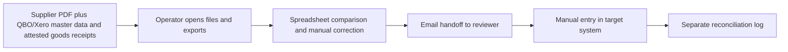
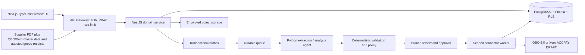

# MatchClerk — Ideation & Strategy

[Portfolio index](../README.md) · [Phase 1](01-ideation-and-strategy.md) · [Phase 2](02-roadmapping-and-scoping.md) · [Phase 3](03-requirements-prd-frd.md) · [Phase 4](04-sprint-execution-and-triage.md) · [Phase 5](05-testing-qa-and-uat.md) · [Phase 6](06-launch-gtm-and-telemetry.md)

**Document control:** MC-P1, revision 1.0, authored 2026-10-17. Status: proposed portfolio design; implementation, customer research, tests and stakeholder approvals have not been performed.

**Source boundary:** Fully specified product; source pp. 1–19 and 21–22, F1–F18, NF1–NF8. [Primary document](../../MatchClerk-Project-Implementation.pdf). Proposed architecture and assumptions are explicitly recorded in [the evidence register](../source-and-assumptions.md).

## [PM] Source objective and discovery hypothesis

SME finance teams re-key supplier PDFs, chase delivery evidence and reconcile PO differences during close; the source estimates 10–20+ hours of weekly effort. Extract supplier invoice lines, match invoices to purchase orders and receiving evidence, suggest accounting codes, and create QBO/Xero bills after human approval. The beachhead is Controllers and operations directors at real-estate operators, specialty contractors and wholesale distributors with 15–150 employees and 200–2,000 supplier invoices/month. Discovery statements below are research hypotheses, not completed interviews or observed customer outcomes.

| BR ID | Business requirement | Success evidence |
| --- | --- | --- |
| MC-BR-01 | Extract supplier invoice lines, match invoices to purchase orders and receiving evidence, suggest accounting codes, and create QBO/Xero bills after human approval. | ≥70% of approved invoices by pilot day 90 |
| MC-BR-02 | Preserve accountable human control and tenant isolation | No accounting write before controller approval. No payment execution. QBO drafts live internally; Xero DRAFT creation also waits for approval in this design. |
| MC-BR-03 | Recover safely from malformed input, duplicate events and partial failure | No duplicate external side effect; each failed operation is discoverable and recoverable |
| MC-BR-04 | Make operating value measurable | Extraction critical-header exact match ≥85%; line-amount F1 ≥80%; operational line-field accuracy ≥85%; auto-match ≥70%; five paying logos and controller NPS ≥40 by day 90. |

### Competitive analysis

Primary vendor documentation reviewed 2026-10-17. Capability descriptions are limited to published material; tradeoff judgments are our inference. Prices and missing features are not inferred from silence. Broad-suite competitors can serve SMEs: the source's blanket market-gap assertion is a hypothesis requiring validation.

| Alternative | Published capability | Fit / evaluation question | Proposed differentiation to test |
| --- | --- | --- | --- |
| [BILL](https://www.bill.com/product/accounts-payable/) | Invoice capture, approvals and two/three-way matching | Broader AP/payment suite; validate plan and connector fit in a demo | MatchClerk: Extract supplier invoice lines, match invoices to purchase orders and receiving evidence, suggest accounting codes, and create QBO/Xero bills after human approval. Test evidence quality and implementation effort with the same customer scenario. |
| [Ramp](https://support.ramp.com/3-way-match-with-ramp-procurement/) | Bill-to-PO-to-item-receipt matching | Receiving and imported-PO capabilities depend on plan and ERP | MatchClerk: Extract supplier invoice lines, match invoices to purchase orders and receiving evidence, suggest accounting codes, and create QBO/Xero bills after human approval. Test evidence quality and implementation effort with the same customer scenario. |
| [Dext](https://help.dext.com/en/articles/416705-getting-started-with-dext-for-businesses) | Capture invoices and publish extracted data to accounting | Evaluate the complete receipt matching workflow rather than assume capture is equivalent | MatchClerk: Extract supplier invoice lines, match invoices to purchase orders and receiving evidence, suggest accounting codes, and create QBO/Xero bills after human approval. Test evidence quality and implementation effort with the same customer scenario. |

### Personas

These are designed research archetypes. Names do not represent interviewed customers.

| Persona / role | Goals | Pain points | Daily workflow | Technical proficiency |
| --- | --- | --- | --- | --- |
| Priya — AP clerk | Clear the inbox accurately before daily cutoff | Re-keying and unclear PO ownership | 08:30 inbox; 10:00 corrections; 15:00 approval follow-up | Medium: spreadsheets and accounting UI |
| Ava — Controller | Close on time with defensible approval evidence | Wrong GL coding and duplicate liabilities | 09:00 queue review; 13:00 vendor exceptions; 17:00 close checks | High finance expertise; medium software proficiency |
| Marcus — Operations manager | Confirm receipts and protect job costs | Partial delivery evidence arrives by text | Site delivery check; PO lookup; job-code confirmation | Medium: mobile forms and PO reports |

### Discovery and validation plan

| Method / sample | Concrete prompt or exercise | Decision threshold | Owner |
| --- | --- | --- | --- |
| Six buyer interviews across two target segments | Walk through the last invoice that was delayed; show the actual handoff and current time spent. | At least 4/6 demonstrate the same core pain and name a budget owner. | PM |
| Five observed operator sessions | Process five representative records using the current workflow; time active work separately from waiting. | Observed baseline replaces the ROI estimate; at least 3/5 complete the proposed flow without coaching. | PM + UX |
| Three technical discovery workshops | Inspect source fields, permissions, data exports and failure/replay behavior in a sandbox. | All mandatory source fields map and the human control boundary is feasible. | BSA + integration lead |
| Two design partners, 30-day pilot | Compare a consented baseline cohort with a parallel-run cohort; log every correction and failure. | Achieve the product gates in Phase 5 before GA; no fabricated case study claim. | Pilot success lead |

## [PM] Vision, positioning and business case

**Vision:** For Controllers and operations directors at real-estate operators, specialty contractors and wholesale distributors with 15–150 employees and 200–2,000 supplier invoices/month. MatchClerk is a supervised operational product that extract supplier invoice lines, match invoices to purchase orders and receiving evidence, suggest accounting codes, and create QBO/Xero bills after human approval. Its value is measured by approved invoices/week with less than 60 seconds of active human handling, with explicit evidence and human accountability.

**Value proposition:** Replace fragmented manual handoffs with one traceable work queue, typed validation and an authorized next action. The defensible wedge to test is faster deployment into the customer's existing process and clearer control evidence. Competitive superiority has not been demonstrated.

**Commercial model:** Proposed monthly subscription of USD 1,500.00 for the modeled 2,000 invoices; implementation USD 1,500.00. MatchClerk prices are source recommendations; expansion prices are portfolio hypotheses. No market-size estimate is invented.

| ROI input or output | Illustrative value | Calculation / interpretation |
| --- | --- | --- |
| Monthly eligible volume | 2,000 invoices | Model assumption; replace with pilot logs |
| Active manual handling | 6 → 1 minutes/invoice | Excludes waiting and assumes human review remains |
| Loaded labor rate | USD 35/hour | Illustrative input; not a wage benchmark |
| Gross monthly capacity value | USD 5,833.33 | 2000 × (6-1) / 60 × 35 |
| Net monthly value after fee | USD 4,333.33 | 5,833.33 - 1,500.00; recovered capacity is not automatically cash savings |
| Customer implementation payback | 0.35 months | One-time fee / net monthly capacity value; validate with buyer |
| Modeled monthly COGS | USD 275.00 | 2000 × 0.10 variable processing + 55 infrastructure + 20 allocated support |
| Modeled gross margin | 81.7% | Revenue less modeled COGS; excludes sales/R&D; support allocation must be validated |
| 50% realization sensitivity | USD 1,416.67 net/month | Half the modeled labor benefit; do not expand if measured customer value is negative |

For Full AP, component subscriptions are bundled and the infrastructure allocation includes shared component operations. For every product, cloud/API licensing and human support must be re-estimated before a commercial commitment. Break-even volume at this labor model is 515 eligible records/month. A high gross-margin estimate alone does not establish demand.

## [BSA] As-Is and To-Be feasibility

| Gap | Target design | Feasibility proof / dependency | Residual risk |
| --- | --- | --- | --- |
| Manual interpretation and missing provenance | Typed extraction with page/row evidence; deterministic rule engine | Extraction confidence ≥0.85; unique vendor/invoice key; valid arithmetic; unambiguous PO; received quantity covers billed quantity; price variance within policy; GL code present. | Confidence must be evaluated on representative labeled inputs |
| No reliable handoff ownership | Role-based queue with statuses, owner and business deadline | Missing receipt in THREE_WAY mode → AWAITING_RECEIPT; ambiguous match or unexplained totals → NEEDS_REVIEW. | Review bottleneck if staffing is insufficient |
| Fragmented target writes | Scoped adapter with operation ledger and reconciliation | QBO/Xero OAuth plus PO capability spike and an attested receipt source are prerequisites. | Provider capabilities vary by subscription, region and API version |
| Spreadsheet access without strong isolation | Session-derived tenant, RLS, composite foreign keys and encrypted objects | Negative tenant/role tests plus restore drill before launch | Application roles and pooled DB sessions require careful reset |
| No closed-loop value evidence | Outcome events joined to source lineage and adoption cohorts | Pilot baseline plus telemetry definitions in Phase 6 | Attribution can overstate savings without a comparable baseline |

**Architectural decision:** Deploy a modular NestJS service and independent Python workers, rather than separate microservices for every feature. Use PostgreSQL as the durable source of truth, AWS SQS for ordinary background work, Redis for rate-limit counters and cache, and S3 SSE-KMS for evidence. Long-lived work state stays in PostgreSQL; queues deliver work, not authoritative approval state. Source stack options are resolved in [platform architecture](../platform-architecture.md); no implementation is claimed.

**Product-specific feasibility constraint:** Default allowed price variance is max(1% of comparable PO line net amount, 2.00 invoice-currency units), or min when REQUIRE_BOTH is enabled. Quantity tolerance is zero. Compare tax separately; do not allow an aggregate total to hide a line overcharge.

**Investment gate:** Fund the pilot only after the source-field mapping, control boundary and two design-partner commitments are validated. PM owns demand and economic evidence; BSA owns integration and data feasibility. Stop expansion if high-severity control defects persist or the measured benefit is below the subscription cost for two pilot reviews.
