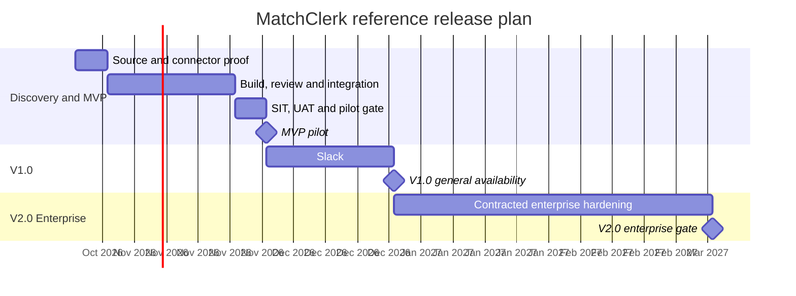

# MatchClerk — Roadmapping & Scoping

[Portfolio index](../README.md) · [Phase 1](01-ideation-and-strategy.md) · [Phase 2](02-roadmapping-and-scoping.md) · [Phase 3](03-requirements-prd-frd.md) · [Phase 4](04-sprint-execution-and-triage.md) · [Phase 5](05-testing-qa-and-uat.md) · [Phase 6](06-launch-gtm-and-telemetry.md)

**Document control:** MC-P2, revision 1.0, authored 2026-10-17. Status: proposed portfolio design; implementation, customer research, tests and stakeholder approvals have not been performed.

**Source boundary:** Fully specified product; source pp. 1–19 and 21–22, F1–F18, NF1–NF8. [Primary document](../../MatchClerk-Project-Implementation.pdf). Proposed architecture and assumptions are explicitly recorded in [the evidence register](../source-and-assumptions.md).

## [PM] Release strategy and roadmap

Planning baseline starts 2026-10-19; these are scenario dates, not funded delivery promises. One six-week core MatchClerk build follows the source; expansion MVP durations are estimates. Dependencies and shared specialist capacity can move dates. All changes pass the gates in Phase 5.

| Quarter | Milestone / target date | Scope | Exit gate / owner |
| --- | --- | --- | --- |
| 2026 Q4 | Discovery starts 2026-10-19 | Integration evidence, baseline research and architecture decisions | Two partners plus source capability proof / PM + BSA |
| 2026 Q4 | MVP → 2026-11-30 | PDF/PNG/ZIP upload; tenant email routing; header and line extraction; both QBO and Xero connectors; 2/3-way matching; tolerances; GL suggestions; human approval; audit; tenant administration; exact duplicate-write prevention | All Must stories accepted and no critical control defect / PM + BSA |
| 2026 Q4 | V1.0 → 2026-12-28 | Slack, fuzzy duplicate triage, job/class fields and CSV export | Two paid cohorts meet outcome and service targets / PM |
| 2027 Q1 | V2.0 Enterprise → 2027-03-08 | Multi-entity workspaces and NetSuite adapter under separate entitlement tests | Contracted connector proof, restore test, security evidence and revised capacity plan / architect |

MatchClerk portfolio V1.0 consolidates the source's weeks 7–10 v1.1 scope; version names here are planning labels. The [portfolio index](../README.md) shows the proposed expansion sequence. An MVP date cannot imply every downstream connector is available.

## [PM] MoSCoW scope contract

| Priority | Committed decision | Rationale / release treatment |
| --- | --- | --- |
| Must-have | PDF/PNG/ZIP upload; tenant email routing; header and line extraction; both QBO and Xero connectors; 2/3-way matching; tolerances; GL suggestions; human approval; audit; tenant administration; exact duplicate-write prevention | Needed for the core outcome or a financial/tenant control; absent capability blocks pilot release |
| Should-have | Slack approval; fuzzy duplicate suggestions; contractor dimensions; CSV reports | Improves adoption or efficiency; can ship after control gates are stable |
| Could-have | Statement-assist preview and secondary currency review using provider FX | Experiment only after pilot demand and measurable incremental value |
| Won’t-have in this planning horizon | Autonomous payments; tax advice; supplier network; native mobile app; replacing the ledger | Explicitly excluded; a new business case and control design are required to reconsider |

### RICE model: ten ranked features

Reach is eligible invoices affected per quarter in one representative account; total potential quarterly reach is 2000. Features overlap, so reach values must not be summed. Impact uses 3=massive, 2=high, 1=medium, 0.5=low; confidence is a fraction; effort is cross-functional person-weeks. **Score = reach × impact × confidence / effort.** Inputs are estimates, not measured adoption. A high score cannot displace mandatory security, approval or integrity controls.

| Rank | Feature | Reach / quarter | Impact | Confidence | Effort / person-weeks | Final score |
| --- | --- | --- | --- | --- | --- | --- |
| 1 | Secure invoice intake | 2000 | 3 | 85% | 3 | 1700.00 |
| 2 | Line extraction and arithmetic validation | 1800 | 3 | 80% | 4 | 1080.00 |
| 3 | PO and receipt matching | 1700 | 3 | 80% | 4 | 1020.00 |
| 4 | Human review and approval | 1600 | 2 | 80% | 3 | 853.33 |
| 5 | QBO bill connector | 1500 | 3 | 75% | 4 | 843.75 |
| 6 | Xero draft connector | 1400 | 2 | 80% | 3 | 746.67 |
| 7 | Vendor GL rules | 1200 | 2 | 70% | 3 | 560.00 |
| 8 | Audit and exact deduplication | 1000 | 1 | 65% | 2 | 325.00 |
| 9 | Slack approvals | 600 | 1 | 60% | 2 | 180.00 |
| 10 | Statement assist | 400 | 0.5 | 50% | 6 | 16.67 |

**Sequencing rule:** Deliver Must controls and integration proof first, then highest-scoring feasible workflow features. Re-score after the first 100 eligible records or four pilot weeks, whichever comes first. Record changes with evidence in the next Phase 1 revision.

## [BSA] Non-functional requirements

All values are proposed acceptance targets unless identified as source-derived. Percentiles are calculated on successful and failed eligible operations, with timeouts included at their timeout value; do not hide failed work from latency reporting.

| ID | Dimension | Concrete requirement | Measurement / release proof |
| --- | --- | --- | --- |
| MC-NFR-01 | Capacity | 50 tenants × 2,000 invoices/month = 100,000/month; 250 concurrent UI sessions. | Load a representative 100,000-row tenant history; run a 60-minute mixed workload. |
| MC-NFR-02 | Throughput and queue | API accepts 10 requests/sec sustained. Expensive new jobs: 0.25/sec sustained and 0.5/sec for 60 sec; 32 worker slots scaling to 64. | Rate-limit excess costly work explicitly with 429 + Retry-After; maintain queue wait p95 <15 sec under the declared profile. |
| MC-NFR-03 | API latency | Read p95 ≤400 ms / p99 ≤1000 ms; accepted mutations p95 ≤600 ms / p99 ≤1500 ms. | Excludes agent/provider processing from synchronous handler; measure full async journey separately. |
| MC-NFR-04 | Agent and end-to-end latency | Agent p95 <90 sec; automated intake-to-review-ready p95 <180 sec for supported-size inputs. | Human waiting is excluded from automated duration and reported separately. Source NF1/NF2: ≤10 pages and p95 <90 sec extraction / <3 min draft-ready. |
| MC-NFR-05 | Availability | MVP 99.5% monthly 24×7 API availability; GA target 99.9% after observed pilot reliability. | MVP error budget 216 min per 30-day month; GA 43.2 min. Source business-hour-weighted 99.5% is retained as a comparison, with calendar coverage proposed here. |
| MC-NFR-06 | Identity and authorization | OIDC login; MFA for OWNER and CONTROLLER; explicit RBAC on every request; short-lived sessions; 10-minute single-use email action nonce. | GET never approves. Link opens review; authenticated POST plus CSRF control performs action. Test every role and tenant negative case. |
| MC-NFR-07 | Encryption and isolation | TLS 1.2+; AES-256 managed encryption for DB/S3; KMS envelope encryption for OAuth tokens; tenant RLS with FORCE ROW LEVEL SECURITY. | Session-derived tenant only; composite tenant foreign keys; signed object URLs expire in 60 sec; no public bucket. |
| MC-NFR-08 | SOC 2 control readiness | Access reviews quarterly, change approvals, incident records, vendor DPAs and recovery evidence; no claim of SOC 2 certification. | Security owner maintains control/evidence register; audit report required before any certification claim. |
| MC-NFR-09 | Recovery and durability | Database PITR 30 days; RPO ≤15 min and RTO ≤4 hours; restore drill before launch and quarterly. | SQS retention 14 days, DLQ redrive via operation ledger; object versioning; encrypted backup restore proof. |
| MC-NFR-10 | Privacy and AI handling | Raw evidence default retention 24 months; active-store deletion within 30 days of verified offboarding request; backups age out within another 30 days unless legal hold. | Region-pinned EU deployment by default; approved inference vendors only; no training on tenant data; zero retention only when contractually supported. |
| MC-NFR-11 | Accessibility | WCAG 2.1 AA on onboarding, review and approval; full keyboard path and screen-reader labels. | Manual keyboard/screen-reader review plus automated checks; no critical accessibility blocker. |
| MC-NFR-12 | Correctness and observability | Decimal money; UTC timestamps plus tenant timezone; source lineage, actor and operation IDs on each mutation. | No duplicate external effects under replay tests; no prompt/PDF/token content in application logs. |

**Dependency constraint:** QBO/Xero OAuth plus PO capability spike and an attested receipt source are prerequisites. **Business-rule constraint:** Default allowed price variance is max(1% of comparable PO line net amount, 2.00 invoice-currency units), or min when REQUIRE_BOTH is enabled. Quantity tolerance is zero. Compare tax separately; do not allow an aggregate total to hide a line overcharge. API licenses and entitlement checks are paid dependencies, not assumed free infrastructure. Current provider constraints and the architecture decision record live in [platform architecture](../platform-architecture.md).
