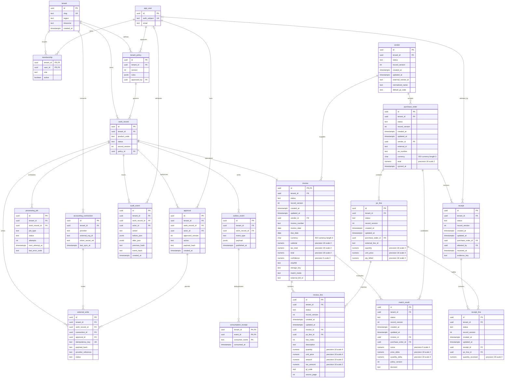
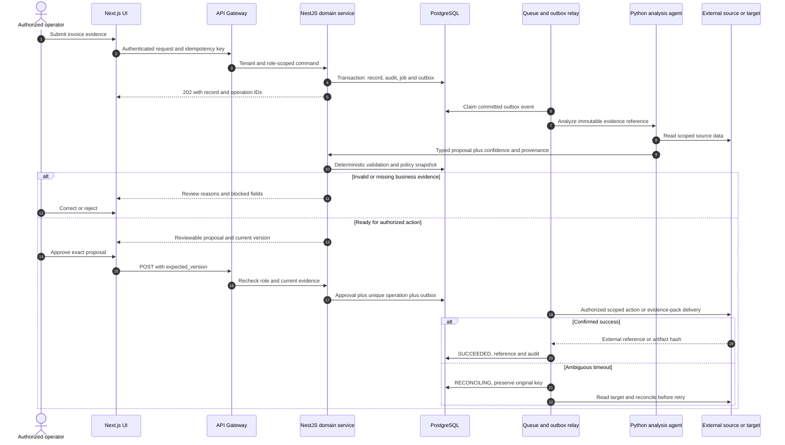
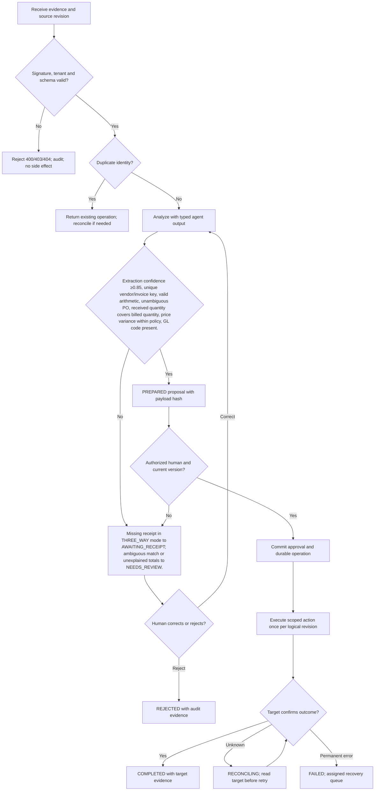

# MatchClerk — Requirements — PRD, BRD & FRD

[Portfolio index](../README.md) · [Phase 1](01-ideation-and-strategy.md) · [Phase 2](02-roadmapping-and-scoping.md) · [Phase 3](03-requirements-prd-frd.md) · [Phase 4](04-sprint-execution-and-triage.md) · [Phase 5](05-testing-qa-and-uat.md) · [Phase 6](06-launch-gtm-and-telemetry.md)

**Document control:** MC-P3, revision 1.0, authored 2026-10-17. Status: proposed portfolio design; implementation, customer research, tests and stakeholder approvals have not been performed.

**Source boundary:** Fully specified product; source pp. 1–19 and 21–22, F1–F18, NF1–NF8. [Primary document](../../MatchClerk-Project-Implementation.pdf). Proposed architecture and assumptions are explicitly recorded in [the evidence register](../source-and-assumptions.md).

## Scope, actors and requirement identity

| BR ID | Business requirement | Success evidence |
| --- | --- | --- |
| MC-BR-01 | Extract supplier invoice lines, match invoices to purchase orders and receiving evidence, suggest accounting codes, and create QBO/Xero bills after human approval. | ≥70% of approved invoices by pilot day 90 |
| MC-BR-02 | Preserve accountable human control and tenant isolation | No accounting write before controller approval. No payment execution. QBO drafts live internally; Xero DRAFT creation also waits for approval in this design. |
| MC-BR-03 | Recover safely from malformed input, duplicate events and partial failure | No duplicate external side effect; each failed operation is discoverable and recoverable |
| MC-BR-04 | Make operating value measurable | Extraction critical-header exact match ≥85%; line-amount F1 ≥80%; operational line-field accuracy ≥85%; auto-match ≥70%; five paying logos and controller NPS ≥40 by day 90. |

FR-1 through FR-8 map one-to-one to US-1 through US-8 below. Stories 1–6 support BR-01/02, story 7 supports BR-02/04 and story 8 supports BR-03. Every action also inherits tenant isolation, audit and idempotency requirements. A proposed acceptance criterion is not an executed test result.

## [PM] User stories and strict acceptance criteria

### MC-US-1 / MC-FR-1 — Secure intake

As a AP clerk, I want to upload a supplier PDF, so that I can begin processing without re-keying.

```gherkin
Feature: MatchClerk Secure intake
  Scenario: Secure intake business contract
    Given a signed-in clerk and a clean 2-page PDF of 2 MB
    When the upload completes
    Then the invoice appears as RECEIVED within 5 seconds and one processing job exists

  Scenario: Reject unauthorized or stale changes
    Given the actor lacks tenant or role permission, or the submitted version is stale
    When the same business action is attempted
    Then cross-tenant access returns 404, a disallowed role returns 403, and a stale mutation returns 409
    And no domain row, approval, or external side effect is committed
```

**Database assertion:** invoice.status='RECEIVED'; processing_job count=1. **API:** POST `/api/v1/invoices/upload`. Read-only endpoints do not require a submitted mutation version; their negative case covers tenant and role access. 

### MC-US-2 / MC-FR-2 — Extraction

As a AP clerk, I want to correct extracted line fields beside the source, so that I can resolve low-confidence data before matching.

```gherkin
Feature: MatchClerk Extraction
  Scenario: Extraction business contract
    Given INV-1042 has ten units at 100.00 and tax 20.00
    When the extractor returns total 1020.00 with confidence 0.91
    Then ten units, subtotal 1000.00 and tax 20.00 are persisted as decimal strings and source-page provenance is visible

  Scenario: Reject unauthorized or stale changes
    Given the actor lacks tenant or role permission, or the submitted version is stale
    When the same business action is attempted
    Then cross-tenant access returns 404, a disallowed role returns 403, and a stale mutation returns 409
    And no domain row, approval, or external side effect is committed
```

**Database assertion:** invoice.total=1020.00; invoice_line.quantity=10.0000. **API:** POST `/api/v1/invoices/{id}/extract`. Read-only endpoints do not require a submitted mutation version; their negative case covers tenant and role access. 

### MC-US-3 / MC-FR-3 — Three-way match

As a operations manager, I want to match the invoice to receipt-covered PO lines, so that I can avoid billing unreceived goods.

```gherkin
Feature: MatchClerk Three-way match
  Scenario: Three-way match business contract
    Given PO-501 has ten units ordered but eight attested as received
    When ten units are invoiced in THREE_WAY mode
    Then the case becomes AWAITING_RECEIPT and no accounting write is queued

  Scenario: Reject unauthorized or stale changes
    Given the actor lacks tenant or role permission, or the submitted version is stale
    When the same business action is attempted
    Then cross-tenant access returns 404, a disallowed role returns 403, and a stale mutation returns 409
    And no domain row, approval, or external side effect is committed
```

**Database assertion:** invoice.status='AWAITING_RECEIPT'; external_write count=0. **API:** POST `/api/v1/invoices/{id}/match`. Read-only endpoints do not require a submitted mutation version; their negative case covers tenant and role access. 

### MC-US-4 / MC-FR-4 — Tolerance policy

As a controller, I want to configure price and quantity tolerances, so that I can apply consistent financial controls.

```gherkin
Feature: MatchClerk Tolerance policy
  Scenario: Tolerance policy business contract
    Given PO net line is 1000.00 and policy is 1 percent or 2.00 maximum allowance
    When an invoice line is 1012.00
    Then the 12.00 delta exceeds the 10.00 allowance and NEEDS_REVIEW records the calculation

  Scenario: Reject unauthorized or stale changes
    Given the actor lacks tenant or role permission, or the submitted version is stale
    When the same business action is attempted
    Then cross-tenant access returns 404, a disallowed role returns 403, and a stale mutation returns 409
    And no domain row, approval, or external side effect is committed
```

**Database assertion:** match_result.price_delta=12.00; invoice.status='NEEDS_REVIEW'. **API:** PATCH `/api/v1/settings/matching`. Read-only endpoints do not require a submitted mutation version; their negative case covers tenant and role access. 

### MC-US-5 / MC-FR-5 — Approval and QBO write

As a controller, I want to approve a reviewed bill once, so that I can create one authorized liability.

```gherkin
Feature: MatchClerk Approval and QBO write
  Scenario: Approval and QBO write business contract
    Given all mandatory evidence is valid and invoice version is 4
    When two approve requests carry the same idempotency key and expected_version 4
    Then one approval and one QBO Bill write occur and both clients receive the same operation ID

  Scenario: Reject unauthorized or stale changes
    Given the actor lacks tenant or role permission, or the submitted version is stale
    When the same business action is attempted
    Then cross-tenant access returns 404, a disallowed role returns 403, and a stale mutation returns 409
    And no domain row, approval, or external side effect is committed
```

**Database assertion:** approval count=1; external_write count=1; external_bill_id IS NOT NULL after success. **API:** POST `/api/v1/invoices/{id}/approve`. Read-only endpoints do not require a submitted mutation version; their negative case covers tenant and role access. 

### MC-US-6 / MC-FR-6 — Xero draft

As a controller, I want to send an approved invoice to Xero as a draft, so that I can retain downstream accounting review.

```gherkin
Feature: MatchClerk Xero draft
  Scenario: Xero draft business contract
    Given an approved invoice has valid ContactID and AccountCode mappings
    When the Xero adapter submits it
    Then the payload has Type ACCPAY and Status DRAFT and the returned InvoiceID is recorded

  Scenario: Reject unauthorized or stale changes
    Given the actor lacks tenant or role permission, or the submitted version is stale
    When the same business action is attempted
    Then cross-tenant access returns 404, a disallowed role returns 403, and a stale mutation returns 409
    And no domain row, approval, or external side effect is committed
```

**Database assertion:** external_write.provider='XERO'; invoice.external_bill_id IS NOT NULL. **API:** POST `/api/v1/invoices/{id}/approve`. Read-only endpoints do not require a submitted mutation version; their negative case covers tenant and role access. 

### MC-US-7 / MC-FR-7 — Audit access

As a auditor, I want to inspect field changes and approval evidence, so that I can explain every accounting decision.

```gherkin
Feature: MatchClerk Audit access
  Scenario: Audit access business contract
    Given a clerk corrected GL code 5000 to 5100
    When an auditor opens the audit view
    Then before and after values and actor are visible while edit and approve controls remain forbidden

  Scenario: Reject unauthorized or stale changes
    Given the actor lacks tenant or role permission, or the submitted version is stale
    When the same business action is attempted
    Then cross-tenant access returns 404, a disallowed role returns 403, and a stale mutation returns 409
    And no domain row, approval, or external side effect is committed
```

**Database assertion:** audit_event.action='FIELD_CORRECTED'; record_version advanced once. **API:** GET `/api/v1/invoices/{id}/audit`. Read-only endpoints do not require a submitted mutation version; their negative case covers tenant and role access. 

### MC-US-8 / MC-FR-8 — Recovery and duplicate control

As a controller, I want to reconcile a timed-out connector operation, so that I can avoid a second bill on retry.

```gherkin
Feature: MatchClerk Recovery and duplicate control
  Scenario: Recovery and duplicate control business contract
    Given a provider created a bill but its response was lost
    When the connector worker retries after reconciling its stable reference
    Then it records the existing bill and does not issue a second blind create

  Scenario: Reject unauthorized or stale changes
    Given the actor lacks tenant or role permission, or the submitted version is stale
    When the same business action is attempted
    Then cross-tenant access returns 404, a disallowed role returns 403, and a stale mutation returns 409
    And no domain row, approval, or external side effect is committed
```

**Database assertion:** external_write.status='SUCCEEDED'; unique external reference count=1. **API:** POST `/api/v1/operations/{operation_id}/reconcile`. Read-only endpoints do not require a submitted mutation version; their negative case covers tenant and role access. Recovery acceptance: replay the source event or request and confirm the original operation identity and side-effect count.

## [BSA] Domain model and entity relationships

This diagram includes domain tables and the shared control tables required by this product. UUIDs are internal keys; external IDs remain text. Every domain table includes tenant_id, status, record_version and timestamps. Approval-bearing aggregate tables (invoice) share their ID with work_record.id; API/domain updates keep both states synchronized in one transaction. A work_record specializes into exactly one aggregate type, not every linked type simultaneously.



### Physical constraints and integrity rules

| Rule | Concrete implementation |
| --- | --- |
| Tenant-safe foreign keys | Tenant-owned tables have UNIQUE(tenant_id,id); intra-tenant foreign keys use (tenant_id,parent_id) → parent(tenant_id,id), even where the ER diagram abbreviates the key. Global app_user/tenant keys are exceptions; actor scope additionally references membership(tenant_id,user_id). |
| Money and quantity | numeric(18,2) for currency amounts; numeric(18,4) for quantities/unit prices; numeric(9,6) for ratios; JSON monetary values are decimal strings. ISO-4217 currency is char(3). Round only at declared posting boundaries. |
| Optimistic mutation | UPDATE work_record SET record_version=record_version+1 WHERE tenant_id=session_tenant AND id=record_id AND record_version=expected_version; zero rows → 409 STALE_VERSION. |
| Approval binding | approval stores approved_version and SHA-256 of canonical mutation payload. Unique work_record_id + approved_version + action prevents duplicate authorization. Revoke validity when business evidence changes. |
| Write identity | external_write.idempotency_key is unique and immutable; bind it to tenant, connection, record, action and business revision. A reused key with changed payload returns 409 IDEMPOTENCY_CONFLICT. |
| Event delivery | Create domain update, audit row, processing_job and outbox row in one PostgreSQL transaction. Consumption receipt unique key is (tenant_id,event_id,consumer_name). Delivery is at-least-once. |
| Audit immutability | Application roles cannot UPDATE/DELETE audit_event; daily signed hash manifest in locked object storage. System events have null actor_id and explicit service identity in after_json. |
| Indexes | CREATE INDEX on domain aggregate (tenant_id,status,created_at DESC); processing_job (status,next_attempt_at); audit_event (tenant_id,work_record_id,created_at); external_write (tenant_id,provider_reference). |
| Domain invariants | Default allowed price variance is max(1% of comparable PO line net amount, 2.00 invoice-currency units), or min when REQUIRE_BOTH is enabled. Quantity tolerance is zero. Compare tax separately; do not allow an aggregate total to hide a line overcharge. |
| Retention deletion | Evidence objects and operational rows follow tenant policy; audit personal identifiers are minimized and removed under verified deletion unless a documented legal hold applies. Hashes are not assumed anonymous. |

### API contract and source-to-target mapping

REST JSON over HTTPS, versioned at /api/v1. Authenticate via HttpOnly OIDC-backed session for UI and scoped service credentials for callbacks. Tenant identity never comes from a client body. All mutating requests carry Idempotency-Key; updates also carry expected_version. Body size limit is 1 MB JSON; files use signed upload. Example UUIDs are synthetic fixtures, not live data. API requests below show action inputs; the intake payload is also specified separately.

**Canonical intake example:** `{"invoice_number":"INV-1042","vendor_external_id":"V-77","currency":"USD","subtotal":"1000.00","tax_total":"20.00","total":"1020.00","lines":[{"line_index":1,"quantity":"10.0000","unit_price":"100.0000","amount":"1000.00","gl_code":"5100"}]}`

| FRD / API ID | Method and endpoint | Request JSON | Success JSON / status | Internal target mapping | Errors |
| --- | --- | --- | --- | --- | --- |
| MC-FR-1 / API-1 | POST /api/v1/invoices/upload | `{"object_key":"quarantine/invoice-fixture.pdf","sha256":"aaaaaaaaaaaaaaaaaaaaaaaaaaaaaaaaaaaaaaaaaaaaaaaaaaaaaaaaaaaaaaaa","filename":"INV-1042.pdf","content_type":"application/pdf","size_bytes":2097152}` | 202 `{"id":"22222222-2222-4222-8222-222222222222","operation_id":"33333333-3333-4333-8333-333333333333","status":"RECEIVED","record_version":1,"queue_visible_within_ms":5000}` | invoice.invoice_number | 400 SCHEMA_INVALID; 403 POLICY_DENIED; 409 STALE_VERSION; 422 RULE_VIOLATION; 429 RATE_LIMITED |
| MC-FR-2 / API-2 | POST /api/v1/invoices/{id}/extract | `{"expected_version":1}` | 202 `{"id":"22222222-2222-4222-8222-222222222222","operation_id":"33333333-3333-4333-8333-333333333333","status":"EXTRACTING","record_version":2,"job_type":"EXTRACT","schema_version":1}` | vendor.external_vendor_id | 400 SCHEMA_INVALID; 403 POLICY_DENIED; 409 STALE_VERSION; 422 RULE_VIOLATION; 429 RATE_LIMITED |
| MC-FR-3 / API-3 | POST /api/v1/invoices/{id}/match | `{"expected_version":3}` | 202 `{"id":"22222222-2222-4222-8222-222222222222","operation_id":"33333333-3333-4333-8333-333333333333","status":"MATCHING","record_version":4,"reason_codes":["RECEIPT_SHORTFALL"],"missing_qty":"2.0000"}` | invoice_line.quantity | 400 SCHEMA_INVALID; 403 POLICY_DENIED; 409 STALE_VERSION; 422 RULE_VIOLATION; 429 RATE_LIMITED |
| MC-FR-4 / API-4 | PATCH /api/v1/settings/matching | `{"amount_pct":"1.00","amount_abs":"2.00","quantity_abs":"0.0000","mode":"THREE_WAY","rule":"ALLOW_EITHER"}` | 200 `{"id":"22222222-2222-4222-8222-222222222222","operation_id":"33333333-3333-4333-8333-333333333333","status":"POLICY_UPDATED","record_version":4,"policy_version":5}` | invoice_line.po_line_id | 400 SCHEMA_INVALID; 403 POLICY_DENIED; 409 STALE_VERSION; 422 RULE_VIOLATION; 429 RATE_LIMITED |
| MC-FR-5 / API-5 | POST /api/v1/invoices/{id}/approve | `{"expected_version":4,"provider":"QBO"}` | 202 `{"id":"22222222-2222-4222-8222-222222222222","operation_id":"33333333-3333-4333-8333-333333333333","status":"APPROVED","record_version":5,"provider":"QBO","outcome_url":"/api/v1/operations/33333333-3333-4333-8333-333333333333"}` | invoice.external_bill_id | 400 SCHEMA_INVALID; 403 POLICY_DENIED; 409 STALE_VERSION; 422 RULE_VIOLATION; 429 RATE_LIMITED |
| MC-FR-6 / API-6 | POST /api/v1/invoices/{id}/approve | `{"expected_version":4,"provider":"XERO","external_state":"DRAFT"}` | 202 `{"id":"22222222-2222-4222-8222-222222222222","operation_id":"33333333-3333-4333-8333-333333333333","status":"APPROVED","record_version":5,"provider":"XERO","external_state":"DRAFT"}` | invoice.external_bill_id | 400 SCHEMA_INVALID; 403 POLICY_DENIED; 409 STALE_VERSION; 422 RULE_VIOLATION; 429 RATE_LIMITED |
| MC-FR-7 / API-7 | GET /api/v1/invoices/{id}/audit | `null` | 200 `{"id":"22222222-2222-4222-8222-222222222222","result":"AUDIT_RETURNED","record_version":4,"items":[{"action":"FIELD_CORRECTED","before":{"gl_code":"5000"},"after":{"gl_code":"5100"}}]}` | invoice.external_bill_id | 400 SCHEMA_INVALID; 403 POLICY_DENIED; 409 STALE_VERSION; 422 RULE_VIOLATION; 429 RATE_LIMITED |
| MC-FR-8 / API-8 | POST /api/v1/operations/{operation_id}/reconcile | `{"provider":"QBO"}` | 202 `{"id":"22222222-2222-4222-8222-222222222222","operation_id":"33333333-3333-4333-8333-333333333333","status":"RECONCILING","record_version":4,"provider":"QBO","next_action":"READ_TARGET"}` | invoice.external_bill_id | 400 SCHEMA_INVALID; 403 POLICY_DENIED; 409 STALE_VERSION; 422 RULE_VIOLATION; 429 RATE_LIMITED |

For 202 responses, the body reflects **acceptance state**, not final downstream success. Updates accepted at expected_version 4 return revision 5; intake creates revision 1. Independent scenario fixtures explain differing versions between rows. Clients use returned versions, not a hard-coded constant. A GET result with an artifact returns JSON metadata (download_url, expires_at, sha256); the binary is fetched through the authenticated evidence gateway. A full record response contains the fields from the domain ERD, validation reasons and provenance. Read-only policy-denial and budget checks return their decision without performing the proposed action.

| Source field / system | API field or derivation | Target table.column | Transformation and rejection rule |
| --- | --- | --- | --- |
| PDF invoice # | invoice_number | invoice.invoice_number | Trim whitespace; Unicode NFKC; preserve original in audit |
| Supplier master Id / ContactID | vendor_external_id | vendor.external_vendor_id | Tenant+connection scoped; no name-only auto-merge |
| PDF line quantity | lines[].quantity | invoice_line.quantity | Decimal(18,4); negative value routes to credit-note review |
| PO Id and line Id | po_line_id | invoice_line.po_line_id | Stable external-line mapping; stale sync >15 min blocks release |
| QBO Bill.Id / Xero InvoiceID | external_bill_id | invoice.external_bill_id | Write only from confirmed connector response or reconciliation |

| Contract | Exact rule / example |
| --- | --- |
| Error envelope | `{"error":{"code":"STALE_VERSION","message":"Record changed after review","retryable":false,"request_id":"req-fixture-17","current_version":5}}` |
| Additional statuses | 401 AUTH_REQUIRED; 404 RECORD_NOT_FOUND; 413 FILE_TOO_LARGE; 415 UNSUPPORTED_MEDIA; 424 DEPENDENCY_UNAVAILABLE; 503 TEMPORARY_UNAVAILABLE. Domain detail codes include those in the Phase 4 triage log. |
| Upload safety | PDF/PNG up to 25 MB per file; ZIP up to 25 MB compressed, 100 MB expanded, 100 members and depth 1. Reject executable MIME, path traversal, encrypted archives and malicious files; scan before extraction. |
| Paging | GET collection uses limit ≤100 and opaque cursor; deterministic created_at,id order; no unbounded full-tenant export. |
| Webhook signature | Verify provider signature on raw body before parsing. Persist provider event identity before returning 202. Provider-authenticated replay is deduplicated, not dropped based only on age. |
| Provider failure | 429 honors Retry-After; 5xx/network retries use jittered backoff. Timeout with unknown write outcome enters RECONCILING and must not issue an immediate second create. |

## [BSA] System sequence



For a product with an internal evidence-pack or event output, the final external participant means the authorized consumer or artifact store; it does not imply a financial write. No accounting write before controller approval. No payment execution. QBO drafts live internally; Xero DRAFT creation also waits for approval in this design.

## [BSA] Business rules and UAT/system decision flow



**State contract:** RECEIVED → ANALYZING → NEEDS_REVIEW or PREPARED → APPROVED → RUNNING → COMPLETED. Domain-specific states (such as NEEDS_REVIEW.) refine the control state; raw status transitions are never accepted from clients. REJECTED is terminal for that business revision. A corrected record creates a new revision and invalidates prior approval. FAILED/RECONCILING are explicit recovery states; only service commands with allowed transitions can change them.

## [PM & BSA] Formal sign-off record

| Document / control | Accountable stakeholder | Acceptance evidence | Decision / signature state |
| --- | --- | --- | --- |
| BRD: BR-01 to BR-04 | Economic buyer / PM | Validated problem, baseline, price and control ownership | Review required; no stakeholder signature recorded |
| PRD: US-1 to US-8 | Product owner + customer process owner | Story walkthrough and five-scenario UAT acceptance | Review required; no stakeholder signature recorded |
| FRD: API, ERD and process model | BSA + engineering lead | Mapping workshop, contract tests and migration review | Review required; no stakeholder signature recorded |
| Architecture and threat controls | Solutions architect + security owner | Capability spikes, tenant tests and restore evidence | Review required; no stakeholder signature recorded |
| Financial side-effect boundary | Customer controller | Approval, duplicate and reconciliation evidence | Review required; no stakeholder signature recorded |

Approval requires named reviewer, UTC decision timestamp, artifact revision and evidence link in the actual delivery system. This portfolio records the review mechanism without fabricating approval.


## MatchClerk source coverage and connector refinements

| Source requirement | Portfolio implementation / API | Validation coverage |
| --- | --- | --- |
| F1/F2 intake | Upload contract plus POST /api/v1/webhooks/email-inbound; validate signed provider event, route by opaque tenant alias, scan every attachment and deduplicate event/attachment hash. | MC-SIT-01 plus MC-SIT-17: email replay, spoofed signature, unsupported attachment, ZIP safety and non-invoice classification |
| F3 extraction | POST /api/v1/invoices/{id}/extract; persist every header, line amount, confidence and source-page coordinate. | MC-SIT-02 and MC-SIT-13; golden set below |
| F4/F5 connectors | OAuth start/callback and capability routes in platform architecture; independent QBO/Xero adapter tests. | MC-SIT-05/06; ten unique correct sandbox bills per provider |
| F6/F7 matching and tolerance | POST /api/v1/invoices/{id}/match and PATCH /api/v1/settings/matching; internal attested receipt ledger. | MC-SIT-03/04; partial, cumulative and concurrent allocation fixtures |
| F8 coding | GET/PATCH /api/v1/vendor-aliases/{id}; GET /api/v1/accounts; alias default, then prior exact line history, then suggested fallback. | MC-SIT-18: correct vendor/GL mapping; missing GL blocks approval |
| F9 approval | POST approve/reject; GET email link opens authenticated review only; Slack follows V1.0 gate. | MC-SIT-05/06/09/10 plus MC-SIT-19: single-use, expired and prefetched email link |
| F10/F11 audit and protection | GET invoice audit; RLS, KMS, authenticated object proxy and retention controls. | MC-SIT-07/10/16; no full PDF/token in logs |
| F12 administration | PATCH /api/v1/settings/matching; user membership and vendor alias administration restricted to OWNER/CONTROLLER. | MC-SIT-20: tenant policy version, role denial and historical decision replay |
| F13–F18 expansion | Slack, fuzzy duplicates, dimensions, FX review, statement assist and CSV follow Phase 2 gates. Exact duplicate financial writes are a safety requirement from MVP. | Add FR/RTM cases before each corresponding release; no assumption of present implementation |

**Proposed deterministic match model:** Resolve vendor identity first. Retrieve exact PO number, otherwise open vendor POs from the last 180 days. Rank score = 0.35 × amount_similarity + 0.25 × date_proximity + 0.25 × line_overlap + 0.15 × exact_po_bonus. Each input is in [0,1]. amount_similarity = max(0, 1 - absolute(invoice_net - remaining_po_net)/max(remaining_po_net,0.01)); date_proximity = max(0,1-absolute(invoice_date-po_date)/180 days); line_overlap = matched normalized line tokens / union line tokens after deterministic stop-word removal; exact_po_bonus is 1 or 0. Proposed auto-match threshold is score ≥0.85 and ≥0.10 gap to the second candidate. Source provides weights; exact functions, tie margin and score threshold are design decisions. Ranking never overrides quantity, currency, tax, GL or approval gates.

**Extraction gates:** The source's operational ≥85% line-item accuracy and QA ≥80% line-amount F1 are separate measurements, not interchangeable definitions. Evaluate critical headers by exact normalized value; line-amount F1 uses one-to-one aligned lines; operational line-field accuracy is correct required line fields / all required labeled line fields. Start with 100 invoices from ≥10 vendors, including scans, multipage, multiple taxes and unsupported credit-note cases. Split 60 tuning / 40 locked holdout, preserve vendor distribution and report each subgroup. Model changes require a second held-out cohort before generalization claims. Header ≥85%, line-amount F1 ≥80% and operational required line-field accuracy ≥85% are the launch floors; these do not prove all future invoices are accurate.

**Receipt allocation:** Lock the relevant PO lines and allocate accepted receipts minus prior billed allocations in a serializable transaction. Partial deliveries accumulate. A receipt quantity cannot be reused by two invoices. No-PO invoices stay in review and cannot be posted in the MVP; a later non-PO policy requires a controller-approved alternate control path.

**Exact duplicate constraint:** Reserve normalized vendor/invoice-number/currency/total identity within tenant and accounting organization before external release; duplicates stay linked for review, not destructively merged. The operation ledger separately enforces one bill creation per approved invoice. A corrected invoice number cannot create a second bill after a successful write; it requires a reviewed amendment of the existing bill.

**Upload lifecycle:** POST /api/v1/uploads/start validates MIME and size and returns a tenant-bound quarantine PUT URL plus object_key (201). After the client uploads bytes, POST /api/v1/invoices/upload finalizes the object, verifies actual byte count/hash, scans content and creates RECEIVED plus one processing job (202). Failed scanning quarantines the object and creates no extraction job.

**External payload examples:** These minimal examples illustrate US/no-tax posting fields. Tax-bearing invoices require locale-tested TaxCode/TxnTaxDetail mappings and connector sandbox proof; the INV-1042 taxed fixture must not be sent through a tax-free mapping.

| Provider | Authorized request | Mapping and safety boundary |
| --- | --- | --- |
| QBO | POST /v3/company/realm-fixture/bill; `{"VendorRef":{"value":"77"},"TxnDate":"2026-11-03","DocNumber":"INV-NOTAX-001","PrivateNote":"MatchClerk operation 33333333-3333-4333-8333-333333333333","Line":[{"Amount":1000,"DetailType":"AccountBasedExpenseLineDetail","AccountBasedExpenseLineDetail":{"AccountRef":{"value":"5100"}}}]}` | Internal invoice uses decimal strings; adapter emits provider numeric types with decimal-safe serialization. No invented native DRAFT status or guaranteed custom field. PO-linked/item-based payloads require a separate entitlement and line-linking proof. |
| Xero | POST /api.xro/2.0/Invoices; `{"Invoices":[{"Type":"ACCPAY","Status":"DRAFT","Contact":{"ContactID":"77777777-7777-4777-8777-777777777777"},"InvoiceNumber":"INV-NOTAX-001","Date":"2026-11-03","DueDate":"2026-12-03","CurrencyCode":"USD","LineAmountTypes":"Exclusive","LineItems":[{"Description":"Materials","Quantity":10,"UnitAmount":100,"AccountCode":"5100","TaxType":"NONE"}]}]}` | Sandbox validates local TaxType and account mapping; persist returned InvoiceID. DRAFT is not AUTHORISED; any later accounting authorization is a distinct controller action. |

**Magic link and rejection:** GET /api/v1/review-links/{nonce} exchanges a valid ten-minute single-use nonce after authentication, then opens review. POST /api/v1/invoices/{id}/reject accepts `{"expected_version":4,"reason":"Supplier invoice does not match delivered goods"}` and returns a REJECTED revision with audit; no external bill is created. A rejected record is retained for evidence and excluded from billing-success metrics.
