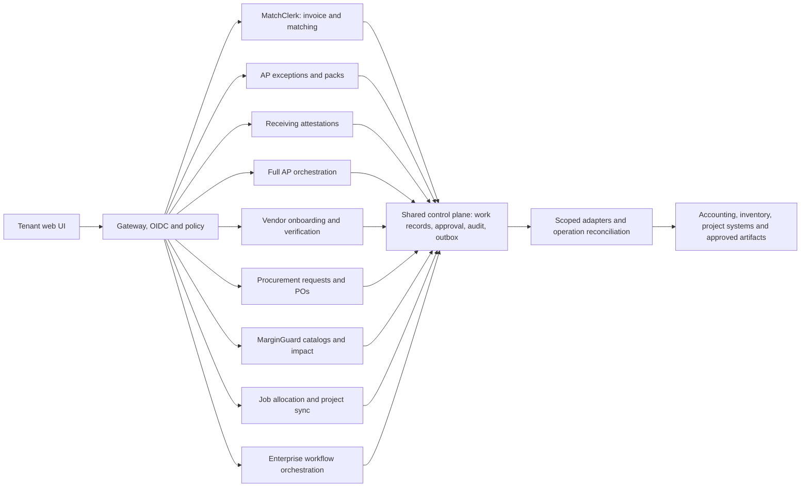

# Shared platform architecture and integration decisions

[Portfolio index](README.md) · [Evidence register](source-and-assumptions.md)

This is a proposed implementation blueprint. Product packs carry the domain-specific models, APIs and rules; this document resolves shared stack decisions and connector semantics. All tenant-facing control paths require implementation and validation before production use.

## Architecture decision record

| ADR | Decision | Reason and tradeoff | Verification |
| --- | --- | --- | --- |
| ADR-01 | Next.js App Router + TypeScript + Tailwind/shadcn; Node LTS selected and pinned at implementation kickoff | One accessible review workspace; framework versions are implementation choices, not claims that the PDF stack is current. | Dependency/security review and accessible prototype |
| ADR-02 | NestJS modular API plus independent Python analysis workers | Domain rules stay deterministic and testable; costly extraction scales independently. | End-to-end typed contract and failure tests |
| ADR-03 | PostgreSQL + Prisma migrations; RLS enforced through transaction-local tenant context | Relational integrity and audit lineage; ORM convenience does not replace database policy. | FORCE RLS, non-bypass runtime roles and pooled-session negative tests |
| ADR-04 | Auth.js with approved OIDC providers; application-owned membership and policy | Avoid unresolved auth-vendor alternatives; enterprise SSO/SCIM is later scope. | MFA claims, session revocation and privilege review |
| ADR-05 | SQS standard queues and DLQ; PostgreSQL outbox and operation ledger; Redis for cache/rate limits only | Durable at-least-once delivery; local ledger handles replay and unknown outcomes. | Crash-after-commit and redelivery tests |
| ADR-06 | S3 SSE-KMS, RDS managed encryption/PITR, ECS/Fargate regional services, Secrets Manager | EU region Frankfurt by default; avoids assuming a global front end can move financial evidence across regions. | Region policy, key access, object authorization and restore tests |
| ADR-07 | Provider-neutral vision/OCR interface with strict schema output; approved model selected after evaluation | No hard-coded outdated model recommendation; model cannot approve, mutate accounting or select unrestricted tools. | Consent, contract, accuracy, latency and cost evaluation |
| ADR-08 | Temporal only for Enterprise multi-day workflows | Persist approval waits and explicit compensations without inventing distributed transactions. | Replay history and recovery demonstration |
| ADR-09 | REST /api/v1 contracts; JSON Schema validation; no GraphQL in initial scope | Predictable integration and traceability with fewer public surfaces. | Schema compatibility and error-contract tests |
| ADR-10 | OpenTelemetry traces, structured logs and Prometheus-compatible metrics | Invoice/work-record lineage across async services; customer data excluded from logs. | Trace joins and synthetic incident drill |

## Shared boundaries and ownership

Each bounded context owns its domain rows. Full AP references component IDs and revisions; it cannot edit another domain's financial state. Vendor Onboarding owns supplier applications, evidence checks and approved vendor mappings; Full AP consumes vendor.verified events. Receiving owns attestation; MatchClerk owns invoice/PO allocation. Procurement owns approved commitments. MarginGuard owns catalog comparison and approved price proposals. Job agents own allocation lineage. Enterprise orchestrates typed actions under the relevant domain policy. Each work_record has exactly one aggregate specialization; approval-bearing secondary aggregates such as payment_pack and purchase_order also have their own work_record.

## Roles and human control

| Role | Allowed activity | Prohibited activity |
| --- | --- | --- |
| OWNER | Manage organization, invite users, configure billing and nominate controllers | Cannot bypass separation-of-duties or approve another tenant record |
| CONTROLLER | Approve financial proposals, clear high-risk exceptions, verify vendor evidence and release packs | Cannot self-approve a pack prepared by the same actor |
| CLERK / OPERATOR | Upload, correct, assign and prepare review proposals | Cannot approve financial accounting writes unless a separately scoped explicit policy grants that authority; MVP does not grant it |
| RECEIVER | Attest physical receipt for assigned site; propose corrections | Cannot post bills, approve payment packs or attest another site |
| BUYER / PRICING_MANAGER | Prepare purchase/price proposals and approve authorized operational actions within policy | Cannot self-approve the original purchase request or change bank information |
| SUPPLIER_CONTACT | Submit and view only one invited supplier application; invitation-scoped evidence access | Cannot inspect other applications, accounting records or approve verification |
| AUDITOR | Read redacted source lineage and immutable decision history | Cannot mutate domain, policy or approval state |
| SERVICE | Execute one allowlisted typed operation with stored human authorization where required | Cannot infer authority from model output or widen entity scope |

Authorization uses explicit action scopes as well as roles. Approval is checked against current membership, entity/site scope, policy version, source revision and payload hash. Receiver attestation is a physical operation, distinct from controller financial approval. Magic links and Slack cards open authenticated review; prefetched GETs never approve anything.

## Common API surfaces

Product-specific contracts live in Phase 3. These additional surfaces cover source-required platform setup and admin paths. The examples below are synthetic request/response contracts, not live credentials.

| Endpoint | Method / request | Response and mapping | Failure semantics |
| --- | --- | --- | --- |
| /api/v1/connections/qbo/start | POST `{"return_path":"/settings/connections"}` | 200 `{"authorization_url":"https://appcenter.intuit.com/connect/oauth2","state_expires_in":600}`; persist single-use OAuth state server-side. | 403 role; 429 setup throttle |
| /api/v1/connections/qbo/callback | GET query code + state + realmId | 302 to safe relative return path; exchange code, encrypt tokens and bind external realm to current tenant. | 400 state mismatch; 409 realm bound to another tenant; never log authorization code |
| /api/v1/connections/xero/start | POST `{"return_path":"/settings/connections"}` | 200 authorization URL and 600-second state; authorize approved scopes only. | 403 role; 429 setup throttle |
| /api/v1/connections/xero/callback | GET code + state | 302 after exchange; store authorized organization choices; require explicit org selection. | 400 expired state; 401 revoked grant |
| /api/v1/connections/{id}/organization | POST `{"external_org_id":"org-fixture-77","expected_version":1}` | 200 `{"connection_id":"connection-fixture","status":"CONNECTED"}`; unique tenant/provider/org binding. | 409 organization conflict; 403 missing external access |
| /api/v1/connections/{id}/capabilities | GET | 200 `{"read_vendors":true,"read_purchase_orders":true,"write_bill":true,"native_bill_draft":false,"goods_receipt_source":"INTERNAL_ATTESTED","tested_at":"2026-10-23T14:00:00Z"}`; example QBO fixture, not verified result. | 424 capability proof missing; do not claim a native receipt API |
| /api/v1/webhooks/email-inbound | POST `{"provider_event_id":"email-fixture-77","recipient_alias":"tenant-opaque-77","attachment_keys":["inbound/event-77/attachment-1.pdf"]}` | 202 `{"accepted":true,"event_id":"event-fixture-77"}`; route signed provider event to tenant alias; scan and classify attachments. | 401 bad signature; 413 limits; replay returns existing identity |
| /api/v1/accounts | GET provider and cursor query | 200 `{"items":[{"external_id":"5100","name":"Materials","active":true}],"next_cursor":null}`; filter cached active tenant accounts. | 401 revoked source; 424 no current sync |
| /api/v1/vendor-aliases/{id} | PATCH `{"raw_name":"Acme Supply Ltd","external_vendor_id":"V-77","default_gl_code":"5100","expected_version":2}` | 200 normalized alias revision; tenant+external org vendor identity prevents cross-org merge. | 403 role; 422 inactive account; 409 conflicting alias |
| /api/v1/receipts/import | POST `{"po_external_id":"PO-501","source":"ATTESTED_CSV","attested_by":"receiver-fixture","lines":[{"po_line_external_id":"1","accepted_qty":"7.0000","uom":"EA"}]}` | 202 import operation; a named authorized staff attestation is required before quantity release. | 422 missing attestation/UOM; 409 over-allocation |
| /api/v1/memberships/{id} | PATCH `{"role":"AUDITOR","active":true,"expected_version":1}` | 200 updated membership with audit and immediate policy invalidation. | 403 non-owner; 409 removal of last owner |
| /api/v1/operations/{id} | GET | 200 `{"status":"RECONCILING","attempts":1,"retryable":false,"provider_reference":null}`; UI distinguishes queued, running, review and final states. | 404 wrong tenant |
| /api/v1/evidence/{id}/content | GET authenticated download gateway | 200 streamed evidence only after session, tenant and scope checks; internal S3 signed request expires in 60 seconds. | 404 wrong tenant; copied client URL still requires authorized session |

All mutations follow the product's idempotency/version contract. Tenant is session-derived. OAuth state is cryptographically random, stored hashed, session-bound, single-use and expires after ten minutes. Refresh tokens are KMS-encrypted in Secrets Manager; DB holds secret references, external organization and health state. Refresh is single-flight per connection with compare-and-swap rotation.

## Accounting and external side-effect contract

QBO financial proposals remain internal until approval; do not assume a Bill API supports a generic DRAFT status. Xero supports ACCPAY DRAFT, distinct from AUTHORISED. In both cases this design requires human approval before creation. A created QBO Bill is a real liability; neither posting nor later payment authorization is implied by a visual draft label. QBO PO support must be validated for plan, region, tax and item/line linking. Do not replace a PO with an estimate or prior bill while advertising a true three-way match.

Receipt evidence comes from the internal attestation ledger, signed customer CSV or a specifically tested inventory adapter. Native receiving support is not assumed for QBO or Xero. Xero's published idempotency cache lasts six minutes; a durable local operation ledger is therefore required beyond that window. QBO stable request IDs and reference search are used only where proven by the integration spike; the portfolio does not claim they provide universal exactly-once behavior. [Xero idempotency](https://developer.xero.com/documentation/guides/idempotent-requests/idempotency/), [Xero invoice states](https://developer.xero.com/documentation/api/accounting/invoices), [QBO PO reference](https://developer.intuit.com/app/developer/qbo/docs/api/accounting/all-entities/purchaseorder).

For an unknown write outcome: freeze the logical action, read target records by stable external identity and content evidence, then either confirm the existing object, retry with proven safe identity, or require an integration operator. Never auto-retry an ambiguous create merely because the local request timed out. Expired provider idempotency memory does not erase local history. Cross-system workflows use explicit compensation and reconciliation rather than a distributed exactly-once promise.

Internal Xero connection limits are three concurrent requests and 45/minute, with budget reservations for writes and health checks. Daily budgets read provider headers and current contract entitlement; pause bulk sync below 10% remaining quota. Published limits and platform fees may change; revalidate at implementation and before each connector release. [Xero limits](https://developer.xero.com/faq/limits), [Xero developer platform FAQ](https://developer.xero.com/faq).

## Evidence security, AI boundary and retention

Evidence uploads enter a private quarantine prefix, pass malware/MIME/archive limits, then move to approved encrypted storage. Analysis receives a bounded text/image representation and strict output schema. Document content is untrusted data; prompt injection cannot invoke tools. Model output never establishes receipt attestation, approval identity, supplier account changes or tool permission. Use zero-retention inference only where the selected vendor contract supports it; do not assert a flag alone guarantees it. No tenant data or Xero API data trains/fine-tunes a model; tenant correction rules are deterministic configuration. [Xero AI/data terms FAQ](https://developer.xero.com/faq).

Clients fetch evidence through the authenticated content gateway. Direct object URLs are internal-only, avoiding a claim that ordinary bearer presigned URLs are bound to user sessions. Operational deletion occurs within 30 days of a verified request; encrypted backups age out within the following 30 days unless a documented legal hold applies. State this residual backup window in customer terms. Audit retention requires a reviewed purpose and minimizing identifiers; it is not an excuse for indefinite personal-data storage.

## Release and operating ownership

Local uses Docker PostgreSQL/Redis/MinIO and deterministic adapters. Staging uses isolated provider sandboxes and synthetic or consented de-identified evidence. Production has separate identities, keys, queues and provider applications. Migrations use expand/backfill/contract patterns and a restore rehearsal. Production identity cannot access staging data or vice versa.

Shared infrastructure does not make product budgets additive without validation. Each pack's SLO is a planned service contract; the busiest combined portfolio mix requires a new capacity test. New MVP scenarios start only when prior capabilities stabilize and team funding exists. PM owns value/scope, BSA owns mapping and test evidence, architect owns boundaries/reliability, security owner owns control evidence, and the customer controller owns financial authorization.
