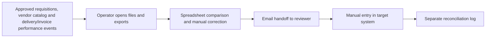
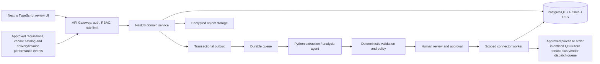

# Procurement Digital Employee — Ideation & Strategy

[Portfolio index](../README.md) · [Phase 1](01-ideation-and-strategy.md) · [Phase 2](02-roadmapping-and-scoping.md) · [Phase 3](03-requirements-prd-frd.md) · [Phase 4](04-sprint-execution-and-triage.md) · [Phase 5](05-testing-qa-and-uat.md) · [Phase 6](06-launch-gtm-and-telemetry.md)

**Document control:** PD-P1, revision 1.0, authored 2026-10-17. Status: proposed portfolio design; implementation, customer research, tests and stakeholder approvals have not been performed.

**Source boundary:** Named expansion, source p. 20: PO drafting from approved requests, vendor scorecards and catalog price watch attachment. [Primary document](../../MatchClerk-Project-Implementation.pdf). Proposed architecture and assumptions are explicitly recorded in [the evidence register](../source-and-assumptions.md).

## [PM] Source objective and discovery hypothesis

SME operations teams buy through email threads, recreate approved requests as POs and lack structured supplier performance evidence. Turn approved purchase requests into reviewed purchase orders, track supplier responsiveness and variances, and attach catalog price intelligence. The beachhead is Contractors and wholesale distributors already using MatchClerk that request PO creation and have 100–500 purchase requests/month. Discovery statements below are research hypotheses, not completed interviews or observed customer outcomes.

| BR ID | Business requirement | Success evidence |
| --- | --- | --- |
| PD-BR-01 | Turn approved purchase requests into reviewed purchase orders, track supplier responsiveness and variances, and attach catalog price intelligence. | ≥85% within one business day and zero unauthorized commitments |
| PD-BR-02 | Preserve accountable human control and tenant isolation | Agents draft POs and supplier messages. Humans authorize financial commitment and outbound dispatch; no inferred approval from an email sentiment. |
| PD-BR-03 | Recover safely from malformed input, duplicate events and partial failure | No duplicate external side effect; each failed operation is discoverable and recoverable |
| PD-BR-04 | Make operating value measurable | Request-to-PO median <4 business hours; ≥95% PO line fidelity; ≥80% vendor scorecards have receipt/invoice-backed evidence. |

### Competitive analysis

Primary vendor documentation reviewed 2026-10-17. Capability descriptions are limited to published material; tradeoff judgments are our inference. Prices and missing features are not inferred from silence. Broad-suite competitors can serve SMEs: the source's blanket market-gap assertion is a hypothesis requiring validation.

| Alternative | Published capability | Fit / evaluation question | Proposed differentiation to test |
| --- | --- | --- | --- |
| [Procurify](https://success.procurify.com/en/collections/8539162-purchasing-receiving-with-procurify) | Purchasing and receiving workflows | Established purchasing system; test incremental value of a supervised agent | Procurement Digital Employee: Turn approved purchase requests into reviewed purchase orders, track supplier responsiveness and variances, and attach catalog price intelligence. Test evidence quality and implementation effort with the same customer scenario. |
| [Precoro](https://help.precoro.com/matching-process) | PO, invoice and receipt variance controls | Direct control-workflow competitor; compare ERP support and adoption effort | Procurement Digital Employee: Turn approved purchase requests into reviewed purchase orders, track supplier responsiveness and variances, and attach catalog price intelligence. Test evidence quality and implementation effort with the same customer scenario. |
| [Coupa](https://docs.coupa.com/en/supplier-documentation/coupa-for-suppliers/the-coupa-supplier-portal-or-csp/features-and-processes-in-the-coupa-supplier-portal/purchase-orders/about-purchase-orders) | Supplier PO exchange through portal, cXML and email | Broad procurement ecosystem; validate fit for smaller teams | Procurement Digital Employee: Turn approved purchase requests into reviewed purchase orders, track supplier responsiveness and variances, and attach catalog price intelligence. Test evidence quality and implementation effort with the same customer scenario. |

### Personas

These are designed research archetypes. Names do not represent interviewed customers.

| Persona / role | Goals | Pain points | Daily workflow | Technical proficiency |
| --- | --- | --- | --- | --- |
| Marcus — Operations requester | Get site materials ordered on time | Approved email is lost before a PO exists | Submit request; track status; confirm required date | Medium mobile and spreadsheets |
| Nadia — Procurement manager | Control commitments and improve suppliers | No consistent request or performance data | Validate catalog; approve PO; review supplier scorecards | High procurement systems |
| Ava — Controller | Keep commitments inside approved budgets | POs appear after spending decisions | Review budget exceptions; approve high-value requests | High finance; medium software |

### Discovery and validation plan

| Method / sample | Concrete prompt or exercise | Decision threshold | Owner |
| --- | --- | --- | --- |
| Six buyer interviews across two target segments | Walk through the last purchase request that was delayed; show the actual handoff and current time spent. | At least 4/6 demonstrate the same core pain and name a budget owner. | PM |
| Five observed operator sessions | Process five representative records using the current workflow; time active work separately from waiting. | Observed baseline replaces the ROI estimate; at least 3/5 complete the proposed flow without coaching. | PM + UX |
| Three technical discovery workshops | Inspect source fields, permissions, data exports and failure/replay behavior in a sandbox. | All mandatory source fields map and the human control boundary is feasible. | BSA + integration lead |
| Two design partners, 30-day pilot | Compare a consented baseline cohort with a parallel-run cohort; log every correction and failure. | Achieve the product gates in Phase 5 before GA; no fabricated case study claim. | Pilot success lead |

## [PM] Vision, positioning and business case

**Vision:** For Contractors and wholesale distributors already using MatchClerk that request PO creation and have 100–500 purchase requests/month. Procurement Digital Employee is a supervised operational product that turn approved purchase requests into reviewed purchase orders, track supplier responsiveness and variances, and attach catalog price intelligence. Its value is measured by approved purchase requests converted to correct pos within one business day, with explicit evidence and human accountability.

**Value proposition:** Replace fragmented manual handoffs with one traceable work queue, typed validation and an authorized next action. The defensible wedge to test is faster deployment into the customer's existing process and clearer control evidence. Competitive superiority has not been demonstrated.

**Commercial model:** Proposed monthly subscription of USD 1,500.00 for the modeled 300 purchase requests; implementation USD 2,000.00. MatchClerk prices are source recommendations; expansion prices are portfolio hypotheses. No market-size estimate is invented.

| ROI input or output | Illustrative value | Calculation / interpretation |
| --- | --- | --- |
| Monthly eligible volume | 300 purchase requests | Model assumption; replace with pilot logs |
| Active manual handling | 20 → 5 minutes/purchase request | Excludes waiting and assumes human review remains |
| Loaded labor rate | USD 40/hour | Illustrative input; not a wage benchmark |
| Gross monthly capacity value | USD 3,000.00 | 300 × (20-5) / 60 × 40 |
| Net monthly value after fee | USD 1,500.00 | 3,000.00 - 1,500.00; recovered capacity is not automatically cash savings |
| Customer implementation payback | 1.33 months | One-time fee / net monthly capacity value; validate with buyer |
| Modeled monthly COGS | USD 195.00 | 300 × 0.15 variable processing + 70 infrastructure + 80 allocated support |
| Modeled gross margin | 87.0% | Revenue less modeled COGS; excludes sales/R&D; support allocation must be validated |
| 50% realization sensitivity | USD 0.00 net/month | Half the modeled labor benefit; do not expand if measured customer value is negative |

For Full AP, component subscriptions are bundled and the infrastructure allocation includes shared component operations. For every product, cloud/API licensing and human support must be re-estimated before a commercial commitment. Break-even volume at this labor model is 150 eligible records/month. A high gross-margin estimate alone does not establish demand.

## [BSA] As-Is and To-Be feasibility

| Gap | Target design | Feasibility proof / dependency | Residual risk |
| --- | --- | --- | --- |
| Manual interpretation and missing provenance | Typed extraction with page/row evidence; deterministic rule engine | Requester cannot self-approve; budget reservation succeeds; supplier active; catalog valid; required manager/controller approval complete; PO connector supports line type. | Confidence must be evaluated on representative labeled inputs |
| No reliable handoff ownership | Role-based queue with statuses, owner and business deadline | Budget overrun, inactive supplier, stale catalog or missing approval → NEEDS_REVIEW; no PO dispatch before explicit approval. | Review bottleneck if staffing is insufficient |
| Fragmented target writes | Scoped adapter with operation ledger and reconciliation | Requires tenant budget owners, vendor master and a proven purchase-order connector; MarginGuard is an optional attachment. | Provider capabilities vary by subscription, region and API version |
| Spreadsheet access without strong isolation | Session-derived tenant, RLS, composite foreign keys and encrypted objects | Negative tenant/role tests plus restore drill before launch | Application roles and pooled DB sessions require careful reset |
| No closed-loop value evidence | Outcome events joined to source lineage and adoption cohorts | Pilot baseline plus telemetry definitions in Phase 6 | Attribution can overstate savings without a comparable baseline |

**Architectural decision:** Deploy a modular NestJS service and independent Python workers, rather than separate microservices for every feature. Use PostgreSQL as the durable source of truth, AWS SQS for ordinary background work, Redis for rate-limit counters and cache, and S3 SSE-KMS for evidence. Long-lived work state stays in PostgreSQL; queues deliver work, not authoritative approval state. Source stack options are resolved in [platform architecture](../platform-architecture.md); no implementation is claimed.

**Product-specific feasibility constraint:** Reserve budget in the same transaction as final request approval; release on rejection or cancellation. Requests ≥5000.00 require both manager and controller. A lower threshold never permits requester self-approval.

**Investment gate:** Fund the pilot only after the source-field mapping, control boundary and two design-partner commitments are validated. PM owns demand and economic evidence; BSA owns integration and data feasibility. Stop expansion if high-severity control defects persist or the measured benefit is below the subscription cost for two pilot reviews.
