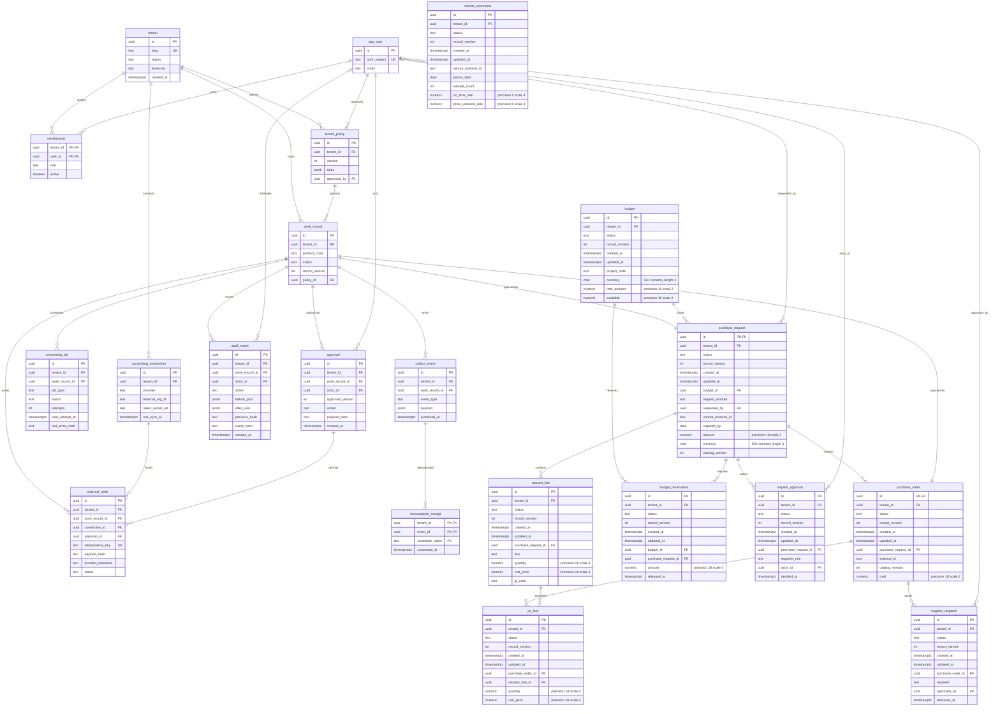
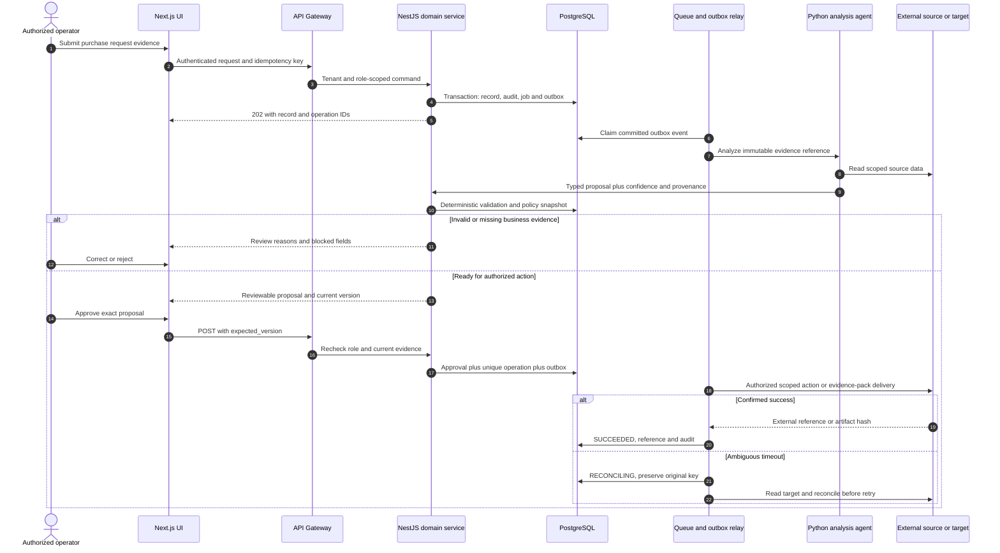
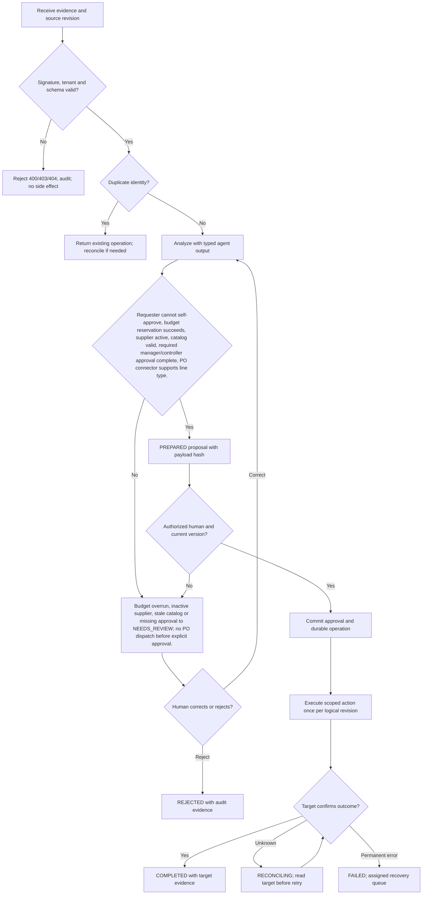

# Procurement Digital Employee — Requirements — PRD, BRD & FRD

[Portfolio index](../README.md) · [Phase 1](01-ideation-and-strategy.md) · [Phase 2](02-roadmapping-and-scoping.md) · [Phase 3](03-requirements-prd-frd.md) · [Phase 4](04-sprint-execution-and-triage.md) · [Phase 5](05-testing-qa-and-uat.md) · [Phase 6](06-launch-gtm-and-telemetry.md)

**Document control:** PD-P3, revision 1.0, authored 2026-10-17. Status: proposed portfolio design; implementation, customer research, tests and stakeholder approvals have not been performed.

**Source boundary:** Named expansion, source p. 20: PO drafting from approved requests, vendor scorecards and catalog price watch attachment. [Primary document](../../MatchClerk-Project-Implementation.pdf). Proposed architecture and assumptions are explicitly recorded in [the evidence register](../source-and-assumptions.md).

## Scope, actors and requirement identity

| BR ID | Business requirement | Success evidence |
| --- | --- | --- |
| PD-BR-01 | Turn approved purchase requests into reviewed purchase orders, track supplier responsiveness and variances, and attach catalog price intelligence. | ≥85% within one business day and zero unauthorized commitments |
| PD-BR-02 | Preserve accountable human control and tenant isolation | Agents draft POs and supplier messages. Humans authorize financial commitment and outbound dispatch; no inferred approval from an email sentiment. |
| PD-BR-03 | Recover safely from malformed input, duplicate events and partial failure | No duplicate external side effect; each failed operation is discoverable and recoverable |
| PD-BR-04 | Make operating value measurable | Request-to-PO median <4 business hours; ≥95% PO line fidelity; ≥80% vendor scorecards have receipt/invoice-backed evidence. |

FR-1 through FR-8 map one-to-one to US-1 through US-8 below. Stories 1–6 support BR-01/02, story 7 supports BR-02/04 and story 8 supports BR-03. Every action also inherits tenant isolation, audit and idempotency requirements. A proposed acceptance criterion is not an executed test result.

## [PM] User stories and strict acceptance criteria

### PD-US-1 / PD-FR-1 — Request intake

As a operations requester, I want to submit a coded purchase request, so that I can start an accountable buying workflow.

```gherkin
Feature: Procurement Digital Employee Request intake
  Scenario: Request intake business contract
    Given project JOB-42 and active vendor V-77 exist
    When I request 48 units at 100.00 USD
    Then a 4800.00 request with required-by date is recorded without creating a PO

  Scenario: Reject unauthorized or stale changes
    Given the actor lacks tenant or role permission, or the submitted version is stale
    When the same business action is attempted
    Then cross-tenant access returns 404, a disallowed role returns 403, and a stale mutation returns 409
    And no domain row, approval, or external side effect is committed
```

**Database assertion:** purchase_request.amount=4800.00; purchase_order count=0. **API:** POST `/api/v1/purchase-requests`. Read-only endpoints do not require a submitted mutation version; their negative case covers tenant and role access. 

### PD-US-2 / PD-FR-2 — Budget control

As a controller, I want to reserve approved request amounts atomically, so that I can avoid overspending shared budgets.

```gherkin
Feature: Procurement Digital Employee Budget control
  Scenario: Budget control business contract
    Given budget remaining is 6000.00 and two requests each need 4800.00
    When both approval transactions run concurrently
    Then only one reserves 4800.00 and the other returns BUDGET_EXCEEDED

  Scenario: Reject unauthorized or stale changes
    Given the actor lacks tenant or role permission, or the submitted version is stale
    When the same business action is attempted
    Then cross-tenant access returns 404, a disallowed role returns 403, and a stale mutation returns 409
    And no domain row, approval, or external side effect is committed
```

**Database assertion:** budget_reservation sum=4800.00; budget.available=1200.00. **API:** POST `/api/v1/purchase-requests/{id}/reserve-budget`. Read-only endpoints do not require a submitted mutation version; their negative case covers tenant and role access. 

### PD-US-3 / PD-FR-3 — Approval policy

As a procurement manager, I want to route high-value requests through two reviewers, so that I can enforce commitment authority.

```gherkin
Feature: Procurement Digital Employee Approval policy
  Scenario: Approval policy business contract
    Given a request amount is 5200.00
    When the requester submits it
    Then manager and controller tasks are created and the requester cannot satisfy either task

  Scenario: Reject unauthorized or stale changes
    Given the actor lacks tenant or role permission, or the submitted version is stale
    When the same business action is attempted
    Then cross-tenant access returns 404, a disallowed role returns 403, and a stale mutation returns 409
    And no domain row, approval, or external side effect is committed
```

**Database assertion:** request_approval required count=2; purchase_request.status='NEEDS_REVIEW'. **API:** POST `/api/v1/purchase-requests/{id}/submit`. Read-only endpoints do not require a submitted mutation version; their negative case covers tenant and role access. 

### PD-US-4 / PD-FR-4 — PO drafting

As a procurement manager, I want to draft a PO from approved request lines, so that I can avoid transcription errors.

```gherkin
Feature: Procurement Digital Employee PO drafting
  Scenario: PO drafting business contract
    Given REQ-2027-081 has approved quantity 48 and unit price 100.00
    When I generate a PO draft
    Then all source line references, quantities, account mappings and 4800.00 total match

  Scenario: Reject unauthorized or stale changes
    Given the actor lacks tenant or role permission, or the submitted version is stale
    When the same business action is attempted
    Then cross-tenant access returns 404, a disallowed role returns 403, and a stale mutation returns 409
    And no domain row, approval, or external side effect is committed
```

**Database assertion:** po_line.quantity=48.0000; po_line.unit_price=100.0000. **API:** POST `/api/v1/purchase-requests/{id}/draft-po`. Read-only endpoints do not require a submitted mutation version; their negative case covers tenant and role access. 

### PD-US-5 / PD-FR-5 — Authorized write

As a procurement manager, I want to publish one approved PO to accounting, so that I can make a controlled commitment.

```gherkin
Feature: Procurement Digital Employee Authorized write
  Scenario: Authorized write business contract
    Given an approved request has one internal PO and supported item references
    When I authorize publication with version 4
    Then one provider PO is created and its external ID is stored

  Scenario: Reject unauthorized or stale changes
    Given the actor lacks tenant or role permission, or the submitted version is stale
    When the same business action is attempted
    Then cross-tenant access returns 404, a disallowed role returns 403, and a stale mutation returns 409
    And no domain row, approval, or external side effect is committed
```

**Database assertion:** purchase_order.external_id IS NOT NULL; external_write count=1. **API:** POST `/api/v1/purchase-requests/{id}/approve`. Read-only endpoints do not require a submitted mutation version; their negative case covers tenant and role access. 

### PD-US-6 / PD-FR-6 — Supplier dispatch

As a procurement manager, I want to approve a supplier dispatch separately, so that I can control external communications.

```gherkin
Feature: Procurement Digital Employee Supplier dispatch
  Scenario: Supplier dispatch business contract
    Given a published PO has a reviewed recipient and PDF
    When I approve dispatch
    Then one dispatch event is queued and delivery state is recorded independently of PO publication

  Scenario: Reject unauthorized or stale changes
    Given the actor lacks tenant or role permission, or the submitted version is stale
    When the same business action is attempted
    Then cross-tenant access returns 404, a disallowed role returns 403, and a stale mutation returns 409
    And no domain row, approval, or external side effect is committed
```

**Database assertion:** supplier_dispatch.approved_by IS NOT NULL; outbox_event dispatch count=1. **API:** POST `/api/v1/purchase-orders/{id}/dispatch-approval`. Read-only endpoints do not require a submitted mutation version; their negative case covers tenant and role access. 

### PD-US-7 / PD-FR-7 — Supplier scoring

As a procurement manager, I want to see evidence-backed responsiveness and variance scores, so that I can choose better suppliers.

```gherkin
Feature: Procurement Digital Employee Supplier scoring
  Scenario: Supplier scoring business contract
    Given vendor V-77 has ten completed POs and eight on-time receipts
    When the scorecard refreshes
    Then on-time ratio is 0.80 with numerator eight, denominator ten and linked evidence

  Scenario: Reject unauthorized or stale changes
    Given the actor lacks tenant or role permission, or the submitted version is stale
    When the same business action is attempted
    Then cross-tenant access returns 404, a disallowed role returns 403, and a stale mutation returns 409
    And no domain row, approval, or external side effect is committed
```

**Database assertion:** vendor_scorecard.on_time_rate=0.8000; sample_count=10. **API:** GET `/api/v1/vendors/{id}/scorecard`. Read-only endpoints do not require a submitted mutation version; their negative case covers tenant and role access. 

### PD-US-8 / PD-FR-8 — Catalog drift recovery

As a controller, I want to reapprove a PO after a price change, so that I can avoid stale commitments.

```gherkin
Feature: Procurement Digital Employee Catalog drift recovery
  Scenario: Catalog drift recovery business contract
    Given a request was approved at 100.00 per unit
    When catalog price changes to 110.00 before publication
    Then the proposal is invalidated and requires revised budget reservation and approval

  Scenario: Reject unauthorized or stale changes
    Given the actor lacks tenant or role permission, or the submitted version is stale
    When the same business action is attempted
    Then cross-tenant access returns 404, a disallowed role returns 403, and a stale mutation returns 409
    And no domain row, approval, or external side effect is committed
```

**Database assertion:** purchase_request.status='NEEDS_REVIEW'; purchase_order.external_id IS NULL. **API:** POST `/api/v1/purchase-requests/{id}/revalidate`. Read-only endpoints do not require a submitted mutation version; their negative case covers tenant and role access. Recovery acceptance: replay the source event or request and confirm the original operation identity and side-effect count.

## [BSA] Domain model and entity relationships

This diagram includes domain tables and the shared control tables required by this product. UUIDs are internal keys; external IDs remain text. Every domain table includes tenant_id, status, record_version and timestamps. Approval-bearing aggregate tables (purchase_request, purchase_order) share their ID with work_record.id; API/domain updates keep both states synchronized in one transaction. A work_record specializes into exactly one aggregate type, not every linked type simultaneously.



### Physical constraints and integrity rules

| Rule | Concrete implementation |
| --- | --- |
| Tenant-safe foreign keys | Tenant-owned tables have UNIQUE(tenant_id,id); intra-tenant foreign keys use (tenant_id,parent_id) → parent(tenant_id,id), even where the ER diagram abbreviates the key. Global app_user/tenant keys are exceptions; actor scope additionally references membership(tenant_id,user_id). |
| Money and quantity | numeric(18,2) for currency amounts; numeric(18,4) for quantities/unit prices; numeric(9,6) for ratios; JSON monetary values are decimal strings. ISO-4217 currency is char(3). Round only at declared posting boundaries. |
| Optimistic mutation | UPDATE work_record SET record_version=record_version+1 WHERE tenant_id=session_tenant AND id=record_id AND record_version=expected_version; zero rows → 409 STALE_VERSION. |
| Approval binding | approval stores approved_version and SHA-256 of canonical mutation payload. Unique work_record_id + approved_version + action prevents duplicate authorization. Revoke validity when business evidence changes. |
| Write identity | external_write.idempotency_key is unique and immutable; bind it to tenant, connection, record, action and business revision. A reused key with changed payload returns 409 IDEMPOTENCY_CONFLICT. |
| Event delivery | Create domain update, audit row, processing_job and outbox row in one PostgreSQL transaction. Consumption receipt unique key is (tenant_id,event_id,consumer_name). Delivery is at-least-once. |
| Audit immutability | Application roles cannot UPDATE/DELETE audit_event; daily signed hash manifest in locked object storage. System events have null actor_id and explicit service identity in after_json. |
| Indexes | CREATE INDEX on domain aggregate (tenant_id,status,created_at DESC); processing_job (status,next_attempt_at); audit_event (tenant_id,work_record_id,created_at); external_write (tenant_id,provider_reference). |
| Domain invariants | Reserve budget in the same transaction as final request approval; release on rejection or cancellation. Requests ≥5000.00 require both manager and controller. A lower threshold never permits requester self-approval. |
| Retention deletion | Evidence objects and operational rows follow tenant policy; audit personal identifiers are minimized and removed under verified deletion unless a documented legal hold applies. Hashes are not assumed anonymous. |

### API contract and source-to-target mapping

REST JSON over HTTPS, versioned at /api/v1. Authenticate via HttpOnly OIDC-backed session for UI and scoped service credentials for callbacks. Tenant identity never comes from a client body. All mutating requests carry Idempotency-Key; updates also carry expected_version. Body size limit is 1 MB JSON; files use signed upload. Example UUIDs are synthetic fixtures, not live data. API requests below show action inputs; the intake payload is also specified separately.

**Canonical intake example:** `{"request_number":"REQ-2027-081","project_code":"JOB-42","vendor_external_id":"V-77","currency":"USD","required_by":"2027-08-20","lines":[{"sku":"STEEL-A","quantity":"48.0000","unit_price":"100.0000","gl_code":"5100"}]}`

| FRD / API ID | Method and endpoint | Request JSON | Success JSON / status | Internal target mapping | Errors |
| --- | --- | --- | --- | --- | --- |
| PD-FR-1 / API-1 | POST /api/v1/purchase-requests | `{"request_number":"REQ-2027-081","project_code":"JOB-42","vendor_external_id":"V-77","currency":"USD","required_by":"2027-08-20","lines":[{"sku":"STEEL-A","quantity":"48.0000","unit_price":"100.0000","gl_code":"5100"}]}` | 202 `{"id":"22222222-2222-4222-8222-222222222222","operation_id":"33333333-3333-4333-8333-333333333333","status":"RECEIVED","record_version":1,"amount":"4800.00","currency":"USD"}` | purchase_request.request_number | 400 SCHEMA_INVALID; 403 POLICY_DENIED; 409 STALE_VERSION; 422 RULE_VIOLATION; 429 RATE_LIMITED |
| PD-FR-2 / API-2 | POST /api/v1/purchase-requests/{id}/reserve-budget | `{"expected_version":2,"amount":"4800.00"}` | 200 `{"id":"22222222-2222-4222-8222-222222222222","operation_id":"33333333-3333-4333-8333-333333333333","status":"RESERVED","record_version":3,"reserved_amount":"4800.00","budget_available":"1200.00"}` | budget.project_code | 400 SCHEMA_INVALID; 403 POLICY_DENIED; 409 STALE_VERSION; 422 RULE_VIOLATION; 429 RATE_LIMITED |
| PD-FR-3 / API-3 | POST /api/v1/purchase-requests/{id}/submit | `{"expected_version":3}` | 202 `{"id":"22222222-2222-4222-8222-222222222222","operation_id":"33333333-3333-4333-8333-333333333333","status":"NEEDS_REVIEW","record_version":4,"required_roles":["MANAGER","CONTROLLER"]}` | request_line.sku | 400 SCHEMA_INVALID; 403 POLICY_DENIED; 409 STALE_VERSION; 422 RULE_VIOLATION; 429 RATE_LIMITED |
| PD-FR-4 / API-4 | POST /api/v1/purchase-requests/{id}/draft-po | `{"expected_version":4}` | 202 `{"id":"22222222-2222-4222-8222-222222222222","operation_id":"33333333-3333-4333-8333-333333333333","status":"PREPARED","record_version":5,"total":"4800.00","quantity":"48.0000"}` | po_line.quantity | 400 SCHEMA_INVALID; 403 POLICY_DENIED; 409 STALE_VERSION; 422 RULE_VIOLATION; 429 RATE_LIMITED |
| PD-FR-5 / API-5 | POST /api/v1/purchase-requests/{id}/approve | `{"expected_version":4,"action":"PUBLISH_PO"}` | 202 `{"id":"22222222-2222-4222-8222-222222222222","operation_id":"33333333-3333-4333-8333-333333333333","status":"APPROVED","record_version":5,"provider":"QBO"}` | purchase_order.external_id | 400 SCHEMA_INVALID; 403 POLICY_DENIED; 409 STALE_VERSION; 422 RULE_VIOLATION; 429 RATE_LIMITED |
| PD-FR-6 / API-6 | POST /api/v1/purchase-orders/{id}/dispatch-approval | `{"expected_version":4,"recipient":"orders@vendor.example"}` | 202 `{"id":"22222222-2222-4222-8222-222222222222","operation_id":"33333333-3333-4333-8333-333333333333","status":"DISPATCH_QUEUED","record_version":5,"recipient":"orders@vendor.example"}` | purchase_order.external_id | 400 SCHEMA_INVALID; 403 POLICY_DENIED; 409 STALE_VERSION; 422 RULE_VIOLATION; 429 RATE_LIMITED |
| PD-FR-7 / API-7 | GET /api/v1/vendors/{id}/scorecard | `null` | 200 `{"id":"22222222-2222-4222-8222-222222222222","result":"SCORECARD_RETURNED","record_version":4,"sample_count":10,"on_time_count":8,"on_time_rate":"0.8000"}` | purchase_order.external_id | 400 SCHEMA_INVALID; 403 POLICY_DENIED; 409 STALE_VERSION; 422 RULE_VIOLATION; 429 RATE_LIMITED |
| PD-FR-8 / API-8 | POST /api/v1/purchase-requests/{id}/revalidate | `{"expected_version":4,"catalog_version":5}` | 202 `{"id":"22222222-2222-4222-8222-222222222222","operation_id":"33333333-3333-4333-8333-333333333333","status":"NEEDS_REVIEW","record_version":5,"reason_code":"CATALOG_CHANGED"}` | purchase_order.external_id | 400 SCHEMA_INVALID; 403 POLICY_DENIED; 409 STALE_VERSION; 422 RULE_VIOLATION; 429 RATE_LIMITED |

For 202 responses, the body reflects **acceptance state**, not final downstream success. Updates accepted at expected_version 4 return revision 5; intake creates revision 1. Independent scenario fixtures explain differing versions between rows. Clients use returned versions, not a hard-coded constant. A GET result with an artifact returns JSON metadata (download_url, expires_at, sha256); the binary is fetched through the authenticated evidence gateway. A full record response contains the fields from the domain ERD, validation reasons and provenance. Read-only policy-denial and budget checks return their decision without performing the proposed action.

| Source field / system | API field or derivation | Target table.column | Transformation and rejection rule |
| --- | --- | --- | --- |
| Request reference | request_number | purchase_request.request_number | Unique tenant reference |
| Job budget code | project_code | budget.project_code | Resolve active budget; reject unmapped job |
| Catalog SKU | lines[].sku | request_line.sku | Store catalog version and supplier SKU alias |
| Approved line quantity | quantity | po_line.quantity | Copy from approved request revision only |
| Provider purchase-order Id | external_id | purchase_order.external_id | Persist connector confirmation before dispatch |

| Contract | Exact rule / example |
| --- | --- |
| Error envelope | `{"error":{"code":"STALE_VERSION","message":"Record changed after review","retryable":false,"request_id":"req-fixture-17","current_version":5}}` |
| Additional statuses | 401 AUTH_REQUIRED; 404 RECORD_NOT_FOUND; 413 FILE_TOO_LARGE; 415 UNSUPPORTED_MEDIA; 424 DEPENDENCY_UNAVAILABLE; 503 TEMPORARY_UNAVAILABLE. Domain detail codes include those in the Phase 4 triage log. |
| Upload safety | PDF/PNG up to 25 MB per file; ZIP up to 25 MB compressed, 100 MB expanded, 100 members and depth 1. Reject executable MIME, path traversal, encrypted archives and malicious files; scan before extraction. |
| Paging | GET collection uses limit ≤100 and opaque cursor; deterministic created_at,id order; no unbounded full-tenant export. |
| Webhook signature | Verify provider signature on raw body before parsing. Persist provider event identity before returning 202. Provider-authenticated replay is deduplicated, not dropped based only on age. |
| Provider failure | 429 honors Retry-After; 5xx/network retries use jittered backoff. Timeout with unknown write outcome enters RECONCILING and must not issue an immediate second create. |

## [BSA] System sequence



For a product with an internal evidence-pack or event output, the final external participant means the authorized consumer or artifact store; it does not imply a financial write. Agents draft POs and supplier messages. Humans authorize financial commitment and outbound dispatch; no inferred approval from an email sentiment.

## [BSA] Business rules and UAT/system decision flow



**State contract:** RECEIVED → ANALYZING → NEEDS_REVIEW or PREPARED → APPROVED → RUNNING → COMPLETED. Domain-specific states (such as NEEDS_REVIEW; no PO dispatch before explicit approval.) refine the control state; raw status transitions are never accepted from clients. REJECTED is terminal for that business revision. A corrected record creates a new revision and invalidates prior approval. FAILED/RECONCILING are explicit recovery states; only service commands with allowed transitions can change them.

## [PM & BSA] Formal sign-off record

| Document / control | Accountable stakeholder | Acceptance evidence | Decision / signature state |
| --- | --- | --- | --- |
| BRD: BR-01 to BR-04 | Economic buyer / PM | Validated problem, baseline, price and control ownership | Review required; no stakeholder signature recorded |
| PRD: US-1 to US-8 | Product owner + customer process owner | Story walkthrough and five-scenario UAT acceptance | Review required; no stakeholder signature recorded |
| FRD: API, ERD and process model | BSA + engineering lead | Mapping workshop, contract tests and migration review | Review required; no stakeholder signature recorded |
| Architecture and threat controls | Solutions architect + security owner | Capability spikes, tenant tests and restore evidence | Review required; no stakeholder signature recorded |
| Financial side-effect boundary | Customer controller | Approval, duplicate and reconciliation evidence | Review required; no stakeholder signature recorded |

Approval requires named reviewer, UTC decision timestamp, artifact revision and evidence link in the actual delivery system. This portfolio records the review mechanism without fabricating approval.
