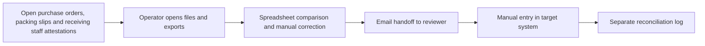
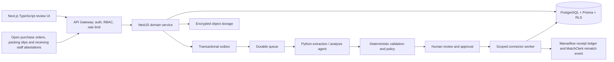

# Receiving Workflow Agent — Ideation & Strategy

[Portfolio index](../README.md) · [Phase 1](01-ideation-and-strategy.md) · [Phase 2](02-roadmapping-and-scoping.md) · [Phase 3](03-requirements-prd-frd.md) · [Phase 4](04-sprint-execution-and-triage.md) · [Phase 5](05-testing-qa-and-uat.md) · [Phase 6](06-launch-gtm-and-telemetry.md)

**Document control:** RW-P1, revision 1.0, authored 2026-10-17. Status: proposed portfolio design; implementation, customer research, tests and stakeholder approvals have not been performed.

**Source boundary:** Expansion offer, source p. 20: proposed when AWAITING_RECEIPT volume is high. Detailed receipt workflow is an architectural proposal. [Primary document](../../MatchClerk-Project-Implementation.pdf). Proposed architecture and assumptions are explicitly recorded in [the evidence register](../source-and-assumptions.md).

## [PM] Source objective and discovery hypothesis

Warehouse and site teams record deliveries on paper or in text messages, leaving AP unable to verify quantities before bill approval. Capture and attest partial goods receipts against PO lines, surface shortages and damage, and unblock invoice matching only when received evidence is valid. The beachhead is MatchClerk contractors and distributors with more than 20% of PO invoices waiting for receipt evidence and one accountable receiving lead. Discovery statements below are research hypotheses, not completed interviews or observed customer outcomes.

| BR ID | Business requirement | Success evidence |
| --- | --- | --- |
| RW-BR-01 | Capture and attest partial goods receipts against PO lines, surface shortages and damage, and unblock invoice matching only when received evidence is valid. | ≥80% within one business day, with zero over-allocation |
| RW-BR-02 | Preserve accountable human control and tenant isolation | OCR proposes quantities; staff attest physical receipt. A receipt does not create an accounting liability or payment. |
| RW-BR-03 | Recover safely from malformed input, duplicate events and partial failure | No duplicate external side effect; each failed operation is discoverable and recoverable |
| RW-BR-04 | Make operating value measurable | ≥95% attested receipts link to correct PO line; receipt evidence latency p95 <1 business day; zero billed allocation above accepted quantity. |

### Competitive analysis

Primary vendor documentation reviewed 2026-10-17. Capability descriptions are limited to published material; tradeoff judgments are our inference. Prices and missing features are not inferred from silence. Broad-suite competitors can serve SMEs: the source's blanket market-gap assertion is a hypothesis requiring validation.

| Alternative | Published capability | Fit / evaluation question | Proposed differentiation to test |
| --- | --- | --- | --- |
| [inFlow Inventory](https://www.inflowinventory.com/support/cloud/how-do-i-create-and-complete-a-purchase-order) | Purchase order creation and receiving | Inventory system replacement is broader than receipt evidence capture | Receiving Workflow Agent: Capture and attest partial goods receipts against PO lines, surface shortages and damage, and unblock invoice matching only when received evidence is valid. Test evidence quality and implementation effort with the same customer scenario. |
| [Zoho Inventory](https://www.zoho.com/us/inventory/help/purchase-orders/purchase-receive.html) | Purchase receiving against purchase orders | Full inventory workflow; compare partial receipts and warehouse adoption | Receiving Workflow Agent: Capture and attest partial goods receipts against PO lines, surface shortages and damage, and unblock invoice matching only when received evidence is valid. Test evidence quality and implementation effort with the same customer scenario. |
| [Cin7](https://www.cin7.com/features/inventory/purchasing/) | Purchasing and receiving within inventory management | Broader inventory footprint; validate implementation burden | Receiving Workflow Agent: Capture and attest partial goods receipts against PO lines, surface shortages and damage, and unblock invoice matching only when received evidence is valid. Test evidence quality and implementation effort with the same customer scenario. |

### Personas

These are designed research archetypes. Names do not represent interviewed customers.

| Persona / role | Goals | Pain points | Daily workflow | Technical proficiency |
| --- | --- | --- | --- | --- |
| Diego — Receiving lead | Record actual accepted quantities at delivery | Paper slips and unreliable site connectivity | Check delivery; photograph damage; attest line counts | Medium mobile; low accounting |
| Marcus — Operations manager | Resolve shortages without excess billing | No shared view of partial deliveries | Review exceptions; chase supplier; authorize over-receipt | Medium PO systems |
| Priya — AP clerk | Unblock invoice matching from trusted receipt evidence | Repeated calls to site staff | Filter waiting invoices; inspect receipts; rerun match | Medium finance systems |

### Discovery and validation plan

| Method / sample | Concrete prompt or exercise | Decision threshold | Owner |
| --- | --- | --- | --- |
| Six buyer interviews across two target segments | Walk through the last delivery that was delayed; show the actual handoff and current time spent. | At least 4/6 demonstrate the same core pain and name a budget owner. | PM |
| Five observed operator sessions | Process five representative records using the current workflow; time active work separately from waiting. | Observed baseline replaces the ROI estimate; at least 3/5 complete the proposed flow without coaching. | PM + UX |
| Three technical discovery workshops | Inspect source fields, permissions, data exports and failure/replay behavior in a sandbox. | All mandatory source fields map and the human control boundary is feasible. | BSA + integration lead |
| Two design partners, 30-day pilot | Compare a consented baseline cohort with a parallel-run cohort; log every correction and failure. | Achieve the product gates in Phase 5 before GA; no fabricated case study claim. | Pilot success lead |

## [PM] Vision, positioning and business case

**Vision:** For MatchClerk contractors and distributors with more than 20% of PO invoices waiting for receipt evidence and one accountable receiving lead. Receiving Workflow Agent is a supervised operational product that capture and attest partial goods receipts against PO lines, surface shortages and damage, and unblock invoice matching only when received evidence is valid. Its value is measured by po invoices unblocked by attested receipts within one business day, with explicit evidence and human accountability.

**Value proposition:** Replace fragmented manual handoffs with one traceable work queue, typed validation and an authorized next action. The defensible wedge to test is faster deployment into the customer's existing process and clearer control evidence. Competitive superiority has not been demonstrated.

**Commercial model:** Proposed monthly subscription of USD 750.00 for the modeled 1,000 deliverys; implementation USD 750.00. MatchClerk prices are source recommendations; expansion prices are portfolio hypotheses. No market-size estimate is invented.

| ROI input or output | Illustrative value | Calculation / interpretation |
| --- | --- | --- |
| Monthly eligible volume | 1,000 deliverys | Model assumption; replace with pilot logs |
| Active manual handling | 6 → 2 minutes/delivery | Excludes waiting and assumes human review remains |
| Loaded labor rate | USD 30/hour | Illustrative input; not a wage benchmark |
| Gross monthly capacity value | USD 2,000.00 | 1000 × (6-2) / 60 × 30 |
| Net monthly value after fee | USD 1,250.00 | 2,000.00 - 750.00; recovered capacity is not automatically cash savings |
| Customer implementation payback | 0.60 months | One-time fee / net monthly capacity value; validate with buyer |
| Modeled monthly COGS | USD 130.00 | 1000 × 0.05 variable processing + 40 infrastructure + 40 allocated support |
| Modeled gross margin | 82.7% | Revenue less modeled COGS; excludes sales/R&D; support allocation must be validated |
| 50% realization sensitivity | USD 250.00 net/month | Half the modeled labor benefit; do not expand if measured customer value is negative |

For Full AP, component subscriptions are bundled and the infrastructure allocation includes shared component operations. For every product, cloud/API licensing and human support must be re-estimated before a commercial commitment. Break-even volume at this labor model is 375 eligible records/month. A high gross-margin estimate alone does not establish demand.

## [BSA] As-Is and To-Be feasibility

| Gap | Target design | Feasibility proof / dependency | Residual risk |
| --- | --- | --- | --- |
| Manual interpretation and missing provenance | Typed extraction with page/row evidence; deterministic rule engine | A receiver attests evidence; PO is open; unit conversion is explicit; accepted cumulative quantity ≤ordered plus approved tolerance; damaged units excluded. | Confidence must be evaluated on representative labeled inputs |
| No reliable handoff ownership | Role-based queue with statuses, owner and business deadline | Missing PO, excess quantity, unsupported unit conversion or damage → NEEDS_REVIEW; evidence cannot release an invoice until attested. | Review bottleneck if staffing is insufficient |
| Fragmented target writes | Scoped adapter with operation ledger and reconciliation | Requires synchronized PO lines and MatchClerk invoice rematch subscriber. | Provider capabilities vary by subscription, region and API version |
| Spreadsheet access without strong isolation | Session-derived tenant, RLS, composite foreign keys and encrypted objects | Negative tenant/role tests plus restore drill before launch | Application roles and pooled DB sessions require careful reset |
| No closed-loop value evidence | Outcome events joined to source lineage and adoption cohorts | Pilot baseline plus telemetry definitions in Phase 6 | Attribution can overstate savings without a comparable baseline |

**Architectural decision:** Deploy a modular NestJS service and independent Python workers, rather than separate microservices for every feature. Use PostgreSQL as the durable source of truth, AWS SQS for ordinary background work, Redis for rate-limit counters and cache, and S3 SSE-KMS for evidence. Long-lived work state stays in PostgreSQL; queues deliver work, not authoritative approval state. Source stack options are resolved in [platform architecture](../platform-architecture.md); no implementation is claimed.

**Product-specific feasibility constraint:** accepted_qty = delivered_qty - damaged_qty. Partial receipts accumulate per PO line. Returns are append-only negative adjustments linked to the original receipt; never erase a historical attestation.

**Investment gate:** Fund the pilot only after the source-field mapping, control boundary and two design-partner commitments are validated. PM owns demand and economic evidence; BSA owns integration and data feasibility. Stop expansion if high-severity control defects persist or the measured benefit is below the subscription cost for two pilot reviews.
