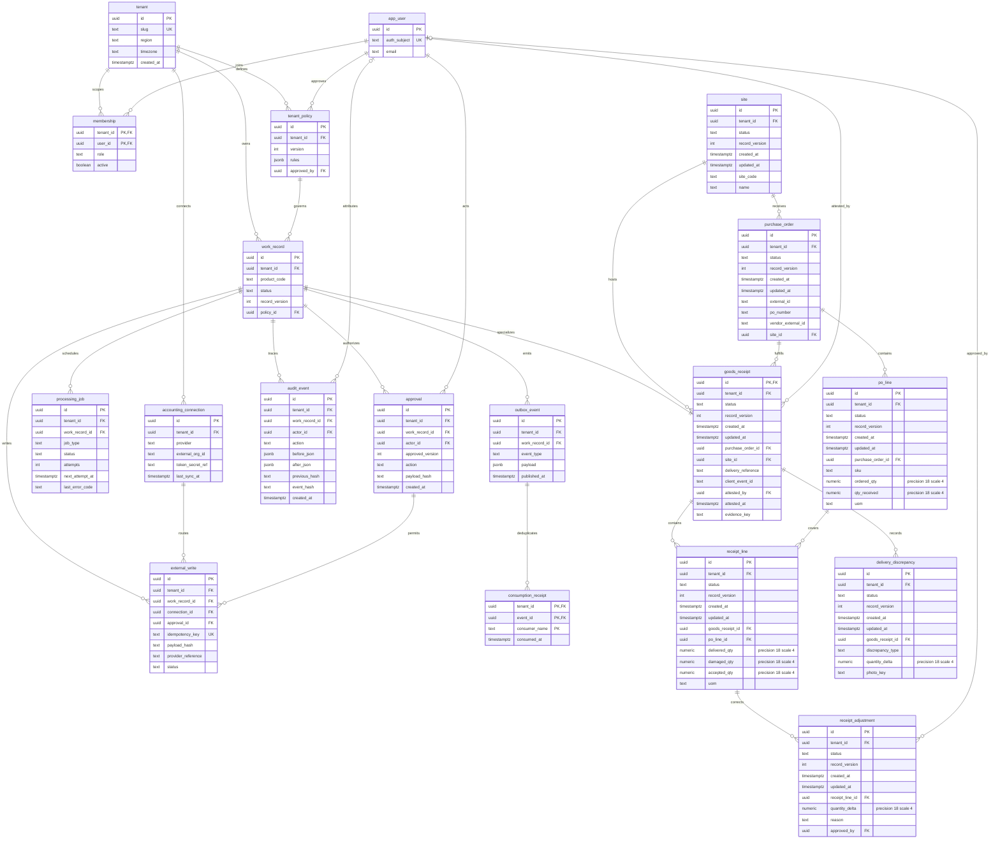
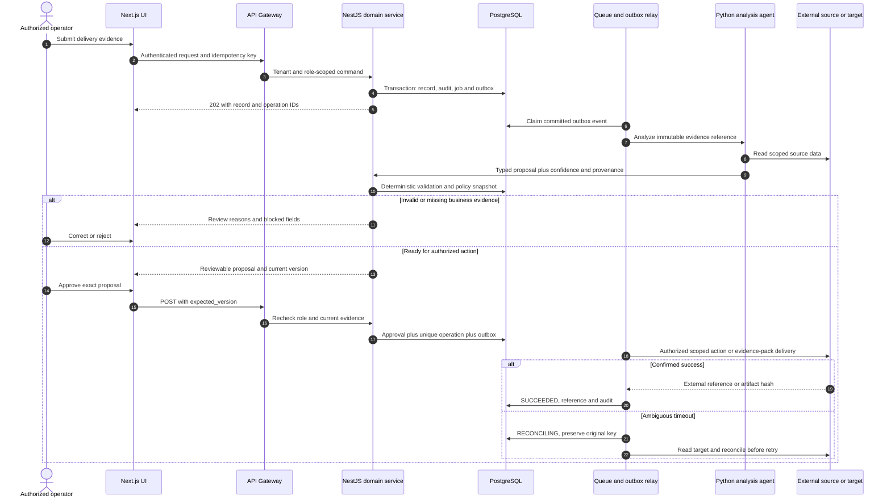
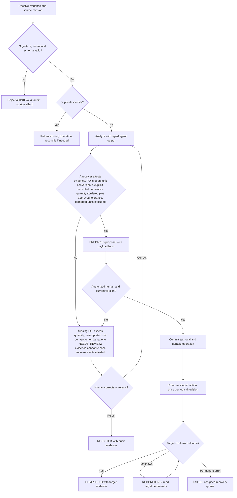

# Receiving Workflow Agent — Requirements — PRD, BRD & FRD

[Portfolio index](../README.md) · [Phase 1](01-ideation-and-strategy.md) · [Phase 2](02-roadmapping-and-scoping.md) · [Phase 3](03-requirements-prd-frd.md) · [Phase 4](04-sprint-execution-and-triage.md) · [Phase 5](05-testing-qa-and-uat.md) · [Phase 6](06-launch-gtm-and-telemetry.md)

**Document control:** RW-P3, revision 1.0, authored 2026-10-17. Status: proposed portfolio design; implementation, customer research, tests and stakeholder approvals have not been performed.

**Source boundary:** Expansion offer, source p. 20: proposed when AWAITING_RECEIPT volume is high. Detailed receipt workflow is an architectural proposal. [Primary document](../../MatchClerk-Project-Implementation.pdf). Proposed architecture and assumptions are explicitly recorded in [the evidence register](../source-and-assumptions.md).

## Scope, actors and requirement identity

| BR ID | Business requirement | Success evidence |
| --- | --- | --- |
| RW-BR-01 | Capture and attest partial goods receipts against PO lines, surface shortages and damage, and unblock invoice matching only when received evidence is valid. | ≥80% within one business day, with zero over-allocation |
| RW-BR-02 | Preserve accountable human control and tenant isolation | OCR proposes quantities; staff attest physical receipt. A receipt does not create an accounting liability or payment. |
| RW-BR-03 | Recover safely from malformed input, duplicate events and partial failure | No duplicate external side effect; each failed operation is discoverable and recoverable |
| RW-BR-04 | Make operating value measurable | ≥95% attested receipts link to correct PO line; receipt evidence latency p95 <1 business day; zero billed allocation above accepted quantity. |

FR-1 through FR-8 map one-to-one to US-1 through US-8 below. Stories 1–6 support BR-01/02, story 7 supports BR-02/04 and story 8 supports BR-03. Every action also inherits tenant isolation, audit and idempotency requirements. A proposed acceptance criterion is not an executed test result.

## [PM] User stories and strict acceptance criteria

### RW-US-1 / RW-FR-1 — PO lookup

As a receiving lead, I want to find open PO lines by supplier and delivery reference, so that I can record against the correct order.

```gherkin
Feature: Receiving Workflow Agent PO lookup
  Scenario: PO lookup business contract
    Given PO-501 has ten units ordered
    When I select vendor V-77 and PO-501
    Then only that tenant and site open lines appear with remaining quantity ten

  Scenario: Reject unauthorized or stale changes
    Given the actor lacks tenant or role permission, or the submitted version is stale
    When the same business action is attempted
    Then cross-tenant access returns 404, a disallowed role returns 403, and a stale mutation returns 409
    And no domain row, approval, or external side effect is committed
```

**Database assertion:** goods_receipt.purchase_order_id references PO-501. **API:** POST `/api/v1/receipts`. Read-only endpoints do not require a submitted mutation version; their negative case covers tenant and role access. 

### RW-US-2 / RW-FR-2 — Slip capture

As a receiving lead, I want to photograph a packing slip, so that I can prefill delivery quantities.

```gherkin
Feature: Receiving Workflow Agent Slip capture
  Scenario: Slip capture business contract
    Given a clean slip shows eight units delivered
    When the extraction agent reads the image
    Then eight units appear as a proposal with confidence and require my attestation

  Scenario: Reject unauthorized or stale changes
    Given the actor lacks tenant or role permission, or the submitted version is stale
    When the same business action is attempted
    Then cross-tenant access returns 404, a disallowed role returns 403, and a stale mutation returns 409
    And no domain row, approval, or external side effect is committed
```

**Database assertion:** goods_receipt.status='NEEDS_REVIEW'; receipt_line.delivered_qty=8.0000. **API:** POST `/api/v1/receipts/{id}/extract`. Read-only endpoints do not require a submitted mutation version; their negative case covers tenant and role access. 

### RW-US-3 / RW-FR-3 — Partial attestation

As a receiving lead, I want to attest a partial delivery, so that I can release only goods physically accepted.

```gherkin
Feature: Receiving Workflow Agent Partial attestation
  Scenario: Partial attestation business contract
    Given ten units are ordered and eight arrived with one damaged
    When I attest delivered eight and damaged one
    Then accepted quantity is seven and the remaining unreceived quantity is three

  Scenario: Reject unauthorized or stale changes
    Given the actor lacks tenant or role permission, or the submitted version is stale
    When the same business action is attempted
    Then cross-tenant access returns 404, a disallowed role returns 403, and a stale mutation returns 409
    And no domain row, approval, or external side effect is committed
```

**Database assertion:** receipt_line.accepted_qty=7.0000; po_line.qty_received=7.0000. **API:** POST `/api/v1/receipts/{id}/attest`. Read-only endpoints do not require a submitted mutation version; their negative case covers tenant and role access. 

### RW-US-4 / RW-FR-4 — Over-receipt control

As a operations manager, I want to review delivery above ordered quantity, so that I can prevent unauthorized over-allocation.

```gherkin
Feature: Receiving Workflow Agent Over-receipt control
  Scenario: Over-receipt control business contract
    Given PO remaining quantity is three
    When a receiver submits four accepted units with zero tolerance
    Then the receipt enters NEEDS_REVIEW with a one-unit excess and no rematch release

  Scenario: Reject unauthorized or stale changes
    Given the actor lacks tenant or role permission, or the submitted version is stale
    When the same business action is attempted
    Then cross-tenant access returns 404, a disallowed role returns 403, and a stale mutation returns 409
    And no domain row, approval, or external side effect is committed
```

**Database assertion:** goods_receipt.status='NEEDS_REVIEW'; outbox release count=0. **API:** POST `/api/v1/receipts/{id}/evaluate`. Read-only endpoints do not require a submitted mutation version; their negative case covers tenant and role access. 

### RW-US-5 / RW-FR-5 — Evidence correction

As a receiving lead, I want to amend a mistaken attestation with a reversal, so that I can retain a defensible history.

```gherkin
Feature: Receiving Workflow Agent Evidence correction
  Scenario: Evidence correction business contract
    Given receipt R1 incorrectly attested seven accepted units
    When I add a negative one-unit adjustment with reason
    Then the original stays immutable and net accepted quantity becomes six

  Scenario: Reject unauthorized or stale changes
    Given the actor lacks tenant or role permission, or the submitted version is stale
    When the same business action is attempted
    Then cross-tenant access returns 404, a disallowed role returns 403, and a stale mutation returns 409
    And no domain row, approval, or external side effect is committed
```

**Database assertion:** receipt_adjustment.quantity_delta=-1.0000; receipt_line.accepted_qty remains 7.0000. **API:** POST `/api/v1/receipts/{id}/adjustments`. Read-only endpoints do not require a submitted mutation version; their negative case covers tenant and role access. 

### RW-US-6 / RW-FR-6 — Unblock matching

As a AP clerk, I want to receive a rematch after receipt confirmation, so that I can avoid manual cross-team chasing.

```gherkin
Feature: Receiving Workflow Agent Unblock matching
  Scenario: Unblock matching business contract
    Given invoice INV-1042 bills seven units and accepted quantity is seven
    When the attestation event commits
    Then one rematch event is consumed and invoice matching re-evaluates quantity coverage

  Scenario: Reject unauthorized or stale changes
    Given the actor lacks tenant or role permission, or the submitted version is stale
    When the same business action is attempted
    Then cross-tenant access returns 404, a disallowed role returns 403, and a stale mutation returns 409
    And no domain row, approval, or external side effect is committed
```

**Database assertion:** outbox_event.event_type='receipt.attested'; consumption_receipt count=1. **API:** POST `/api/v1/receipts/{id}/publish`. Read-only endpoints do not require a submitted mutation version; their negative case covers tenant and role access. 

### RW-US-7 / RW-FR-7 — Site authorization

As a operations manager, I want to restrict receipt attestation by site, so that I can keep physical evidence accountable.

```gherkin
Feature: Receiving Workflow Agent Site authorization
  Scenario: Site authorization business contract
    Given a receiver belongs only to Site-A
    When they request a Site-B receipt
    Then the API returns 404 without exposing the supplier or PO

  Scenario: Reject unauthorized or stale changes
    Given the actor lacks tenant or role permission, or the submitted version is stale
    When the same business action is attempted
    Then cross-tenant access returns 404, a disallowed role returns 403, and a stale mutation returns 409
    And no domain row, approval, or external side effect is committed
```

**Database assertion:** audit_event.action='ACCESS_DENIED'; goods_receipt unchanged. **API:** GET `/api/v1/receipts/{id}`. Read-only endpoints do not require a submitted mutation version; their negative case covers tenant and role access. 

### RW-US-8 / RW-FR-8 — Offline replay

As a receiving lead, I want to submit a saved draft after reconnecting, so that I can avoid duplicate received quantities.

```gherkin
Feature: Receiving Workflow Agent Offline replay
  Scenario: Offline replay business contract
    Given a local draft has client_event_id DEL-8801-A
    When the device submits it twice
    Then one receipt is committed and both responses identify the same receipt

  Scenario: Reject unauthorized or stale changes
    Given the actor lacks tenant or role permission, or the submitted version is stale
    When the same business action is attempted
    Then cross-tenant access returns 404, a disallowed role returns 403, and a stale mutation returns 409
    And no domain row, approval, or external side effect is committed
```

**Database assertion:** UNIQUE(tenant_id,client_event_id) prevents a second goods_receipt. **API:** POST `/api/v1/receipts/offline-sync`. Read-only endpoints do not require a submitted mutation version; their negative case covers tenant and role access. Recovery acceptance: replay the source event or request and confirm the original operation identity and side-effect count.

## [BSA] Domain model and entity relationships

This diagram includes domain tables and the shared control tables required by this product. UUIDs are internal keys; external IDs remain text. Every domain table includes tenant_id, status, record_version and timestamps. Approval-bearing aggregate tables (goods_receipt) share their ID with work_record.id; API/domain updates keep both states synchronized in one transaction. A work_record specializes into exactly one aggregate type, not every linked type simultaneously.



### Physical constraints and integrity rules

| Rule | Concrete implementation |
| --- | --- |
| Tenant-safe foreign keys | Tenant-owned tables have UNIQUE(tenant_id,id); intra-tenant foreign keys use (tenant_id,parent_id) → parent(tenant_id,id), even where the ER diagram abbreviates the key. Global app_user/tenant keys are exceptions; actor scope additionally references membership(tenant_id,user_id). |
| Money and quantity | numeric(18,2) for currency amounts; numeric(18,4) for quantities/unit prices; numeric(9,6) for ratios; JSON monetary values are decimal strings. ISO-4217 currency is char(3). Round only at declared posting boundaries. |
| Optimistic mutation | UPDATE work_record SET record_version=record_version+1 WHERE tenant_id=session_tenant AND id=record_id AND record_version=expected_version; zero rows → 409 STALE_VERSION. |
| Approval binding | approval stores approved_version and SHA-256 of canonical mutation payload. Unique work_record_id + approved_version + action prevents duplicate authorization. Revoke validity when business evidence changes. |
| Write identity | external_write.idempotency_key is unique and immutable; bind it to tenant, connection, record, action and business revision. A reused key with changed payload returns 409 IDEMPOTENCY_CONFLICT. |
| Event delivery | Create domain update, audit row, processing_job and outbox row in one PostgreSQL transaction. Consumption receipt unique key is (tenant_id,event_id,consumer_name). Delivery is at-least-once. |
| Audit immutability | Application roles cannot UPDATE/DELETE audit_event; daily signed hash manifest in locked object storage. System events have null actor_id and explicit service identity in after_json. |
| Indexes | CREATE INDEX on domain aggregate (tenant_id,status,created_at DESC); processing_job (status,next_attempt_at); audit_event (tenant_id,work_record_id,created_at); external_write (tenant_id,provider_reference). |
| Domain invariants | accepted_qty = delivered_qty - damaged_qty. Partial receipts accumulate per PO line. Returns are append-only negative adjustments linked to the original receipt; never erase a historical attestation. |
| Retention deletion | Evidence objects and operational rows follow tenant policy; audit personal identifiers are minimized and removed under verified deletion unless a documented legal hold applies. Hashes are not assumed anonymous. |

### API contract and source-to-target mapping

REST JSON over HTTPS, versioned at /api/v1. Authenticate via HttpOnly OIDC-backed session for UI and scoped service credentials for callbacks. Tenant identity never comes from a client body. All mutating requests carry Idempotency-Key; updates also carry expected_version. Body size limit is 1 MB JSON; files use signed upload. Example UUIDs are synthetic fixtures, not live data. API requests below show action inputs; the intake payload is also specified separately.

**Canonical intake example:** `{"delivery_reference":"DEL-8801","po_external_id":"PO-501","site_code":"SITE-A","client_event_id":"DEL-8801-A","lines":[{"po_line_external_id":"1","delivered_qty":"8.0000","damaged_qty":"1.0000","uom":"EA"}]}`

| FRD / API ID | Method and endpoint | Request JSON | Success JSON / status | Internal target mapping | Errors |
| --- | --- | --- | --- | --- | --- |
| RW-FR-1 / API-1 | POST /api/v1/receipts | `{"delivery_reference":"DEL-8801","po_external_id":"PO-501","site_code":"SITE-A","client_event_id":"DEL-8801-A","lines":[{"po_line_external_id":"1","delivered_qty":"8.0000","damaged_qty":"1.0000","uom":"EA"}]}` | 202 `{"id":"22222222-2222-4222-8222-222222222222","operation_id":"33333333-3333-4333-8333-333333333333","status":"RECEIVED","record_version":1,"po_external_id":"PO-501","remaining_qty":"10.0000"}` | receipt_line.po_line_id | 400 SCHEMA_INVALID; 403 POLICY_DENIED; 409 STALE_VERSION; 422 RULE_VIOLATION; 429 RATE_LIMITED |
| RW-FR-2 / API-2 | POST /api/v1/receipts/{id}/extract | `{"expected_version":1}` | 202 `{"id":"22222222-2222-4222-8222-222222222222","operation_id":"33333333-3333-4333-8333-333333333333","status":"NEEDS_REVIEW","record_version":2,"delivered_qty":"8.0000","attestation_required":true}` | receipt_line.delivered_qty | 400 SCHEMA_INVALID; 403 POLICY_DENIED; 409 STALE_VERSION; 422 RULE_VIOLATION; 429 RATE_LIMITED |
| RW-FR-3 / API-3 | POST /api/v1/receipts/{id}/attest | `{"expected_version":2,"delivered_qty":"8.0000","damaged_qty":"1.0000"}` | 200 `{"id":"22222222-2222-4222-8222-222222222222","operation_id":"33333333-3333-4333-8333-333333333333","status":"ATTESTED","record_version":3,"accepted_qty":"7.0000","remaining_qty":"3.0000"}` | receipt_line.damaged_qty | 400 SCHEMA_INVALID; 403 POLICY_DENIED; 409 STALE_VERSION; 422 RULE_VIOLATION; 429 RATE_LIMITED |
| RW-FR-4 / API-4 | POST /api/v1/receipts/{id}/evaluate | `{"expected_version":3}` | 202 `{"id":"22222222-2222-4222-8222-222222222222","operation_id":"33333333-3333-4333-8333-333333333333","status":"NEEDS_REVIEW","record_version":4,"reason_code":"OVER_RECEIPT","excess_qty":"1.0000"}` | receipt_line.accepted_qty | 400 SCHEMA_INVALID; 403 POLICY_DENIED; 409 STALE_VERSION; 422 RULE_VIOLATION; 429 RATE_LIMITED |
| RW-FR-5 / API-5 | POST /api/v1/receipts/{id}/adjustments | `{"quantity_delta":"-1.0000","reason":"One unit rejected after inspection"}` | 201 `{"id":"22222222-2222-4222-8222-222222222222","operation_id":"33333333-3333-4333-8333-333333333333","status":"ADJUSTMENT_PROPOSED","record_version":4,"quantity_delta":"-1.0000"}` | goods_receipt.client_event_id | 400 SCHEMA_INVALID; 403 POLICY_DENIED; 409 STALE_VERSION; 422 RULE_VIOLATION; 429 RATE_LIMITED |
| RW-FR-6 / API-6 | POST /api/v1/receipts/{id}/publish | `{"expected_version":4}` | 202 `{"id":"22222222-2222-4222-8222-222222222222","operation_id":"33333333-3333-4333-8333-333333333333","status":"RELEASE_QUEUED","record_version":5,"event_type":"receipt.attested"}` | goods_receipt.client_event_id | 400 SCHEMA_INVALID; 403 POLICY_DENIED; 409 STALE_VERSION; 422 RULE_VIOLATION; 429 RATE_LIMITED |
| RW-FR-7 / API-7 | GET /api/v1/receipts/{id} | `null` | 200 `{"id":"22222222-2222-4222-8222-222222222222","result":"RECEIPT_RETURNED","record_version":4,"delivery_reference":"DEL-8801"}` | goods_receipt.client_event_id | 400 SCHEMA_INVALID; 403 POLICY_DENIED; 409 STALE_VERSION; 422 RULE_VIOLATION; 429 RATE_LIMITED |
| RW-FR-8 / API-8 | POST /api/v1/receipts/offline-sync | `{"delivery_reference":"DEL-8801","po_external_id":"PO-501","site_code":"SITE-A","client_event_id":"DEL-8801-A","lines":[{"po_line_external_id":"1","delivered_qty":"8.0000","damaged_qty":"1.0000","uom":"EA"}]}` | 202 `{"id":"22222222-2222-4222-8222-222222222222","operation_id":"33333333-3333-4333-8333-333333333333","status":"RECEIVED","record_version":4,"client_event_id":"DEL-8801-A","duplicate":false}` | goods_receipt.client_event_id | 400 SCHEMA_INVALID; 403 POLICY_DENIED; 409 STALE_VERSION; 422 RULE_VIOLATION; 429 RATE_LIMITED |

For 202 responses, the body reflects **acceptance state**, not final downstream success. Updates accepted at expected_version 4 return revision 5; intake creates revision 1. Independent scenario fixtures explain differing versions between rows. Clients use returned versions, not a hard-coded constant. A GET result with an artifact returns JSON metadata (download_url, expires_at, sha256); the binary is fetched through the authenticated evidence gateway. A full record response contains the fields from the domain ERD, validation reasons and provenance. Read-only policy-denial and budget checks return their decision without performing the proposed action.

| Source field / system | API field or derivation | Target table.column | Transformation and rejection rule |
| --- | --- | --- | --- |
| PO source line Id | po_line_external_id | receipt_line.po_line_id | Resolve tenant+connection+PO+line key |
| Slip delivered units | lines[].delivered_qty | receipt_line.delivered_qty | Decimal(18,4); require explicit uom |
| Receiver damaged units | lines[].damaged_qty | receipt_line.damaged_qty | 0 ≤ damaged ≤ delivered |
| Accepted units | accepted_qty | receipt_line.accepted_qty | delivered minus damaged; never OCR-attested |
| Mobile replay reference | client_event_id | goods_receipt.client_event_id | Unique per tenant across retries |

| Contract | Exact rule / example |
| --- | --- |
| Error envelope | `{"error":{"code":"STALE_VERSION","message":"Record changed after review","retryable":false,"request_id":"req-fixture-17","current_version":5}}` |
| Additional statuses | 401 AUTH_REQUIRED; 404 RECORD_NOT_FOUND; 413 FILE_TOO_LARGE; 415 UNSUPPORTED_MEDIA; 424 DEPENDENCY_UNAVAILABLE; 503 TEMPORARY_UNAVAILABLE. Domain detail codes include those in the Phase 4 triage log. |
| Upload safety | PDF/PNG up to 25 MB per file; ZIP up to 25 MB compressed, 100 MB expanded, 100 members and depth 1. Reject executable MIME, path traversal, encrypted archives and malicious files; scan before extraction. |
| Paging | GET collection uses limit ≤100 and opaque cursor; deterministic created_at,id order; no unbounded full-tenant export. |
| Webhook signature | Verify provider signature on raw body before parsing. Persist provider event identity before returning 202. Provider-authenticated replay is deduplicated, not dropped based only on age. |
| Provider failure | 429 honors Retry-After; 5xx/network retries use jittered backoff. Timeout with unknown write outcome enters RECONCILING and must not issue an immediate second create. |

## [BSA] System sequence



For a product with an internal evidence-pack or event output, the final external participant means the authorized consumer or artifact store; it does not imply a financial write. OCR proposes quantities; staff attest physical receipt. A receipt does not create an accounting liability or payment.

## [BSA] Business rules and UAT/system decision flow



**State contract:** RECEIVED → ANALYZING → NEEDS_REVIEW or PREPARED → APPROVED → RUNNING → COMPLETED. Domain-specific states (such as NEEDS_REVIEW; evidence cannot release an invoice until attested.) refine the control state; raw status transitions are never accepted from clients. REJECTED is terminal for that business revision. A corrected record creates a new revision and invalidates prior approval. FAILED/RECONCILING are explicit recovery states; only service commands with allowed transitions can change them.

## [PM & BSA] Formal sign-off record

| Document / control | Accountable stakeholder | Acceptance evidence | Decision / signature state |
| --- | --- | --- | --- |
| BRD: BR-01 to BR-04 | Economic buyer / PM | Validated problem, baseline, price and control ownership | Review required; no stakeholder signature recorded |
| PRD: US-1 to US-8 | Product owner + customer process owner | Story walkthrough and five-scenario UAT acceptance | Review required; no stakeholder signature recorded |
| FRD: API, ERD and process model | BSA + engineering lead | Mapping workshop, contract tests and migration review | Review required; no stakeholder signature recorded |
| Architecture and threat controls | Solutions architect + security owner | Capability spikes, tenant tests and restore evidence | Review required; no stakeholder signature recorded |
| Financial side-effect boundary | Customer controller | Approval, duplicate and reconciliation evidence | Review required; no stakeholder signature recorded |

Approval requires named reviewer, UTC decision timestamp, artifact revision and evidence link in the actual delivery system. This portfolio records the review mechanism without fabricating approval.
