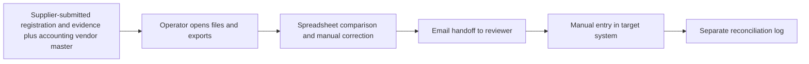
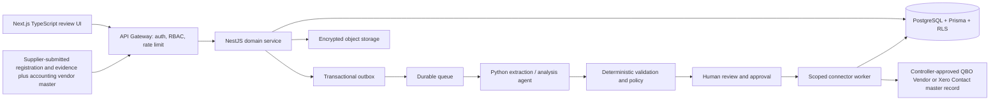

# Vendor Onboarding Agent — Ideation & Strategy

[Portfolio index](../README.md) · [Phase 1](01-ideation-and-strategy.md) · [Phase 2](02-roadmapping-and-scoping.md) · [Phase 3](03-requirements-prd-frd.md) · [Phase 4](04-sprint-execution-and-triage.md) · [Phase 5](05-testing-qa-and-uat.md) · [Phase 6](06-launch-gtm-and-telemetry.md)

**Document control:** VO-P1, revision 1.0, authored 2026-10-17. Status: proposed portfolio design; implementation, customer research, tests and stakeholder approvals have not been performed.

**Source boundary:** Named parallel upsell, source p. 14. The source provides the name only; structured evidence collection and controlled vendor-master synchronization are proposed scope. [Primary document](../../MatchClerk-Project-Implementation.pdf). Proposed architecture and assumptions are explicitly recorded in [the evidence register](../source-and-assumptions.md).

## [PM] Source objective and discovery hypothesis

AP teams onboard suppliers through scattered emails, duplicate records and incomplete evidence, delaying invoice processing and weakening accountability. Collect supplier identity and contact data, validate required evidence, obtain independent controller approval, and synchronize a verified vendor record without changing bank details. The beachhead is MatchClerk and Full AP customers adding 20–100 suppliers/month with a named AP intake owner and independent controller reviewer. Discovery statements below are research hypotheses, not completed interviews or observed customer outcomes.

| BR ID | Business requirement | Success evidence |
| --- | --- | --- |
| VO-BR-01 | Collect supplier identity and contact data, validate required evidence, obtain independent controller approval, and synchronize a verified vendor record without changing bank details. | ≥85% complete within two business days of receiving complete evidence |
| VO-BR-02 | Preserve accountable human control and tenant isolation | No bank account collection or update. A human verifies supplier evidence and approves the exact vendor-master payload; the agent cannot certify legal or tax compliance. |
| VO-BR-03 | Recover safely from malformed input, duplicate events and partial failure | No duplicate external side effect; each failed operation is discoverable and recoverable |
| VO-BR-04 | Make operating value measurable | Required-field completeness 100% before approval; duplicate review precision ≥95% on labeled cases; zero bank-field writes; ≥85% two-business-day completion. |

### Competitive analysis

Primary vendor documentation reviewed 2026-10-17. Capability descriptions are limited to published material; tradeoff judgments are our inference. Prices and missing features are not inferred from silence. Broad-suite competitors can serve SMEs: the source's blanket market-gap assertion is a hypothesis requiring validation.

| Alternative | Published capability | Fit / evaluation question | Proposed differentiation to test |
| --- | --- | --- | --- |
| [Tipalti](https://tipalti.com/accounts-payable-software/) | AP automation, supplier management and international payments | Global payment breadth exceeds the proposed supervised SME scope | Vendor Onboarding Agent: Collect supplier identity and contact data, validate required evidence, obtain independent controller approval, and synchronize a verified vendor record without changing bank details. Test evidence quality and implementation effort with the same customer scenario. |
| [Medius Supplier Onboarding](https://www.medius.com/solutions/supplier-onboarding/) | Supplier forms, evidence collection and approval | Dedicated onboarding alternative; compare controlled SME accounting synchronization | Vendor Onboarding Agent: Collect supplier identity and contact data, validate required evidence, obtain independent controller approval, and synchronize a verified vendor record without changing bank details. Test evidence quality and implementation effort with the same customer scenario. |
| [Stampli Vendor Management](https://www.stampli.com/vendor-management/) | Vendor onboarding forms, verification, documents and readiness review | Broader vendor-management scope; compare implementation and evidence burden | Vendor Onboarding Agent: Collect supplier identity and contact data, validate required evidence, obtain independent controller approval, and synchronize a verified vendor record without changing bank details. Test evidence quality and implementation effort with the same customer scenario. |

### Personas

These are designed research archetypes. Names do not represent interviewed customers.

| Persona / role | Goals | Pain points | Daily workflow | Technical proficiency |
| --- | --- | --- | --- | --- |
| Leena — AP intake specialist | Prepare complete supplier registrations | Missing contact data and repeated email follow-ups | Collect evidence; inspect duplicates; submit for review | High spreadsheets; medium accounting systems |
| Ava — Controller | Authorize legitimate supplier master entries | Weak evidence and requester self-approval | Verify checklist; resolve duplicates; approve sync | High finance; medium software |
| Jules — Supplier administrator | Submit a registration once and track progress | Unclear requirements and insecure attachments | Enter business details; upload requested documents; answer review questions | Medium web forms; low API knowledge |

### Discovery and validation plan

| Method / sample | Concrete prompt or exercise | Decision threshold | Owner |
| --- | --- | --- | --- |
| Six buyer interviews across two target segments | Walk through the last vendor application that was delayed; show the actual handoff and current time spent. | At least 4/6 demonstrate the same core pain and name a budget owner. | PM |
| Five observed operator sessions | Process five representative records using the current workflow; time active work separately from waiting. | Observed baseline replaces the ROI estimate; at least 3/5 complete the proposed flow without coaching. | PM + UX |
| Three technical discovery workshops | Inspect source fields, permissions, data exports and failure/replay behavior in a sandbox. | All mandatory source fields map and the human control boundary is feasible. | BSA + integration lead |
| Two design partners, 30-day pilot | Compare a consented baseline cohort with a parallel-run cohort; log every correction and failure. | Achieve the product gates in Phase 5 before GA; no fabricated case study claim. | Pilot success lead |

## [PM] Vision, positioning and business case

**Vision:** For MatchClerk and Full AP customers adding 20–100 suppliers/month with a named AP intake owner and independent controller reviewer. Vendor Onboarding Agent is a supervised operational product that collect supplier identity and contact data, validate required evidence, obtain independent controller approval, and synchronize a verified vendor record without changing bank details. Its value is measured by verified supplier applications completed before the first invoice requires them, with explicit evidence and human accountability.

**Value proposition:** Replace fragmented manual handoffs with one traceable work queue, typed validation and an authorized next action. The defensible wedge to test is faster deployment into the customer's existing process and clearer control evidence. Competitive superiority has not been demonstrated.

**Commercial model:** Proposed monthly subscription of USD 750.00 for the modeled 100 vendor applications; implementation USD 1,000.00. MatchClerk prices are source recommendations; expansion prices are portfolio hypotheses. No market-size estimate is invented.

| ROI input or output | Illustrative value | Calculation / interpretation |
| --- | --- | --- |
| Monthly eligible volume | 100 vendor applications | Model assumption; replace with pilot logs |
| Active manual handling | 45 → 15 minutes/vendor application | Excludes waiting and assumes human review remains |
| Loaded labor rate | USD 40/hour | Illustrative input; not a wage benchmark |
| Gross monthly capacity value | USD 2,000.00 | 100 × (45-15) / 60 × 40 |
| Net monthly value after fee | USD 1,250.00 | 2,000.00 - 750.00; recovered capacity is not automatically cash savings |
| Customer implementation payback | 0.80 months | One-time fee / net monthly capacity value; validate with buyer |
| Modeled monthly COGS | USD 145.00 | 100 × 0.25 variable processing + 40 infrastructure + 80 allocated support |
| Modeled gross margin | 80.7% | Revenue less modeled COGS; excludes sales/R&D; support allocation must be validated |
| 50% realization sensitivity | USD 250.00 net/month | Half the modeled labor benefit; do not expand if measured customer value is negative |

For Full AP, component subscriptions are bundled and the infrastructure allocation includes shared component operations. For every product, cloud/API licensing and human support must be re-estimated before a commercial commitment. Break-even volume at this labor model is 38 eligible records/month. A high gross-margin estimate alone does not establish demand.

## [BSA] As-Is and To-Be feasibility

| Gap | Target design | Feasibility proof / dependency | Residual risk |
| --- | --- | --- | --- |
| Manual interpretation and missing provenance | Typed extraction with page/row evidence; deterministic rule engine | Required legal-name/contact fields present; document evidence verified by a human; duplicate candidates resolved; intake actor differs from approver; external vendor mapping rechecked. | Confidence must be evaluated on representative labeled inputs |
| No reliable handoff ownership | Role-based queue with statuses, owner and business deadline | Missing evidence, possible duplicate identity, conflicting vendor record or expired review → NEEDS_REVIEW; bank-detail changes are excluded. | Review bottleneck if staffing is insufficient |
| Fragmented target writes | Scoped adapter with operation ledger and reconciliation | Requires vendor/contact read-write connector capability, an approved evidence checklist and independent controller reviewer. | Provider capabilities vary by subscription, region and API version |
| Spreadsheet access without strong isolation | Session-derived tenant, RLS, composite foreign keys and encrypted objects | Negative tenant/role tests plus restore drill before launch | Application roles and pooled DB sessions require careful reset |
| No closed-loop value evidence | Outcome events joined to source lineage and adoption cohorts | Pilot baseline plus telemetry definitions in Phase 6 | Attribution can overstate savings without a comparable baseline |

**Architectural decision:** Deploy a modular NestJS service and independent Python workers, rather than separate microservices for every feature. Use PostgreSQL as the durable source of truth, AWS SQS for ordinary background work, Redis for rate-limit counters and cache, and S3 SSE-KMS for evidence. Long-lived work state stays in PostgreSQL; queues deliver work, not authoritative approval state. Source stack options are resolved in [platform architecture](../platform-architecture.md); no implementation is claimed.

**Product-specific feasibility constraint:** Exact vendor matches use tenant, external organization and immutable external ID. Normalized legal name plus postal region only creates a candidate; it never auto-merges suppliers. A changed identity/contact payload invalidates prior approval and requires independent review.

**Investment gate:** Fund the pilot only after the source-field mapping, control boundary and two design-partner commitments are validated. PM owns demand and economic evidence; BSA owns integration and data feasibility. Stop expansion if high-severity control defects persist or the measured benefit is below the subscription cost for two pilot reviews.
