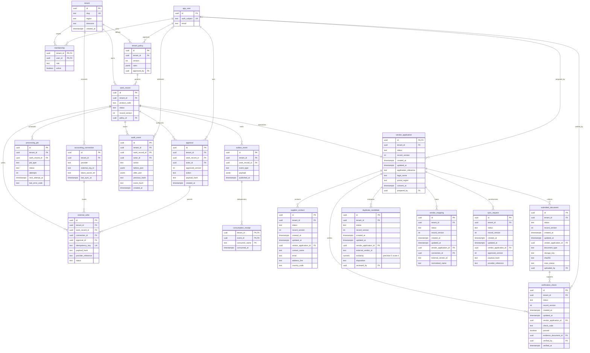
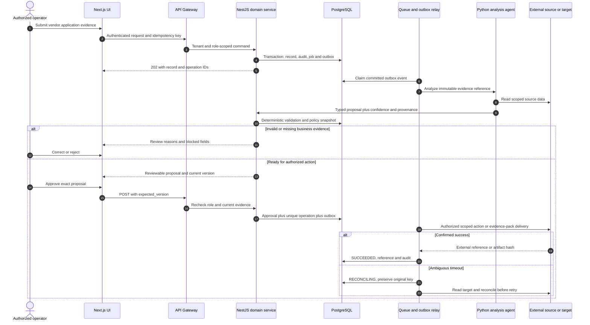
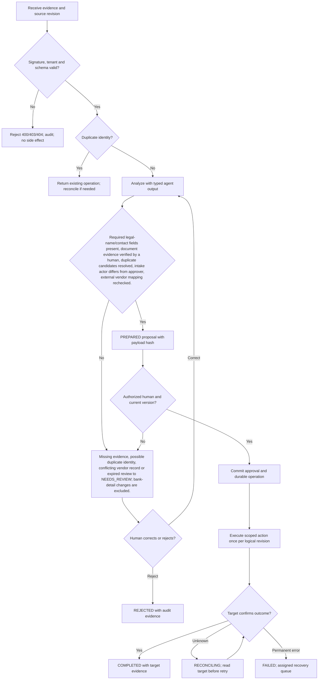

# Vendor Onboarding Agent — Requirements — PRD, BRD & FRD

[Portfolio index](../README.md) · [Phase 1](01-ideation-and-strategy.md) · [Phase 2](02-roadmapping-and-scoping.md) · [Phase 3](03-requirements-prd-frd.md) · [Phase 4](04-sprint-execution-and-triage.md) · [Phase 5](05-testing-qa-and-uat.md) · [Phase 6](06-launch-gtm-and-telemetry.md)

**Document control:** VO-P3, revision 1.0, authored 2026-10-17. Status: proposed portfolio design; implementation, customer research, tests and stakeholder approvals have not been performed.

**Source boundary:** Named parallel upsell, source p. 14. The source provides the name only; structured evidence collection and controlled vendor-master synchronization are proposed scope. [Primary document](../../MatchClerk-Project-Implementation.pdf). Proposed architecture and assumptions are explicitly recorded in [the evidence register](../source-and-assumptions.md).

## Scope, actors and requirement identity

| BR ID | Business requirement | Success evidence |
| --- | --- | --- |
| VO-BR-01 | Collect supplier identity and contact data, validate required evidence, obtain independent controller approval, and synchronize a verified vendor record without changing bank details. | ≥85% complete within two business days of receiving complete evidence |
| VO-BR-02 | Preserve accountable human control and tenant isolation | No bank account collection or update. A human verifies supplier evidence and approves the exact vendor-master payload; the agent cannot certify legal or tax compliance. |
| VO-BR-03 | Recover safely from malformed input, duplicate events and partial failure | No duplicate external side effect; each failed operation is discoverable and recoverable |
| VO-BR-04 | Make operating value measurable | Required-field completeness 100% before approval; duplicate review precision ≥95% on labeled cases; zero bank-field writes; ≥85% two-business-day completion. |

FR-1 through FR-8 map one-to-one to US-1 through US-8 below. Stories 1–6 support BR-01/02, story 7 supports BR-02/04 and story 8 supports BR-03. Every action also inherits tenant isolation, audit and idempotency requirements. A proposed acceptance criterion is not an executed test result.

## [PM] User stories and strict acceptance criteria

### VO-US-1 / VO-FR-1 — Registration intake

As a AP intake specialist, I want to create a supplier application, so that I can start an auditable onboarding record.

```gherkin
Feature: Vendor Onboarding Agent Registration intake
  Scenario: Registration intake business contract
    Given supplier Acme Supply Ltd has consented to registration
    When I enter legal name, address and contact details
    Then one application with reference VEND-2027-041 is created without an external vendor write

  Scenario: Reject unauthorized or stale changes
    Given the actor lacks tenant or role permission, or the submitted version is stale
    When the same business action is attempted
    Then cross-tenant access returns 404, a disallowed role returns 403, and a stale mutation returns 409
    And no domain row, approval, or external side effect is committed
```

**Database assertion:** vendor_application.application_reference='VEND-2027-041'; external_write count=0. **API:** POST `/api/v1/vendor-applications`. Read-only endpoints do not require a submitted mutation version; their negative case covers tenant and role access. 

### VO-US-2 / VO-FR-2 — Evidence collection

As a supplier administrator, I want to upload requested registration evidence securely, so that I can avoid emailing sensitive files.

```gherkin
Feature: Vendor Onboarding Agent Evidence collection
  Scenario: Evidence collection business contract
    Given the application requires registration evidence and an authorized invitation is active
    When I upload a clean PDF
    Then the document is scanned, encrypted and linked to the application with upload provenance

  Scenario: Reject unauthorized or stale changes
    Given the actor lacks tenant or role permission, or the submitted version is stale
    When the same business action is attempted
    Then cross-tenant access returns 404, a disallowed role returns 403, and a stale mutation returns 409
    And no domain row, approval, or external side effect is committed
```

**Database assertion:** submitted_document.scan_status='CLEAN'; submitted_document.sha256 IS NOT NULL. **API:** POST `/api/v1/vendor-applications/{id}/documents`. Read-only endpoints do not require a submitted mutation version; their negative case covers tenant and role access. 

### VO-US-3 / VO-FR-3 — Checklist validation

As a controller, I want to verify mandatory supplier evidence, so that I can avoid approving incomplete registration.

```gherkin
Feature: Vendor Onboarding Agent Checklist validation
  Scenario: Checklist validation business contract
    Given legal name is present but the contact address is missing
    When I run the verification checklist
    Then the application remains NEEDS_REVIEW with CONTACT_ADDRESS_MISSING and cannot be approved

  Scenario: Reject unauthorized or stale changes
    Given the actor lacks tenant or role permission, or the submitted version is stale
    When the same business action is attempted
    Then cross-tenant access returns 404, a disallowed role returns 403, and a stale mutation returns 409
    And no domain row, approval, or external side effect is committed
```

**Database assertion:** verification_check.check_code='CONTACT_ADDRESS'; verification_check.passed=false. **API:** POST `/api/v1/vendor-applications/{id}/checks`. Read-only endpoints do not require a submitted mutation version; their negative case covers tenant and role access. 

### VO-US-4 / VO-FR-4 — Duplicate review

As a AP intake specialist, I want to review possible existing vendors, so that I can avoid duplicate supplier records.

```gherkin
Feature: Vendor Onboarding Agent Duplicate review
  Scenario: Duplicate review business contract
    Given Acme Supply Ltd resembles existing vendor V-77
    When the duplicate search runs
    Then a candidate appears with evidence and no automatic merge or new vendor write occurs

  Scenario: Reject unauthorized or stale changes
    Given the actor lacks tenant or role permission, or the submitted version is stale
    When the same business action is attempted
    Then cross-tenant access returns 404, a disallowed role returns 403, and a stale mutation returns 409
    And no domain row, approval, or external side effect is committed
```

**Database assertion:** duplicate_candidate.external_vendor_id='V-77'; external_write count=0. **API:** POST `/api/v1/vendor-applications/{id}/duplicate-check`. Read-only endpoints do not require a submitted mutation version; their negative case covers tenant and role access. 

### VO-US-5 / VO-FR-5 — Independent approval

As a controller, I want to approve a complete application prepared by another user, so that I can retain accountable vendor controls.

```gherkin
Feature: Vendor Onboarding Agent Independent approval
  Scenario: Independent approval business contract
    Given all evidence is verified and the preparer differs from the controller
    When the controller approves current version 4
    Then one approval is bound to the canonical supplier payload hash

  Scenario: Reject unauthorized or stale changes
    Given the actor lacks tenant or role permission, or the submitted version is stale
    When the same business action is attempted
    Then cross-tenant access returns 404, a disallowed role returns 403, and a stale mutation returns 409
    And no domain row, approval, or external side effect is committed
```

**Database assertion:** approval count=1; approval.approved_version=4. **API:** POST `/api/v1/vendor-applications/{id}/approve`. Read-only endpoints do not require a submitted mutation version; their negative case covers tenant and role access. 

### VO-US-6 / VO-FR-6 — Vendor sync

As a controller, I want to synchronize the approved vendor identity once, so that I can make the supplier available to invoice processing.

```gherkin
Feature: Vendor Onboarding Agent Vendor sync
  Scenario: Vendor sync business contract
    Given the approved application has no bank fields and no unresolved duplicate
    When the connector submits the authorized vendor/contact payload
    Then one external vendor ID is stored and no financial transaction is created

  Scenario: Reject unauthorized or stale changes
    Given the actor lacks tenant or role permission, or the submitted version is stale
    When the same business action is attempted
    Then cross-tenant access returns 404, a disallowed role returns 403, and a stale mutation returns 409
    And no domain row, approval, or external side effect is committed
```

**Database assertion:** vendor_mapping.external_vendor_id IS NOT NULL; sync_request.status='SUCCEEDED'. **API:** POST `/api/v1/vendor-applications/{id}/sync`. Read-only endpoints do not require a submitted mutation version; their negative case covers tenant and role access. 

### VO-US-7 / VO-FR-7 — Full AP handoff

As a AP intake specialist, I want to publish verified onboarding completion, so that I can unblock related AP work.

```gherkin
Feature: Vendor Onboarding Agent Full AP handoff
  Scenario: Full AP handoff business contract
    Given vendor sync succeeded for V-77
    When the completion event is consumed by Full AP
    Then one component task is marked verified with source application revision

  Scenario: Reject unauthorized or stale changes
    Given the actor lacks tenant or role permission, or the submitted version is stale
    When the same business action is attempted
    Then cross-tenant access returns 404, a disallowed role returns 403, and a stale mutation returns 409
    And no domain row, approval, or external side effect is committed
```

**Database assertion:** outbox_event.event_type='vendor.verified'; consumption_receipt count=1. **API:** POST `/api/v1/vendor-applications/{id}/publish`. Read-only endpoints do not require a submitted mutation version; their negative case covers tenant and role access. 

### VO-US-8 / VO-FR-8 — Identity revision recovery

As a controller, I want to invalidate approval when supplier identity changes, so that I can prevent a stale master-data update.

```gherkin
Feature: Vendor Onboarding Agent Identity revision recovery
  Scenario: Identity revision recovery business contract
    Given a registration was approved at version 4
    When a user changes the legal name before synchronization
    Then the approval becomes stale and the new version returns to NEEDS_REVIEW

  Scenario: Reject unauthorized or stale changes
    Given the actor lacks tenant or role permission, or the submitted version is stale
    When the same business action is attempted
    Then cross-tenant access returns 404, a disallowed role returns 403, and a stale mutation returns 409
    And no domain row, approval, or external side effect is committed
```

**Database assertion:** vendor_application.record_version=5; sync_request.status='BLOCKED'. **API:** PATCH `/api/v1/vendor-applications/{id}`. Read-only endpoints do not require a submitted mutation version; their negative case covers tenant and role access. Recovery acceptance: replay the source event or request and confirm the original operation identity and side-effect count.

## [BSA] Domain model and entity relationships

This diagram includes domain tables and the shared control tables required by this product. UUIDs are internal keys; external IDs remain text. Every domain table includes tenant_id, status, record_version and timestamps. Approval-bearing aggregate tables (vendor_application) share their ID with work_record.id; API/domain updates keep both states synchronized in one transaction. A work_record specializes into exactly one aggregate type, not every linked type simultaneously.



### Physical constraints and integrity rules

| Rule | Concrete implementation |
| --- | --- |
| Tenant-safe foreign keys | Tenant-owned tables have UNIQUE(tenant_id,id); intra-tenant foreign keys use (tenant_id,parent_id) → parent(tenant_id,id), even where the ER diagram abbreviates the key. Global app_user/tenant keys are exceptions; actor scope additionally references membership(tenant_id,user_id). |
| Money and quantity | numeric(18,2) for currency amounts; numeric(18,4) for quantities/unit prices; numeric(9,6) for ratios; JSON monetary values are decimal strings. ISO-4217 currency is char(3). Round only at declared posting boundaries. |
| Optimistic mutation | UPDATE work_record SET record_version=record_version+1 WHERE tenant_id=session_tenant AND id=record_id AND record_version=expected_version; zero rows → 409 STALE_VERSION. |
| Approval binding | approval stores approved_version and SHA-256 of canonical mutation payload. Unique work_record_id + approved_version + action prevents duplicate authorization. Revoke validity when business evidence changes. |
| Write identity | external_write.idempotency_key is unique and immutable; bind it to tenant, connection, record, action and business revision. A reused key with changed payload returns 409 IDEMPOTENCY_CONFLICT. |
| Event delivery | Create domain update, audit row, processing_job and outbox row in one PostgreSQL transaction. Consumption receipt unique key is (tenant_id,event_id,consumer_name). Delivery is at-least-once. |
| Audit immutability | Application roles cannot UPDATE/DELETE audit_event; daily signed hash manifest in locked object storage. System events have null actor_id and explicit service identity in after_json. |
| Indexes | CREATE INDEX on domain aggregate (tenant_id,status,created_at DESC); processing_job (status,next_attempt_at); audit_event (tenant_id,work_record_id,created_at); external_write (tenant_id,provider_reference). |
| Domain invariants | Exact vendor matches use tenant, external organization and immutable external ID. Normalized legal name plus postal region only creates a candidate; it never auto-merges suppliers. A changed identity/contact payload invalidates prior approval and requires independent review. |
| Retention deletion | Evidence objects and operational rows follow tenant policy; audit personal identifiers are minimized and removed under verified deletion unless a documented legal hold applies. Hashes are not assumed anonymous. |

### API contract and source-to-target mapping

REST JSON over HTTPS, versioned at /api/v1. Authenticate via HttpOnly OIDC-backed session for UI and scoped service credentials for callbacks. Tenant identity never comes from a client body. All mutating requests carry Idempotency-Key; updates also carry expected_version. Body size limit is 1 MB JSON; files use signed upload. Example UUIDs are synthetic fixtures, not live data. API requests below show action inputs; the intake payload is also specified separately.

**Canonical intake example:** `{"application_reference":"VEND-2027-041","legal_name":"Acme Supply Ltd","postal_region":"CA","country_code":"US","contact":{"name":"Jules Carter","email":"registration@vendor.example","address_line":"100 Market Street"},"consent":true}`

| FRD / API ID | Method and endpoint | Request JSON | Success JSON / status | Internal target mapping | Errors |
| --- | --- | --- | --- | --- | --- |
| VO-FR-1 / API-1 | POST /api/v1/vendor-applications | `{"application_reference":"VEND-2027-041","legal_name":"Acme Supply Ltd","postal_region":"CA","country_code":"US","contact":{"name":"Jules Carter","email":"registration@vendor.example","address_line":"100 Market Street"},"consent":true}` | 202 `{"id":"22222222-2222-4222-8222-222222222222","operation_id":"33333333-3333-4333-8333-333333333333","status":"RECEIVED","record_version":1,"application_reference":"VEND-2027-041"}` | vendor_application.legal_name | 400 SCHEMA_INVALID; 403 POLICY_DENIED; 409 STALE_VERSION; 422 RULE_VIOLATION; 429 RATE_LIMITED |
| VO-FR-2 / API-2 | POST /api/v1/vendor-applications/{id}/documents | `{"document_type":"REGISTRATION","storage_key":"supplier-evidence/registration.pdf"}` | 201 `{"id":"22222222-2222-4222-8222-222222222222","operation_id":"33333333-3333-4333-8333-333333333333","status":"EVIDENCE_RECEIVED","record_version":4,"scan_status":"CLEAN"}` | supplier_contact.email | 400 SCHEMA_INVALID; 403 POLICY_DENIED; 409 STALE_VERSION; 422 RULE_VIOLATION; 429 RATE_LIMITED |
| VO-FR-3 / API-3 | POST /api/v1/vendor-applications/{id}/checks | `{"expected_version":2,"check_code":"CONTACT_ADDRESS","passed":false}` | 200 `{"id":"22222222-2222-4222-8222-222222222222","operation_id":"33333333-3333-4333-8333-333333333333","status":"NEEDS_REVIEW","record_version":3,"check_code":"CONTACT_ADDRESS","passed":false}` | submitted_document.sha256 | 400 SCHEMA_INVALID; 403 POLICY_DENIED; 409 STALE_VERSION; 422 RULE_VIOLATION; 429 RATE_LIMITED |
| VO-FR-4 / API-4 | POST /api/v1/vendor-applications/{id}/duplicate-check | `{"expected_version":3}` | 202 `{"id":"22222222-2222-4222-8222-222222222222","operation_id":"33333333-3333-4333-8333-333333333333","status":"NEEDS_REVIEW","record_version":4,"candidates":[{"external_vendor_id":"V-77","auto_merged":false}]}` | verification_check.passed | 400 SCHEMA_INVALID; 403 POLICY_DENIED; 409 STALE_VERSION; 422 RULE_VIOLATION; 429 RATE_LIMITED |
| VO-FR-5 / API-5 | POST /api/v1/vendor-applications/{id}/approve | `{"expected_version":4}` | 202 `{"id":"22222222-2222-4222-8222-222222222222","operation_id":"33333333-3333-4333-8333-333333333333","status":"APPROVED","record_version":5,"approved_version":4}` | vendor_mapping.external_vendor_id | 400 SCHEMA_INVALID; 403 POLICY_DENIED; 409 STALE_VERSION; 422 RULE_VIOLATION; 429 RATE_LIMITED |
| VO-FR-6 / API-6 | POST /api/v1/vendor-applications/{id}/sync | `{"expected_version":4}` | 202 `{"id":"22222222-2222-4222-8222-222222222222","operation_id":"33333333-3333-4333-8333-333333333333","status":"SYNC_QUEUED","record_version":5,"provider_reference":null,"bank_fields_present":false}` | vendor_mapping.external_vendor_id | 400 SCHEMA_INVALID; 403 POLICY_DENIED; 409 STALE_VERSION; 422 RULE_VIOLATION; 429 RATE_LIMITED |
| VO-FR-7 / API-7 | POST /api/v1/vendor-applications/{id}/publish | `{"expected_version":5}` | 202 `{"id":"22222222-2222-4222-8222-222222222222","operation_id":"33333333-3333-4333-8333-333333333333","status":"RELEASE_QUEUED","record_version":6,"event_type":"vendor.verified"}` | vendor_mapping.external_vendor_id | 400 SCHEMA_INVALID; 403 POLICY_DENIED; 409 STALE_VERSION; 422 RULE_VIOLATION; 429 RATE_LIMITED |
| VO-FR-8 / API-8 | PATCH /api/v1/vendor-applications/{id} | `{"expected_version":4,"legal_name":"Acme Supply Holdings Ltd"}` | 200 `{"id":"22222222-2222-4222-8222-222222222222","operation_id":"33333333-3333-4333-8333-333333333333","status":"NEEDS_REVIEW","record_version":5,"reason_code":"IDENTITY_CHANGED","approval_invalidated":true}` | vendor_mapping.external_vendor_id | 400 SCHEMA_INVALID; 403 POLICY_DENIED; 409 STALE_VERSION; 422 RULE_VIOLATION; 429 RATE_LIMITED |

For 202 responses, the body reflects **acceptance state**, not final downstream success. Updates accepted at expected_version 4 return revision 5; intake creates revision 1. Independent scenario fixtures explain differing versions between rows. Clients use returned versions, not a hard-coded constant. A GET result with an artifact returns JSON metadata (download_url, expires_at, sha256); the binary is fetched through the authenticated evidence gateway. A full record response contains the fields from the domain ERD, validation reasons and provenance. Read-only policy-denial and budget checks return their decision without performing the proposed action.

| Source field / system | API field or derivation | Target table.column | Transformation and rejection rule |
| --- | --- | --- | --- |
| Supplier registered name | legal_name | vendor_application.legal_name | Trim and normalize for search; preserve original evidence |
| Supplier contact email | contact.email | supplier_contact.email | Validate syntax; verify contact through human checklist |
| Evidence file hash | sha256 | submitted_document.sha256 | Hash scanned immutable source object |
| Controller check result | passed | verification_check.passed | Only authorized independent reviewer can mark verified |
| QBO Vendor.Id / Xero ContactID | external_vendor_id | vendor_mapping.external_vendor_id | Tenant+connection scoped; no implicit cross-entity merge |

| Contract | Exact rule / example |
| --- | --- |
| Error envelope | `{"error":{"code":"STALE_VERSION","message":"Record changed after review","retryable":false,"request_id":"req-fixture-17","current_version":5}}` |
| Additional statuses | 401 AUTH_REQUIRED; 404 RECORD_NOT_FOUND; 413 FILE_TOO_LARGE; 415 UNSUPPORTED_MEDIA; 424 DEPENDENCY_UNAVAILABLE; 503 TEMPORARY_UNAVAILABLE. Domain detail codes include those in the Phase 4 triage log. |
| Upload safety | PDF/PNG up to 25 MB per file; ZIP up to 25 MB compressed, 100 MB expanded, 100 members and depth 1. Reject executable MIME, path traversal, encrypted archives and malicious files; scan before extraction. |
| Paging | GET collection uses limit ≤100 and opaque cursor; deterministic created_at,id order; no unbounded full-tenant export. |
| Webhook signature | Verify provider signature on raw body before parsing. Persist provider event identity before returning 202. Provider-authenticated replay is deduplicated, not dropped based only on age. |
| Provider failure | 429 honors Retry-After; 5xx/network retries use jittered backoff. Timeout with unknown write outcome enters RECONCILING and must not issue an immediate second create. |

## [BSA] System sequence



For a product with an internal evidence-pack or event output, the final external participant means the authorized consumer or artifact store; it does not imply a financial write. No bank account collection or update. A human verifies supplier evidence and approves the exact vendor-master payload; the agent cannot certify legal or tax compliance.

## [BSA] Business rules and UAT/system decision flow



**State contract:** RECEIVED → ANALYZING → NEEDS_REVIEW or PREPARED → APPROVED → RUNNING → COMPLETED. Domain-specific states (such as NEEDS_REVIEW; bank-detail changes are excluded.) refine the control state; raw status transitions are never accepted from clients. REJECTED is terminal for that business revision. A corrected record creates a new revision and invalidates prior approval. FAILED/RECONCILING are explicit recovery states; only service commands with allowed transitions can change them.

## [PM & BSA] Formal sign-off record

| Document / control | Accountable stakeholder | Acceptance evidence | Decision / signature state |
| --- | --- | --- | --- |
| BRD: BR-01 to BR-04 | Economic buyer / PM | Validated problem, baseline, price and control ownership | Review required; no stakeholder signature recorded |
| PRD: US-1 to US-8 | Product owner + customer process owner | Story walkthrough and five-scenario UAT acceptance | Review required; no stakeholder signature recorded |
| FRD: API, ERD and process model | BSA + engineering lead | Mapping workshop, contract tests and migration review | Review required; no stakeholder signature recorded |
| Architecture and threat controls | Solutions architect + security owner | Capability spikes, tenant tests and restore evidence | Review required; no stakeholder signature recorded |
| Financial side-effect boundary | Customer controller | Approval, duplicate and reconciliation evidence | Review required; no stakeholder signature recorded |

Approval requires named reviewer, UTC decision timestamp, artifact revision and evidence link in the actual delivery system. This portfolio records the review mechanism without fabricating approval.
