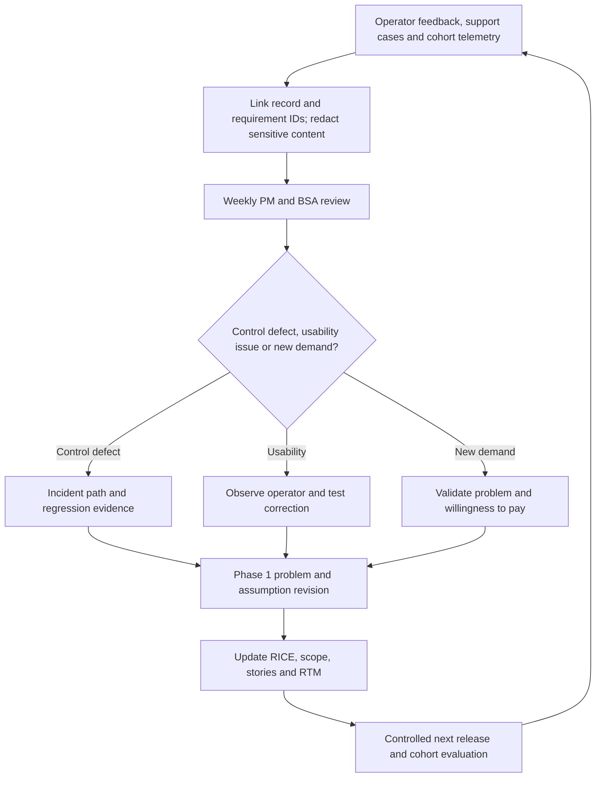

# Vendor Onboarding Agent — Launch, GTM & Telemetry

[Portfolio index](../README.md) · [Phase 1](01-ideation-and-strategy.md) · [Phase 2](02-roadmapping-and-scoping.md) · [Phase 3](03-requirements-prd-frd.md) · [Phase 4](04-sprint-execution-and-triage.md) · [Phase 5](05-testing-qa-and-uat.md) · [Phase 6](06-launch-gtm-and-telemetry.md)

**Document control:** VO-P6, revision 1.0, authored 2026-10-17. Status: proposed portfolio design; implementation, customer research, tests and stakeholder approvals have not been performed.

**Source boundary:** Named parallel upsell, source p. 14. The source provides the name only; structured evidence collection and controlled vendor-master synchronization are proposed scope. [Primary document](../../MatchClerk-Project-Implementation.pdf). Proposed architecture and assumptions are explicitly recorded in [the evidence register](../source-and-assumptions.md).

## [PM] GTM and packaging

**ICP:** MatchClerk and Full AP customers adding 20–100 suppliers/month with a named AP intake owner and independent controller reviewer. **Buyer/champion:** Controller plus the economic budget owner; recruit the daily operator early. **Positioning:** Collect supplier identity and contact data, validate required evidence, obtain independent controller approval, and synchronize a verified vendor record without changing bank details. Demonstrate the customer's own evidence trail and a blocked-case recovery, then compare observed handling time to the baseline. Sales must describe proposed capabilities and supported connectors accurately.

| Launch tier | Audience and offer | Entry / exit gate | Success signal |
| --- | --- | --- | --- |
| Private design partner | Two organizations; 30-day parallel-run; USD 500 pilot fee credited to first paid month | DPA, data consent, named controller and proven mandatory source access; no autonomous payments | Complete five UAT scenarios and baseline interviews; ≥1 repeat weekly operator per organization |
| Paid beta | Five accounts; monthly contract; lower of USD 500 or full plan fee for first month | All technical release gates; daily queue review and weekly value review | Core outcome and safe recovery demonstrated on representative data |
| General availability | Qualified ICP accounts in supported region and connector set | Two consecutive paid cohorts meet Phase 5 gates and reliability target; support owner named | Recurring weekly activation and sustained measured benefit |
| Enterprise | Contracted multi-entity scope and named workflows | Separate security/integration review, capacity test and statement of work | Outcome and control evidence accepted by customer process/IT owners |

| Package | Proposed price / allowance | Scope and guardrails |
| --- | --- | --- |
| Core | USD 750.00/month; 100 vendor applications/month | Structured supplier intake; consent and secure evidence upload; field validation; duplicate review; human verification checklist; independent approval; idempotent vendor/contact sync; audit |
| Additional usage | USD 1.00/vendor application over allowance | Only successfully accepted unique business records count; retries/replays are not separately billed |
| Implementation | USD 1,000.00 once | Source mapping, control setup, consented fixture evaluation and role training |
| Enterprise | Contract quote after discovery | Multi-entity vendor identity and entitlement-tested ERP master-data adapters; no universal connector promise |

All commercial figures are proposals; expansion prices are not present in the source. Display allowances and excluded functions before purchase. Full AP bundles underlying component access and uses one commercial allowance to avoid double charging; Enterprise includes three contracted workflows and two connectors in its modeled retainer, with changes scoped separately. Revenue/gross-margin sensitivity is in Phase 1. Do not imply verified competitor price comparisons.

### Sales and support enablement

| Asset / workflow | Concrete content | Owner / timing |
| --- | --- | --- |
| Qualification script | Ask monthly volume, process owner, source systems, mandatory fields, current handling time and approval authority; disqualify unsupported sources or autonomy expectations. | PM / before beta |
| Evidence-led demo | Use one normal case, one blocked evidence case and one replay/recovery; show review authority and target output. | Solutions consultant / before every pilot |
| ROI worksheet | 100 records × 30 minutes saved /60 × USD 40; replace with observed time before quoting benefits. | Sales lead / kickoff and day 21 |
| Security/integration pack | Data flow, role matrix, DPA/subprocessors, region, retention, connector capability ledger and honest SOC 2 control status. | BSA + security owner / before data access |
| Operator onboarding | Connect source; select policy; map vendor/SKU/job as applicable; invite operator/approver; run test input; complete first authorized outcome. | Customer success / days 1–4 |
| Support training | Find operation by request ID; distinguish review state from outage; pause tenant queue; reconcile unknown target outcomes; escalate suspected integrity issues. | Support lead / before paid beta |
| Service commitments | Business-hours help: 09:00–17:00 tenant locale on weekdays; S1 engineering pager 24×7; normal ticket response one business day. | Support lead / published before GA |

## [PM] Product KPI dictionary

Targets are pilot hypotheses unless sourced. DAU/MAU is a diagnostic for an episodic business workflow, not a substitute for completed outcomes. Bots and internal staff do not count as active users. An active user performs an intentional review, correction or approved action, rather than just logging in.

| Metric | Definition / denominator | Proposed target / decision |
| --- | --- | --- |
| North Star | Verified supplier applications completed before the first invoice requires them | ≥85% complete within two business days of receiving complete evidence |
| Account activation | Accounts completing source connection, valid first input and first accepted outcome within seven days / newly onboarded accounts | ≥70% in first two paid cohorts; investigate by source and segment |
| Adoption rate | Weekly active eligible operator seats / invited eligible operator seats, excluding disabled seats | ≥60% by week 4; also track active accounts / onboarded accounts ≥80% |
| DAU/MAU | Daily unique intentional operators / trailing-30-day unique intentional operators; timezone-normalized | Diagnostic band 20–40% on business days; compare by workflow cadence rather than assume universal benchmark |
| Time to value | Time from completed source setup to first verified business outcome; report setup-to-first separately from signup-to-first | Median ≤1 business day; p90 ≤3 business days |
| Task completion rate | Verified successful outcomes / eligible initiated records in the same intake cohort after seven days; unresolved cases remain in denominator | ≥90% by pilot week 4; show human rejection and blocked evidence separately |
| Human handling time | Sum of active review/correction intervals for a vendor application; pause after 60 seconds inactivity; exclude queue wait | Median ≤15 min; compare with observed baseline, not just the Phase 1 estimate |
| Logo churn | Paid accounts canceled during month / paid accounts active at month start; track 90-day retained cohorts | Target <1.3% monthly, approximately consistent with source annual <15% if stable; expansion target is a planning hypothesis |
| Outcome quality | Required-field completeness 100% before approval; duplicate review precision ≥95% on labeled cases; zero bank-field writes; ≥85% two-business-day completion. | PM owns numerator/denominator definitions; BSA validates lineage and event completeness |

### Event contract and analytic implementation

| Event | Trigger | Required properties / privacy |
| --- | --- | --- |
| record.received | Durable intake transaction commits | event_id, tenant_id, product_code=VO, record_id, source_type, schema_version, occurred_at |
| record.review_ready | Deterministic evidence gate result persists | record_id, policy_version, source_version, ready_at, review_reason_codes, automated_duration_ms |
| review.completed | Authorized human correction/approval/rejection commits | record_id, pseudonymous actor_id, action, active_seconds, record_version; exclude document contents |
| operation.succeeded | Target reference/artifact and verification confirmed | operation_id, record_id, provider, outcome_type, completed_at, attempt_count |
| operation.failed | Terminal failure or explicit reconciliation state enters queue | operation_id, error_code, retryable, source_version; no tokens, prompts or bank details |
| outcome.verified | Domain result passes final source/target reconciliation | record_id, cohort_date, outcome_value, measure_unit, policy_version; used for North Star numerator |

Events are emitted from the transactional outbox and deduplicated by event_id in the analytics store. Event occurred_at is UTC; cohort reporting uses tenant timezone and original intake date. Nightly reconciliation compares accepted records, outcomes and warehouse counts; a discrepancy >0.5% opens a data-quality incident. Backfilled events retain original occurred_at and are labeled backfill=true.

## [BSA] System telemetry and response policy

| Signal | Metric / target | Alert threshold | Response / owner |
| --- | --- | --- | --- |
| API latency | Read p95 ≤400 ms, p99 ≤1000 ms; mutation acceptance p95 ≤600 ms, p99 ≤1500 ms | Over target for 10 min with ≥100 requests; low traffic uses synthetic probes | S2 if core flow affected; engineering checks DB/query/pool/queue traces |
| API availability / errors | MVP 99.5%; GA target 99.9%; 5xx <0.5% | 5xx >1% for 5 min with ≥100 requests, or three consecutive synthetic failures | Page on-call; pause unsafe action path; distinguish dependency outage |
| Integrity / authorization | Zero cross-tenant access or unauthorized action | One confirmed occurrence or duplicate financial logical action | S1 immediately; disable affected write tool, preserve audit, controller/security escalation |
| Agent duration | p95 <90s; automated review-ready p95 <180s | Breach for 15 min or timeout ratio >2% over 100 jobs | Check provider health, evidence size and retry amplification; deterministic fallback/review only |
| Queue age and depth | Ready-job wait p95 <15s; normal oldest age <30s | Depth >100 or oldest >60s for 5 min; DLQ >0 for 5 min | Scale 32→64 workers within provider limits; tenant-fair throttling; investigate dead letters |
| Connector throttles | Per-connection retries and remaining quota tracked | 429 ratio >5% for 10 min, or projected remaining daily quota <10% | Honor Retry-After; reduce concurrency and pause bulk sync; integration owner |
| Logs and traces | request_id, record_id, operation_id, tenant pseudonym and error_code | Same terminal error_code ≥5 times/tenant/hour or unknown exception ≥3/5min | Create grouped issue with redacted evidence; never log full payloads or OAuth secrets |
| Cost per unit | Variable processing model USD 0.25/vendor application; capture model tokens, OCR pages, retries, compute_ms and storage_bytes | p95 variable cost >2× model or daily spend >120% forecast | Cost owner investigates input size and retries; enforce per-tenant budget; preserve required review |
| Database / recovery | CPU <70%, connection pool <80%, PITR lag ≤15 min | Pool >85% for 10 min; backup/PITR failure or lag >15 min | S2; shed noncritical bulk work, repair backup and rerun restore validation |
| Stuck states | processing job lease 5 min; heartbeat every 30s | No heartbeat for 2 min or active job older than 15 min | Reclaim via durable operation ledger; reconcile before repeating any target mutation |

**Cost attribution:** attach provider/model identifier, input/output token counts, OCR pages and versioned unit-rate reference to each job; calculate actual vendor spend plus allocated compute/storage. Pricing rates are read from contracted invoices/configuration, not hard-coded assumptions about current model prices. Never store customer prompt content to measure tokens. Daily tenant processing cap is 120% of its planned variable processing budget; queue further expensive analysis for operator review rather than silently dropping records.

### Incident escalation and rollout control

| Severity | Trigger | Escalation / timing | Recovery gate |
| --- | --- | --- | --- |
| S1 | Tenant breach, unapproved mutation, duplicate liability or material data corruption | Page engineer and security immediately; acknowledge ≤15 min; PM/controller informed ≤30 min; customer update through approved incident channel ≤60 min | Affected path remains paused until evidence reconciles and engineering, security and controller authorize recovery |
| S2 | Core workflow unavailable >15 min, persistent latency or connector failures without safe workaround | On-call acknowledge ≤30 min; integration owner and PM triage; update affected customers within two business hours | SIT regression and source/target reconciliation pass; monitor 60 min after re-enable |
| S3 | Individual recoverable failure or noncritical UI defect | Support acknowledge one business day; BSA classifies rule/data versus service defect | Customer confirms correction; RTM case updated if behavior changed |

Roll out to one tenant for 48 hours, then 10%, 50% and 100% of qualified accounts after 24-hour observation gates. Pause progression on any S1/S2 or unexplained outcome discrepancy. Feature flags pause intake, analysis and target actions independently. Rollback disables new actions, keeps the queue and evidence intact and reconciles in-flight operations; reverting application code cannot undo a confirmed external financial action. Approved compensations or manual accounting corrections require the customer controller.

## [PM] Feedback loop into Phase 1

Customer success captures feedback in-app and through support with consented evidence; BSA links it to source fields, error codes and FR IDs. PM reviews top friction weekly, interviews two users monthly and holds a monthly value review with the controller. Changes to financial policy or model behavior require updated acceptance fixtures and replay evaluation before release. Review price/expansion hypotheses quarterly; retain only opportunities with demonstrated problem frequency, buyer commitment and feasible controls. Publish a case study only after verified before/after measurements and written customer consent.
